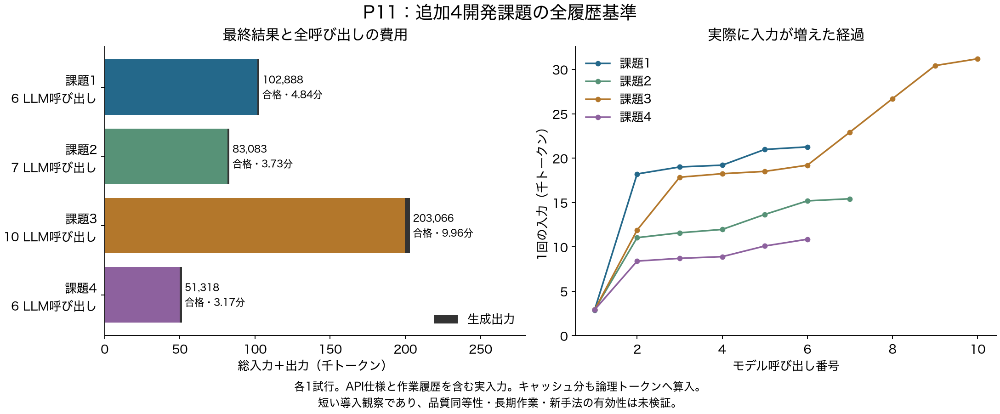
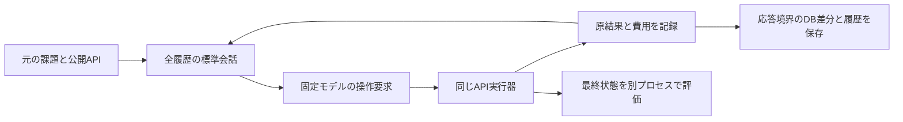

# P11：追加4開発課題の全履歴基準

2026年10月21日07:14 JSTに全4試行を終了し、4件とも独立評価に合格した。合計29モデル呼び出し・440,355入力＋出力トークン・48 API要求、使用量不明0。実入力、操作の順序、費用、33保存点と最終DBの対応に監査エラーはなかった。

これは新手法の成果ではなく、以前の2課題へ接続を合わせ続ける段階を終え、別の課題で同じ比較基準が働くかを確認した結果である。6〜10呼び出しで完了する短い開発観察であり、大規模・長期作業の主評価に十分な難しさがあるとはまだ示せていない。

[図のPDF](../reports/figures/P11/native_series.pdf)／[編集用SVG](../reports/figures/P11/native_series.svg)／[数値CSV](../reports/figures/P11/measurements.csv)／[呼び出し別CSV](../reports/figures/P11/calls.csv)。キャッシュ再利用分も論理トークンに含める。

## 目的と固定条件

公開のtrain ID順で、以前に本文を見たシナリオを除いた先頭4件のvariant 1を選んだ。規則は本文を読む前にコミットし、成否を見て交換しない。[選定理由と代案](experiments/P11_public_task_selection.md)。無作為抽出の代表標本ではない。

MiniMax M3 IQ4_XS、64K、KV q8_0、同じ公開APIの発見規則、標準の操作・結果会話、全履歴を使った。各試行は最大80モデル呼び出し・80 API要求・450,000総トークン・1,800秒、1生成4,096。全方式へ同じ予算を与えるための固定値で、完了まで上限を延長していない。[事前仕様](experiments/P11_additional_baseline.md)。

## 全結果

| 課題 | 要求の性質 | 結果 | LLM / API | 入力 | 出力 | 合計 | 実行時間 |
|---|---|---|---:|---:|---:|---:|---:|
| 1 | 読取・条件付き集約 | 合格 | 6 / 7 | 101,567 | 1,321 | 102,888 | 290.62秒 |
| 2 | 複数アプリの検索と応答 | 合格 | 7 / 13 | 81,770 | 1,313 | 83,083 | 224.06秒 |
| 3 | 時間・関係条件による集合更新 | 合格 | 10 / 19 | 199,851 | 3,215 | 203,066 | 597.49秒 |
| 4 | 指定対象とその他への異なる更新 | 合格 | 6 / 9 | 49,871 | 1,447 | 51,318 | 189.92秒 |

時間は実行器の開始から終了まで。独立評価とバッチの待ち時間は含めず、別の記録で保持する。課題2ではAPI内の実行エラーが1回あり、その後に回復した。最終合格を理由に途中失敗や費用を削除しない。原文再読は4件とも0回。

## 観測できた作業量

第3課題では一覧を3回読み、各応答のトップレベルに20項目があった。その後に対象更新を4回要求した。各ページに同じ項目が含まれる可能性はあるため、60個の独立対象を処理したとは数えない。最も大きい1回の入力は31,193トークンだった。

第4課題は一覧の7項目に対して更新要求4回、第2課題は複数アプリの検索を経た送信要求1回、第1課題は読取を中心に完了した。これらは公開操作の構造と応答の長さを後から数えた観察で、正解側の必要対象数や隠れた難度は使っていない。[本文を出さない観測集計](../reports/P11_observation_shapes.json)。APIメソッド名だけから副作用の正しさを証明したわけではない。

4件とも履歴を圧縮せず成功しており、ここから「新しい記憶方式がなければ解けない」とは言えない。一方、課題3では入力が増えている。次は、通常の直近履歴と原文再読が品質と総費用にどう影響するかを同じ接続で測る。

## 保存・監査の範囲

初期状態と各応答の後で計33保存点を作った。新規オブジェクトは合計1,860,923バイト、保存処理の計測は合計約0.075秒。共有する原DBとモデルはこの容量に含めない。全4試行で保存済みのDB差分が最終提出状態のファイルと一致した。

監査はオブジェクトのハッシュ、実行済み呼び出し・API結果・予算の接頭辞、原会話の再構成を点検する。DBの意味を正解と照合したり、Pythonプロセス・乱数・キャッシュまで復元したりする検証ではない。保存点33個を33個の独立課題と数えない。

[全成否・費用](../reports/P11_final_measurements.json)、[キャッシュ・時間・途中エラー](../reports/P11_final_runtime_audit.json)、各試行の`P11_0*_dispatch_audit.json`と`P11_0*_boundary_audit.json`に出典ハッシュを保存した。今回のオフライン分析は追加モデル呼び出し・環境操作・評価器の再実行0回。

## 次に何を決めるか

[P12](experiments/P12_recent_window.md)は同じ4課題を同じ初期環境から実行し、直近の全応答保持と原文再読を比較する。4,096トークン以内なら入力を変えず、超えたら新しい応答を優先する。操作と結果の組は切り離さない。

通常の対策が十分なら、その結果を受け入れる。FOCUS再実装や台帳のような生成型記憶は、追加費用を含む比較条件と公開仕様の扱いを明示して評価する。現在の4件を成功まで選び直したり、短い作業の合格を大規模・相互依存タスクへの有効性に拡張したりしない。

研究として目指すのは、同じモデルで品質を保ちながら総入力・出力を減らす内部機構である。P11の成果は、その機構を公平に調べる基準と記録が追加4課題で成立したこと。独自の表現・更新規則は未確定であり、通常の対照を超える必要性を引き続き検証する。
