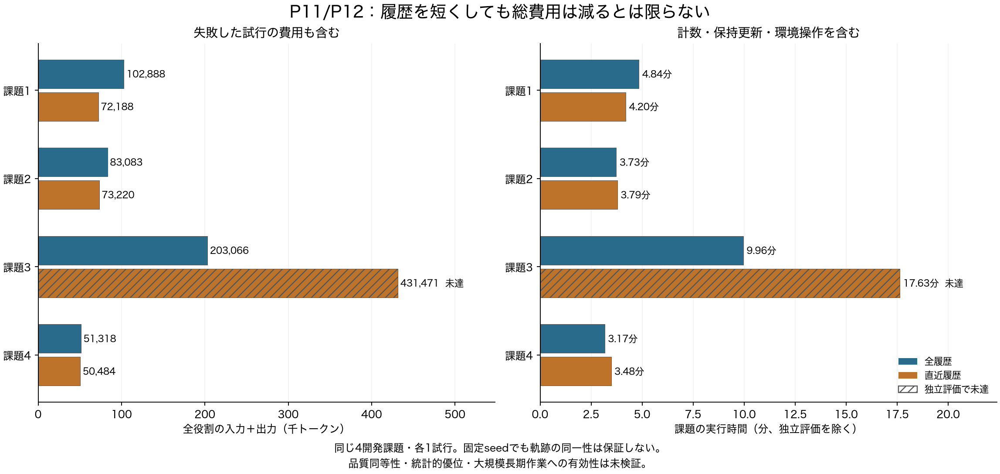
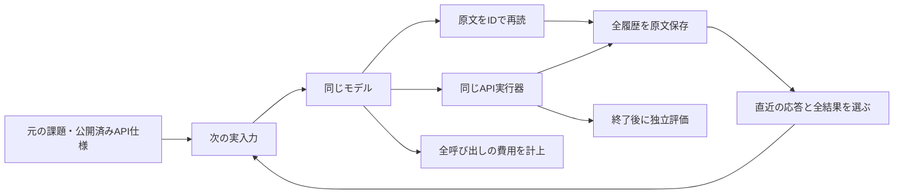

# P12：直近履歴だけでは再取得により総費用が増えた

2026年10月21日07:47 JSTに、同じ4開発課題で全試行と独立評価を終了した。直近履歴方式は3件成功・1件失敗、45モデル呼び出し・627,363総入力＋出力トークンだった。全履歴は4件成功・29呼び出し・440,355トークン。今回の合計では42.5%増えた。成功した3件だけを取り出して削減率を報告しない。

これは各条件1試行の探索的な比較であり、直近保持が一般に劣る証明でも、新方式の成果でもない。全履歴を使えば6〜10呼び出しで完了した短い開発課題で、大規模・長期作業の主評価は別途必要である。

[図のPDF](../reports/figures/P12/comparison.pdf)／[SVG](../reports/figures/P12/comparison.svg)／[全数値CSV](../reports/figures/P12/comparison.csv)。斜線は未達。キャッシュ再利用分も論理トークンへ含め、失敗した試行の費用も残す。

## 何を確かめる実験か

研究の目的は、同じモデルで仕事の品質を保ちながら、実行全体の総入力・出力を減らすハーネスの機構を見つけること。履歴を削った文字数だけでは、再検索・再操作・記憶更新を含む総費用の改善は分からない。まず生成費用のかからない直近保持を比較し、それを超える仕組みが必要か確かめた。

MiniMax M3 IQ4_XS、64K入力枠、標準のAPI会話、公開仕様の発見、原文再読、課題順、各450,000総トークン・80 LLM呼び出し・80 API要求・1,800秒は全履歴と同じ。履歴の代理計数が4,096を超えた場合、直近の応答と対応する全結果を残し、古い応答から外す。元の課題と公開済みAPI仕様は削らず、実入力全体は別に計数する。[事前仕様と選定理由](experiments/P12_recent_window.md)。

古い原文へのアクセスは残る。操作と結果を切り離さず、最新の一応答だけで4Kを超える場合はその応答を残して超過を記録した。履歴の4Kは入力全体の上限ではない。

## 全結果

| 課題 | 全履歴：成否／総トークン | 直近履歴：成否／総トークン | 直近LLM / API | 直近の実行時間 |
|---|---|---|---:|---:|
| 1 | 成功／102,888 | 成功／72,188 | 5 / 6 | 251.98秒 |
| 2 | 成功／83,083 | 成功／73,220 | 7 / 13 | 227.22秒 |
| 3 | 成功／203,066 | 失敗／431,471 | 27 / 46 | 1,057.57秒 |
| 4 | 成功／51,318 | 成功／50,484 | 6 / 9 | 209.01秒 |
| 合計 | 4/4／440,355 | 3/4／627,363 | 45 / 74 | 1,745.78秒 |

課題3は次の入力と出力予約を残予算内に収められず停止した。45万を使い切るまで任意に出力枠を縮めたり、失敗後に予算を延長したりしていない。原文再読が2回あり、API要求とは別に記録した。実行時間は独立評価とバッチ待ち時間を除く。

## 失敗した課題で観測したこと

課題3には、同じ公開API名と同じ引数での再要求が15組あった。前回の元の応答は全15組でその時点の入力から外れており、9組では再取得結果も同じだった。全履歴の同じ課題では同条件の再要求は0組だった。[全履歴の集計](../reports/P11_03_reacquisition.json)／[直近履歴の集計](../reports/P12_03_reacquisition.json)。

認証情報の取得5回、ログイン4回と6回、時刻取得6回、フィード取得7回などが記録された。最終的な対象更新のAPI要求は記録されなかった。[公開操作名とサイズだけの集計](../reports/P12_observation_shapes.json)。引数、返された値、認証情報は公開しない。

同じ要求の繰り返しが必ず不要とは限らず、状態や有効期限が変わる場合もある。元の応答が入力にないことと、同じ情報が他の応答やアーカイブにないことも異なる。この観察だけで「履歴削除が失敗の唯一の原因」とは断定しない。通常の台帳、セッション情報の保持、原文再読の案内で十分改善できる可能性が残る。

## 比較と監査の限界

入力を照合すると、全4課題の第2入力からランダムなツール呼び出しIDが異なっていた。オフラインで対応するIDだけを正規化したところ、内容上の最初の入力差は各課題の最初の部分保持位置と一致した。実際のモデル入力や費用を書き換えた分析ではない。固定seedだけで後続軌跡を等しくできるとは扱わず、同一途中状態への因果介入とも呼ばない。

4件の費用・操作・選択履歴の再計算に不一致はなく、使用量不明は0。選択用トークナイザー要求は139回、選択処理の計測は合計約1.66秒。選択を試してから予算不足で実行しなかった最後の1回も含む。最新応答を残すための4K超過は合計7回あった。記憶を生成するLLM呼び出しは0回。

49保存点について、原会話、操作結果、予算、オブジェクトのハッシュを照合した。成功3件は最後のDB差分と提出状態が一致した。予算停止の課題3は監査器の既定ではこの最終DB比較を行わないため、その確認範囲を区別する。プロセス・乱数・キャッシュまで復元したという結果ではない。

[成否・費用](../reports/P12_final_measurements.json)、[処理時間とキャッシュ](../reports/P12_final_runtime_audit.json)、各`P12_0*_selection_audit.json`、`P12_0*_boundary_audit.json`、`P12_0*_prefix_comparison.json`へ記録と出典ハッシュを残した。結果分析の追加モデル生成・環境操作・評価器再実行は0回。

## この結果で何を決めたか

直近保持を最終方式として採用する根拠は得られなかった。一方で、4Kという設定の一般的な最適性も検証していない。結果を見て失敗課題だけ窓を広げ、その成績を同じ比較として報告する案は採らない。

次は[FOCUSに基づく保持](experiments/P13_native_focus.md)を同じ4件で実行する。将来の計画と救済により履歴を残す既存方式が、追加生成費用を含めてこの問題を軽減するか測る。その後も通常の台帳を強い比較候補として残す。現在は既存方式が何を解決できるか調べる段階で、独自アルゴリズムは未確定である。

得たい最終成果は、削除・保持・再取得のどの情報構造が仕事の完了に影響し、通常対策で残る失敗に対してどの更新規則が必要なのかを、全費用とともに示すこと。この4件の失敗を新規性の証明にせず、原理を絞るための観測として使う。
