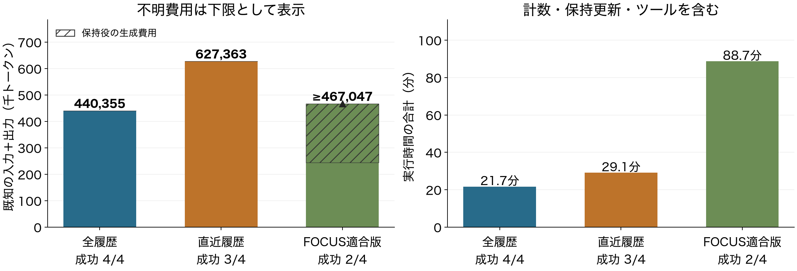

# P13：保持生成の費用と失敗を含む４課題の結果

2026年10月21日12:18 JST時点で、全４課題の実行・独立評価・記録監査が終了した。**FOCUSに基づく適合版は2/4成功、既知467,047トークン＋使用量不明２呼び出し。品質を保った費用削減は示せていない。** 原論文の完全再現、新規方式、本評価の結果ではない。

[図表付きPDF](../materials/20261021_p13/AI_harness_P11_P13_20261021.pdf)／[編集用PowerPoint](../materials/20261021_p13/AI_harness_P11_P13_20261021.pptx)／[全４課題の集計](../reports/P13_final_measurements.json)。

## 目的と、ここまでの研究との関係

研究の目的は、大規模で相互依存する仕事を、同じモデル・品質条件で、より少ない総入力・出力により完了させること。ハーネスが情報・作業状態・実行をどう保持し、再取得し、次の判断へ渡すかを扱う。

以前の作業集約案では、集約の利益を検証できる更新競合や相互修正を実試行から確認できなかった。そこで集約を既定の解決策とせず、既存方式でも残る具体的な問題を調べ直している。[再検討の理由と近接研究](technical_core_review_20261021.md)。今回の基盤と比較設計は、その調査に必要な成果物であり、独自アルゴリズムそのものではない。

P11全履歴、P12直近履歴に続き、P13では将来計画の引用と防御的な救済による保持を同じAPI接続へ適合した。保持役の生成も全費用へ含め、通常の履歴管理に対する追加価値を確認する。FOCUSの小さい草案モデルを含む原設定とは異なる。[事前仕様・補完箇所](experiments/P13_native_focus.md)。

## 固定条件と、実際に変更したもの

- AppWorld 0.1.3.post1、事前選定した４開発課題を同じ順序で実行。各条件１試行。失敗課題だけへ絞らない。
- MiniMax M3 IQ4_XS、64K入力枠、KV q8_0、単一推論スロット。実行役temperature 1.0、保持役0.7。モデル・基本ツール・公開情報の取得規則を固定。
- 各課題は総45万トークン、1800秒、80 LLM呼び出し、80 API要求が上限。**トークンと時間の両制約の下での結果**であり、トークン制約だけのSuccess@Bではない。
- 4Kの履歴目安を超えた時点で、１実行ステップにつき１回の保持更新。草案は最大３回。全保持が確定した場合だけ早期終了。出典不備は元履歴を保ち、費用は計上。
- 実行ソースは`1e1a49a86ddefec074efefb0c1ab2e931e2f824f`で固定。中断後もソースと各課題の条件は維持した。サーバー再起動前後のキャッシュ状態まで同一とは扱わない。

## 全結果

| 課題 | 独立評価 | 既知総トークン | LLM呼出 | API要求 | 使用量不明 | 時間（秒） | 終了理由 |
|---|---|---:|---:|---:|---:|---:|---|
| 1 | 未達 | ≥135,159 | 9 | 4 | 1 | 1800.53 | 生成中の時間上限 |
| 2 | 成功 | 128,357 | 10 | 13 | 0 | 1231.53 | 完了宣言後の評価も合格 |
| 3・復旧後 | 未達 | ≥130,492 | 9 | 11 | 1 | 1800.71 | 保持生成中の時間上限 |
| 4 | 成功 | 73,039 | 8 | 9 | 0 | 487.84 | 完了宣言後の評価も合格 |
| 合計 | 2/4 | ≥467,047 | 36 | 37 | 2 | 5320.61 | 未達２件も含む |

時間は生成・保持・計数・ツール等を含む実行時間で、終了後の独立評価と中断中の空白時間は含めない。不明費用は０と置かず、`≥`で下限を示す。上限付近の小さな超過は停止・保存処理を含む実測値のまま記録する。

| 条件 | 成功 | 既知総トークン | LLM呼出 | 合計実行時間 |
|---|---:|---:|---:|---:|
| P11 全履歴 | 4/4 | 440,355 | 29 | 21.70分 |
| P12 直近履歴 | 3/4 | 627,363 | 45 | 29.10分 |
| P13 FOCUS適合版 | 2/4 | ≥467,047 | 36 | 88.68分 |

P13は既知分だけでもP11より約6.1%多い。P12より既知トークンが少ないことを、同じ品質で安いという主張に使わない。未完了で処理が止まった影響と、不明使用量があるためである。４件・１試行の開発比較から一般的な順位や品質同等性は確定しない。

## 何が観測できたか

**全４課題で、実行役へ渡す履歴を実際に削った記録は０回だった。** 11更新イベントの内訳は、適合して全保持５、形式不備で元履歴を保持５、時間上限で中止１。保持呼び出しは14回で、既知費用222,258トークンに不明１回がある。[可視履歴と費用の集計](../reports/P13_retention_summary.json)。

| 課題 | 保持呼出 | 既知の保持費用 | 主な観測 |
|---|---:|---:|---|
| 1 | 4 | 76,390 | 出力上限１、出典不備２、適合した全保持１ |
| 2 | 3 | 45,403 | ３提出とも適合し全保持 |
| 3・復旧後 | 5 | ≥78,744 | 出典不備１、適合草案２、未提出の出力上限１、時間上限１ |
| 4 | 2 | 21,721 | ２草案を合わせて全保持が確定 |

第３課題の適合草案２つは部分集合を引用したが、同じ更新内の３草案目が提出に至らず、規則通り元履歴を保持した。個々の適合草案と、更新全体の成立を混同しない。出典不備の一部では未来の計画ステップ名が過去の根拠IDとして使われた。構造適合は内容の正しさの証明ではない。[各提出の形式監査](../reports/P13_03_memory_submissions.json)。

保持生成へ役割を切り替えると、単一スロットで入力の再処理も増える。例えば課題１では、P11の既知入力101,567のうち再処理23,414、P13の既知入力124,474のうち再処理122,633だった。これは実装と実行環境における時間負担の観測であり、論理的なトークン数とキャッシュ計算量は別である。[全８試行の費用監査](../reports/P13_all_tasks_costs.json)。

課題１・３では、履歴を削っていなくても実行操作列がP11から分かれた。輸送用の呼出IDだけを事後に対応づけても、固定seedは同じ軌跡を保証しない。正規化は実入力・費用・キャッシュを変更していない。したがって**履歴削除の因果効果を測れたとは言わない**。[課題１](../reports/P13_01_executor_prefix.json)、[課題３](../reports/P13_03_executor_prefix.json)。

## 中断と復旧の扱い

11:34 JSTの確認で旧プロセスとHTTP応答がなかった。停止原因は未特定。完了した課題１・２はそのまま残し、途中だった課題３だけを新IDで初期状態から実行した。これは途中状態の完全復元でも、成功するまでの再試行でもない。[復旧記録](P13_recovery.md)。

元の中断試行には応答がある４呼び出し・52,285トークンと、応答未保存１要求がある。最終評価された４件の表とは別に研究支出へ含め、P13関連の既知支出は**少なくとも519,332トークン**。これに完了試行内の不明２呼び出しと、中断した未応答要求の不明使用量がある。要求ファイルの存在だけでモデル実行の完了を認定しない。

## 監査と限界

全４件で費用・公開操作の対応・保持選択の再計算・保存境界の検査に不一致はなかった。保存境界は25件。課題２・４の最終DBファイル対応も一致。時間上限で止まった課題１・３の`final_db_files_match`は既定監査では未検査の`null`であり、全ての最終DB対応が証明されたとはしない。最終評価自体は全４件で実行し、各終了記録のハッシュへ結び付けた。

この適合版では、原FOCUSと異なる大きな草案モデル、形式不備、単一スロット、時間制約が影響する。原方式が一般に劣るという反証には使わない。また、このAppWorld４件は短い開発校正であり、大規模文書・長期作業・複数担当への一般化は未検証。

## 次の判断と、採用しない説明

1. 通常の台帳P14を同じ４件で比較する。対象・進捗の保持だけで十分かを確認するためであり、台帳を新規提案とは呼ばない。
2. 形式改善や小さい草案モデルは別条件の候補へ残す。今回の試行を途中から修正したり、不正引用を後から消して成功扱いしたりしない。
3. 約10万文書の全コーパス検索を維持するBrowseComp-Plus導入へ進む。質問だけを事前規則で12件に限定し、回答・正解文書ラベルは実行側へ渡さない。検索器・評価器の実機成立を確認してから主評価への採否を判断する。
4. 強い既存方式でも残る具体的な問題が観測できた場合に、その問題へ介入する表現・更新規則を一つ定義する。新しい名称、実験回数、部品の接続だけで独自性を主張しない。

今回得た成果は、比較用ハーネス、全費用の追跡、保持役の形式・時間負担の具体的な観測と、次に検証する条件の絞り込みである。**独自機構、品質を保った費用削減、主実験の成立はまだ未達。**
