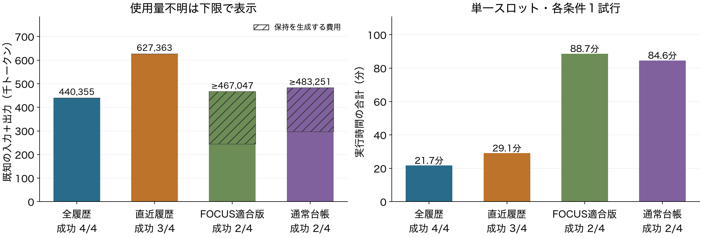

# P14：通常台帳までの４条件比較と、レターに向けた判断

2026年10月21日。通常のLLM生成台帳P14は全４課題の実行・独立評価を終了し、**２件成功、２件は30分上限で未達**だった。37呼出し、既知483,251トークン＋使用量不明２呼出し。品質を保った費用削減は示せていない。４開発課題・各条件１試行の比較であり、新規方式の本評価ではない。

[説明資料PDF](../materials/20261021_p14/AI_harness_P11_P14_20261021.pdf)／[PowerPoint](../materials/20261021_p14/AI_harness_P11_P14_20261021.pptx)／[全件集計](../reports/P14_final_measurements.json)。

## 目的と条件

研究の目的は、ハーネスが作業状態を後の判断へ渡す方法を設計し、最終品質を保ちながら仕事全体の費用を減らすこと。P14は、通常の台帳という単純な対照で十分かを調べるために行った。既存論文の「Ledger」が構築する決定的な実行状態とは異なる。P14をその論文の再現・反証・独自提案とは呼ばない。

P11〜P13と同じ事前選定４課題、MiniMax M3 IQ4_XS、64K、KV q8_0、単一推論スロット。各課題45万総トークン、1800秒、80 LLM呼出し、80 API要求を上限とした。実行ソースは`4e60e80936faf82d59315f2743b1bbf7baacc6b9`から変更していない。台帳も同じモデルを使い、生成・不適合・中断を費用へ含める。[固定仕様](experiments/P14_native_ledger.md)。

4Kを目安に１実行ターンにつき１回の台帳更新を許す。適合時は台帳と直近２spanを元応答の区切りまで残す。不適合時は元履歴と前の台帳を維持する。出典IDの検査は構造の確認であり、内容の真偽を保証しない。

## 全結果

| 課題 | 最終評価 | 既知総トークン | LLM呼出 | API要求 | 使用量不明 | 実行秒 | 終了理由 |
|---|---|---:|---:|---:|---:|---:|---|
| 1 | 未達 | ≥148,385 | 10 | 5 | 1 | 1800.35 | 台帳生成中の時間上限 |
| 2 | 成功 | 116,700 | 10 | 13 | 0 | 1042.39 | 完了宣言・独立評価合格 |
| 3 | 未達 | ≥155,653 | 10 | 16 | 1 | 1800.91 | 台帳生成中の時間上限 |
| 4 | 成功 | 62,513 | 7 | 9 | 0 | 435.06 | 完了宣言・独立評価合格 |
| 合計 | 2/4 | ≥483,251 | 37 | 43 | 2 | 5078.71 | 未達も含む |

実行時間は入力計数・生成・保持更新・ツール・保存を含み、終了後の独立評価は除く。使用量不明は０と置かない。上限直後の停止処理も実時間に含める。

| 条件 | 成功 | 既知総トークン | 呼出 | 合計分 |
|---|---:|---:|---:|---:|
| P11 全履歴 | 4/4 | 440,355 | 29 | 21.70 |
| P12 直近履歴 | 3/4 | 627,363 | 45 | 29.10 |
| P13 FOCUS適合版 | 2/4 | ≥467,047 | 36 | 88.68 |
| P14 通常台帳 | 2/4 | ≥483,251 | 37 | 84.65 |

P14の既知費用だけでも全履歴より約9.7%多い。短い入力や実行役だけの費用を、システム全体の削減と取り違えない。P13の別の中断試行に52,285既知トークン＋使用量不明１要求があり、上表の復旧後４試行とは別に研究支出へ残している。[P13の中断記録](P13_recovery.md)。

## 台帳更新で何が起きたか

| 課題 | 適合／不適合／中断 | 台帳の既知費用 | 原履歴を外した更新 | 原ターンを減らした実行入力 |
|---|---|---:|---:|---:|
| 1 | 4 / 0 / 1 | ≥71,747 | 2 | 2 |
| 2 | 2 / 1 / 0 | 40,406 | 2 | 3 |
| 3 | 1 / 2 / 1 | ≥62,548 | 1 | 4 |
| 4 | 0 / 1 / 0 | 11,195 | 0 | 0 |
| 合計 | 7 / 4 / 2 | ≥185,896 | 5 | 9 |

13更新のうち７件が構造適合、４件が不適合で元履歴を維持し、２件が中断した。台帳生成は既知総費用の約38.5%を占めるが、不明使用量を含む真の割合は未確定。台帳の注記を添えた入力は11回、原履歴を外した入力は９回であり、両者は同じではない。

課題２は台帳でも成功した。実行役だけでは76,294トークンで、全履歴83,083より少ない。しかし台帳40,406を含む総量116,700は約40.5%多い。対応する７実行位置の公開操作は全て同じだった。原文を一部外しても同じ操作を継続した事例であり、台帳が全般に有効・無効という結論ではない。

課題４は台帳提出１回が不適合で、台帳も原履歴削除も後続入力へ反映されなかった。対応する入力・公開操作はP11と同じで、実行役費用51,318も一致した。総量に台帳生成11,195が追加された。無効な更新の費用がそのまま負担となった観測である。

課題１は最初の入力・操作の差が実行位置２、初めて原履歴を外したのは位置４。課題３は入力差が位置３、操作差が位置４だった。開始状態からの全体比較であり、これを原履歴削除だけの因果効果と断定しない。固定seed、保存点の一致、操作列の位置対応だけで同一状態への介入実験になったとは扱わない。

## 監査・限界・次の選択

使用量、要求、記憶選択の再計算は全４件で不一致０。保存境界28件の内容・予算との対応も整合した。課題２・４の最終DBファイル一致を確認し、予算停止した課題１・３の最終DB対応は既定監査では未検査（null）のまま残した。最終評価そのものは全４件で実施し、終了記録のハッシュに結び付けた。監査は追加モデル呼出し・環境操作０。

この結果には台帳生成の不適合、大型モデルによる保持処理、単一スロット、時間上限が影響している。一般的な台帳、原FOCUS、先行研究Ledgerの優劣を示す結果ではない。４件とも標準接続の送信前形式不備は０であり、旧接続で観測した誤完了の原因がここでも自然発生したとは言えない。

10月末のレターに向け、広いデータ導入P15は保留する。次は、未実行要求を記憶へ渡すときの誤完了と、修復に必要な情報の関係へ絞る。一般的な用途別記憶はMemTX等と重なるため、既存部品の接続を独自性にしない。[先行研究との比較・撤回条件](letter_mechanism_review_20261021.md)。

最初のP16は、固定４課題からの記録通り／人工的な送信前拒否を３表示で処理する24生成。元入力で誤完了が起きない、または状態タグだけで十分なら、用途別表示の追加価値を前提に主実験へ進まない。現在の成果は比較基盤と費用・制約の観測であり、**新規機構の有効性はまだ未達**。[P16仕様](experiments/P16_event_view_probe.md)。
