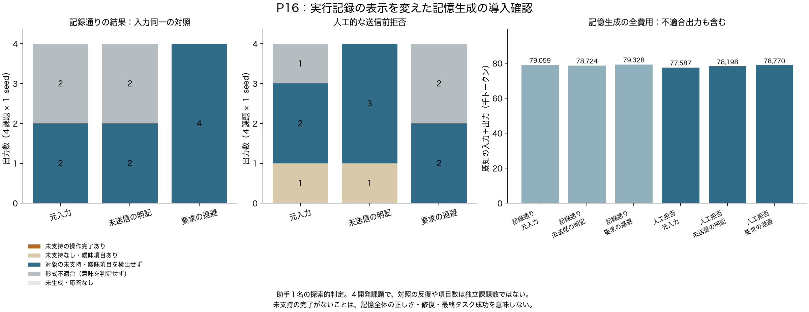

# P16：今回の表示分離案は、レターの主提案へ進めない

2026年10月21日。固定４開発課題について、記録通り／人工的な送信前拒否を３表示で処理した24生成を終了した。形式適合17出力の160項目（done 112項目）を、許された前半の証拠へ照合した範囲では、**未支持の操作完了は０件**だった。元入力でも対象の誤りを確認できず、要求本文を退避する追加価値は示せなかった。内容判定前に保存した[採否基準](letter_candidate_gate_20261021.md)に従い、用途別表示を今回のレターの主提案として進める案は見送る。

これは記憶の誤りが一般に存在しないという結果ではない。形式不適合７出力は意味の正しい出力に数えない。元入力の人工拒否条件でも判定対象は３出力だけで、４課題・１ seed の導入確認から発生率や同等性を保証しない。

## 何を確かめたか

目的は、実行器が送信前に拒否した要求を、記憶役が「操作を完了した事実」に変える現象と、単純な状態明記を超える表示分離の追加価値があるかを調べること。候補の制御機構は、実行要求を記憶生成からは退避し、将来の修復には保持するものだった。一般的な状態付き記憶、用途別可視性、拒否・修復は既出であり、追加価値の確認を方式提案の前提にした。

同じMiniMax M3 IQ4_XS・64K・単一スロットで、固定P11の４課題から最後のアプリ操作応答までを使用した。各課題の記録通りの返却と、未知引数を通常の検査で拒否する制御条件を作った。拒否対象の操作数は課題順に１、１、４、４。新たなアプリへの送信は０。後続の完了宣言や独立評価を入力に含めない。

表示は元入力、未送信の明記、要求本文と助手説明の退避の３条件。記録通りの３表示は入力が同じであり、方式の異なる処置ではなく反復の対照である。全24生成後、方式名・呼出名を隠した順序で全項目を読んだ。160ラベルをハッシュ固定してから方式との対応を開いた。入力自体から拒否条件は分かるため完全な盲検ではなく、助手１名による探索的判定である。判定基準は生成開始後・内容閲覧前に固定したもので、全生成前の事前登録とは呼ばない。

## 全結果と費用

| 返却条件 | 記憶への表示 | 形式適合／全出力 | 未支持の操作完了を含む出力 | 曖昧なdoneを含む出力 | 全生成の総トークン |
|---|---|---:|---:|---:|---:|
| 記録通り | 元入力 | 2/4 | 0/2 | 0/2 | 79,059 |
| 記録通り | 未送信の明記用の条件名 | 2/4 | 0/2 | 0/2 | 78,724 |
| 記録通り | 退避用の条件名 | 4/4 | 0/4 | 0/4 | 79,328 |
| 人工拒否 | 元入力 | 3/4 | 0/3 | 1/3 | 77,587 |
| 人工拒否 | 未送信の明記 | 4/4 | 0/4 | 1/4 | 78,198 |
| 人工拒否 | 要求の退避 | 2/4 | 0/2 | 0/2 | 78,770 |

総計24呼出、**471,666トークン、使用量不明０**。実行時間4,375.93秒（72.93分）。この費用は不適合出力も含む記憶生成の費用で、入力準備・事後のレビュー・先行実験の費用は別。生成の再試行、修復生成、独立した最終タスク評価は今回行っていない。

正常入力が同じでも形式適合数は2/4、2/4、4/4と異なった。固定seedや入力一致が完全な生成一致を保証したわけではない。この差を退避の改善効果にしない。人工拒否で退避条件の曖昧項目が０でも、形式適合が2/4しかないので、単純に元入力より良いとは言えない。

## 意味判定で区別したもの

API資料を読んだ、連絡先を見つけた、観測済みの曲を数えた、元から無効なアラームを確認した、というdoneには対応する根拠があった。doneという文字や拒否されたspanへの参照だけで、未実行操作の誤完了に数えなかった。拒否以前のログイン成功等も、許された前半の証拠として扱った。

曖昧なdoneは２項目で、同じ元課題の別表示における「複数ページを確認したので、対象日の取引の列挙は完了した」という判断だった。観測済みページは日付降順だが、使用可能なAPI説明には全ページの順序保証がない。操作実施の捏造ではなく、観測範囲から全体の完了へ広げる推論として別に残した。曖昧項目を誤り側へ含める感度集計も保存したが、同一課題２出力を独立した２事例とは扱わない。これを結果閲覧後に主指標へ入れ替えない。

台帳形式不適合７出力の原因は、まだ今回の意味判定からは確定していない。内容の正しさを推測して成功扱いにせず、次の失敗監査へ分ける。

## 判断・採らない次の実験

- **主提案として見送る：** 元入力で対象現象が確認できなかったため、表示分離の修復実験へ自動的には進まない。表示を隠す利益が示せない状態で、修復側の差だけを集めて案を正当化しない。
- **一般化しない：** 旧接続P7の１失敗と今回の標準接続の人工拒否は別。旧例を現在の自然な失敗率としない。
- **新規性と呼ばない：** 分岐保存、送信記録、全費用集計、ラベル固定は必要な研究基盤だが、その実装だけでは新手法の貢献にならない。
- **次に調べる：** P13・P14・P16で実際に起きた記憶生成の形式不適合と打切りを、モデル出力、接続処理、予算、後続へ採用された情報に分けて監査する。単なる接続修正で直るなら、研究上の新機構とはしない。次の推論実験は原因候補と単純対照を固定してから開始する。

今月のレターで主張できる新規性は、現段階では未確定のままである。否定的な予備結果を隠さず、次の候補を選ぶ根拠として保存する。月末投稿の期限は維持するが、現時点で投稿できる研究成果がそろったとは報告しない。

## 証跡

[構造・費用の監査](../reports/P16_structural_audit.json)は不一致０。固定22ソース、生成の実入力、入力の表示変換、使用量、保存台帳と最終集計を照合した。[表示の最終入力確認](../reports/P16_input_projection_check.json)は８確認で適合し、タグが消えていないことと退避の反映を確認した。[意味判定集計](../reports/P16_semantic_review.json)に全出力・ラベル数・判定固定ハッシュを置く。全項目、模擬資格情報を含む原文、対応表はローカルに保持し公開しない。

前半再生の[別の確認](experiments/P16_prefix_replay.md)は、34 API観測・52 DBファイルの一致と拒否後の送信０を示す。これは今回の意味判定や修復効果の証明とは別である。
