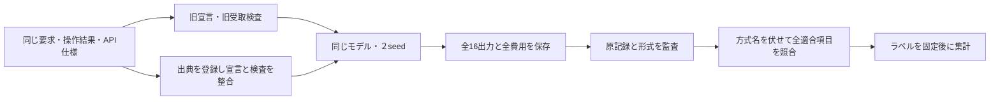
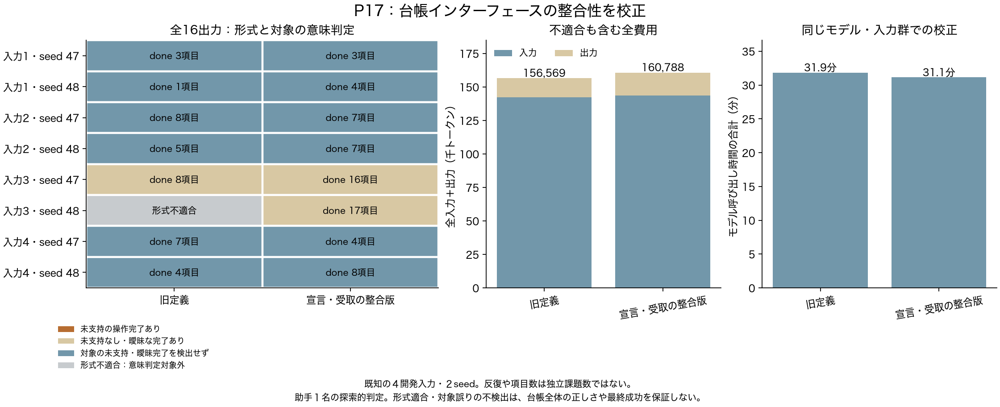

# P17：台帳の形式を直しても、内容の妥当性は別に残る

2026年10月21日。16生成を終了し、原入力・応答・費用・固定ソースの独立監査は不一致０。形式適合した15出力の全140項目を確認した。**整合版は８出力すべて形式適合したが、意味上の安全性やタスク成功の改善は示していない。** 基準実装の校正であり、新規方式の成果とはしない。

[６枚の説明資料PDF](../materials/20261021_p17/AI_harness_P17_20261021.pdf)／[PowerPoint](../materials/20261021_p17/AI_harness_P17_20261021.pptx)。

## 何のために比較したか

旧台帳では、モデルへ渡す定義が空の出典を許し、受取側が拒否していた。入力の要求文を参照するIDもなかった。これを残したまま「台帳が弱い」と結論しないため、宣言・受取制約をそろえる校正を行った。[修正理由](memory_contract_correction_20261021.md)、[生成前に固定した仕様](experiments/P17_ledger_contract.md)。

P16と同じ４つの記録通りの入力、旧版／整合版、seed47・48を固定した計16生成。MiniMax M3 IQ4_XS、64K、KV q8_0、温度1、出力上限4096。順序は入力・seedごとに交互にした。生成中に内容を見て設定を変えず、全16出力終了後に方式・seedを伏せてラベルを固定し、その後に対応を開いた。入力内容から推測できる部分はあり、完全な盲検ではない。

## 全結果

| 指標 | 旧版 | 整合版 |
|---|---:|---:|
| 予定／実行出力 | 8 / 8 | 8 / 8 |
| 形式適合 | 7 / 8 | 8 / 8 |
| 未支持の操作完了を検出した適合出力 | 0 / 7 | 0 / 8 |
| 曖昧な完了を含む適合出力 | 1 / 7 | 2 / 8 |
| 曖昧な完了項目 | 1 | 3 |
| 判定した全項目／done項目 | 60 / 36 | 80 / 66 |
| 不適合も含む総入力＋出力 | 156,569 | 160,788 |
| 使用量不明の呼出し | 0 | 0 |

総費用317,357トークン、バッチ経過3,825.02秒（63.75分）。生成呼出し時間の合計と、計数・記録等も含むバッチ経過は分ける。整合版の費用は旧版より2.7%多かった。４入力とその反復であり、140項目や16出力を独立課題数にしない。

[元記録監査](../reports/P17_structural_audit.json)、[ラベル固定後の全集計](../reports/P17_semantic_review.json)、[図のCSV](../materials/20261021_p17/figures/counts_and_costs.csv)。

旧版の１不適合は１項目の空出典に関係し、定義外statusや未登録task参照はなかった。生成自体は返却されており、費用31,200トークンも除いていない。P14/P16の結果はそのまま保存し、今回の８対８と混ぜて改善率を作らない。

## 内容の確認で残った問題

曖昧な４項目は全て同じ文書・操作の前半から生じた。取得したページが時刻の降順に並び、後続の取得ページが過去の日付であることから、当日の対象を全て列挙したと推論していた。提供されたAPI説明には全体の並び順の保証がない。個別４件の操作成功は返却で確認できるが、対象全体の確認まで証明したとは扱わなかった。

曖昧な項目も未支持側へ含める感度集計では、旧版１適合出力、整合版２適合出力となる。整合版が意味上も優れるという結果ではない。今回の未支持０件を安全性の証明にも使わない。

補助診断では、整合版の３項目が完了について要求側だけを引用していた。内訳は `task` のみ２項目と、`task`＋要求取得結果１項目。うち２項目は、引用していない同じ前半記録に実際の成功返却があった。残り１項目は上記の対象範囲が曖昧な全体完了だった。**引用の不十分さと、前半全体にも支持がない完了は別である。** この診断を新しい主要指標に差し替えず、固定したラベルは変更していない。[補助診断](../reports/P17_supplementary_contract_diagnosis.json)。

## 採否と次の実験

宣言と受取側をそろえる実装修正は保持する。ただし、曖昧な全体完了と要求側だけの引用が残るため、「意味上も問題のない台帳」としての採用条件を満たしたとは判断しない。実行接続は候補として準備済みだが、P19の自動開始はしない。[接続の制御検査315件](aligned_ledger_runtime_preparation_20261021.md)。

旧版への回帰、空出典の自動補完、全件を無条件受理する案は採らない。いずれも意味上の支持を増やさない。逆に、未支持の操作完了が０件だったことから、先の用途別表示案を主提案へ戻す理由も得られない。引用だけを直す新しいプロンプトを成功するまで試す方法も選ばない。

P18では別の４開発シナリオを、同じ全履歴基準・同じ予算で実行中。まず全件の自然な失敗と成功を確認し、対象探索、情報保持、操作、完了判定、単なる費用上限を分ける。未閲覧の確認用12シナリオは維持し、主機構と比較条件を固定するまで開かない。

論文の新規性は引き続き未確定。今回の成果は基準の形式修正と、その修正では解消しない内容上の限界の記録である。対象全体の確認という一般概念も既存研究にあり、これだけを新提案にはしない。２段組４ページの原稿へ入れる主張は、具体的な追加機構と強い単純対照の比較結果から決める。

## 確認の範囲

助手１名による探索的な全項目照合で、独立した人手評価ではない。最終評価、後続操作、正解対象一覧は判定に使っていない。台帳を使った後のタスク成功や費用はP17では測定していない。ラベル固定前に既知の開発入力は把握していた。

ローカルのラベル変換補助をシステム既定の古いPythonで起動した際、`zip(strict=True)` が使えず停止した。研究用Python3.12で変換してから固定・集計し、判定内容や生成結果は変更していない。公開するのは件数・分類・ハッシュで、課題本文・模擬認証情報・全生成履歴は公開しない。
