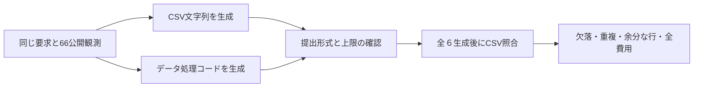

# P20：出力上限に達し、書出内容の比較には未到達

2026年10月21日、18:25〜18:54 JST台。固定した２方式×３seedの全６生成を終了した。１つの既知の開発局面の診断であり、独立した６課題ではない。

**直接CSVと計算コードの両方で、提出０／３。全６件が思考を含む出力上限4,096に達した。通常計算の内容上の効果はまだ判断できない。**

## 目的と構成

P18で72曲の情報取得後に１曲の書出欠落を観測した。通常のデータ処理で解決できる現象かを、追加の台帳・検証器を提案する前に調べる。CodeActの既存原理の導入を新規性とはしない。

入力に元のCSV、正解件数、欠落項目、認証情報、独立評価は含めない。両方式へ渡した要求と観測の文字列は一致。新しい環境操作は０。

## 全６結果

| 方式 | seed | 入力token | 出力token | 終了 | 提出 |
|---|---:|---:|---:|---|---|
| literal_csv | 51 | 9,144 | 4,096 | 出力上限 | なし |
| data_program | 51 | 9,453 | 4,096 | 出力上限 | なし |
| data_program | 52 | 9,453 | 4,096 | 出力上限 | なし |
| literal_csv | 52 | 9,144 | 4,096 | 出力上限 | なし |
| literal_csv | 53 | 9,144 | 4,096 | 出力上限 | なし |
| data_program | 53 | 9,453 | 4,096 | 出力上限 | なし |

合計80,367トークン（入力55,791／出力24,576）、使用量不明０。生成時間の合計1,770.45秒、開始から終了まで1,789.35秒。全６出力の要求・応答・使用量・形式判定を照合し、不一致０。

返却には思考欄があったが、最終の本文・関数呼出しはいずれも０。思考内容を判断原因の説明には使っていない。思考欄の文字数はトークン数とは別である。

CSVやコードが提出されていないため、実行したプログラム０、内容判定できたCSV０。欠落・重複を「０件」とは計上しない。予算内の完全書出は両方式０／３だが、内容の品質同等やコード処理の無効を意味しない。

## 評価器で見つかった保存形式の不整合

初回の評価器は、保存されたplan.jsonのバイト列を実行前の設定ファイルのハッシュと比較して停止した。実行器が同じJSON値を別のインデントで保存したためである。入力ハッシュ、元設定のハッシュ、保存設定とのJSON値の一致を確認した。モデル生成後の設定変更はない。

凍結した旧評価器と全記録を残し、v02で「元設定のバイト列ハッシュ＋保存値の完全一致」を検査するよう修正した。変更したのはこの整合性確認とCLI引数で、CSVの集合照合・失敗の扱いは同じ。全６件に同じ修正を適用した。整形違いは通し、値の変更や元設定の書換えは拒否する３制御検査を追加し、全356検査が合格した。

## 採否と次の実験

P21では同じ要求・66観測・モデル・temperature・seed51/52/53・順序を使い、**両方式の出力上限を8,192へ増やす**。各要求の時間上限も600秒から1,200秒へ増やし、出力延長を通信タイムアウトで打ち切らない。全体の25万トークン・5,400秒上限は維持する。

4,096では全件が提出前に終了したため、同じ条件を無償で再試行せず、上限の感度を別実験として測る。P20の失敗と費用は消さない。同seedでも厳密な生成の再現は保証しない。上限の異なる方式同士を直接比べて優位としない。

8,192でも提出に至らない場合は、上限を自動的に繰り返し倍増しない。入力構成、指示、モデルの利用形態を再検討する。通常計算で解決できた場合は、その既知手段を次の強い対照とし、専用検証を作る根拠にしない。保留12シナリオは未閲覧のまま維持する。

## 記録

- [全結果](../reports/P20_export_diagnostic_summary.json)
- [生成上限・生応答・費用の監査](../reports/P20_generation_budget_audit.json)
- [評価器の訂正記録](../reports/P20_evaluator_correction.json)
- [固定した比較仕様](experiments/P20_data_export.md)
- [既存研究との境界](export_mechanism_review_20261021.md)
- [P18のパス別名集計の訂正](P18_path_alias_correction_20261021.md)

投稿原稿は２段組４ページ・10月31日投稿が目標。現段階で新方式の新規性・有効性は未確定。
