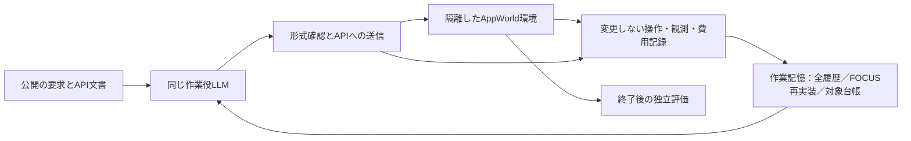
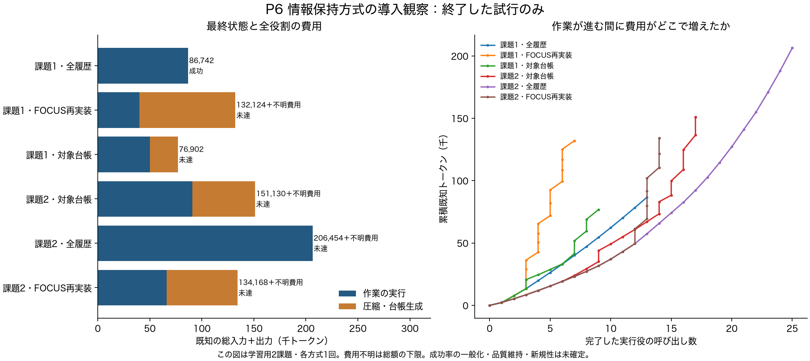

# P6：全6試行の結果と次の判断

2026年10月21日05:30 JSTに、開発用2課題×3方式の導入比較が終了した。**全履歴方式の第1課題だけが成功し、記憶を生成する2方式の品質維持や総トークン削減は確認できなかった。** 一方、単なる「忘却」では説明できない三つの問題を分けられた。記憶生成の費用、実行されていない操作の誤った完了記録、入力配置による再処理である。

これは各条件1回の校正であり、方式一般の順位を決める本実験ではない。大きなリポジトリでの担当再編を既定の結論にせず、[技術的中核の再検討](technical_core_review_20261021.md)に必要な観測として使う。新しいアルゴリズムはまだ採用していない。

## 目的・構成・条件

研究の目的は、**必要な品質を満たしたまま、モデルへの総入力＋出力トークンを減らすこと**。保持判断・台帳更新・再読込も費用へ含める。モデルの外側にある情報・状態・実行制御を対象とするハーネス研究である。

MiniMax M3 IQ4_XS、64K入力枠、q8_0 KV、同じ公開ツールを用いた。各試行の上限は80モデル呼び出し、45万トークン、30分、1呼び出しの生成4,096トークン。2課題は公開trainから選んだ開発対象で、今後の未調整評価とは区別する。[事前条件](experiments/P6_context_preservation.md)と[実行順序・計測版の監査](../reports/P6_final_runtime_audit.json)を残した。

FOCUSは公開原稿を基にした再実装で、原著者のコード・モデル・成績の再現ではない。対象台帳も単純な比較方式である。出力の参照IDが存在するという検査と、その記憶が事実に合うという検査は異なる。

## 結果

| 開発課題 | 方式 | 呼び出し | 既知の総トークン | 独立評価 | 停止 |
|---|---|---:|---:|---|---|
| 1 | 全履歴 | 13 | 86,742 | 成功 | 完了宣言 |
| 1 | FOCUS再実装 | 19 | 132,124＋不明1回 | 未達 | 30分上限 |
| 1 | 対象台帳 | 12 | 76,902 | 未達 | 完了宣言 |
| 2 | 全履歴 | 26 | 206,454＋不明1回 | 未達 | 30分上限 |
| 2 | FOCUS再実装 | 21 | 134,168＋不明1回 | 未達 | 30分上限 |
| 2 | 対象台帳 | 23 | 151,130＋不明1回 | 未達 | 30分上限 |

合計114呼び出し、既知787,520トークン、使用量不明4呼び出し。費用と最終評価の対応監査はエラー0。ただし旧v02の保持記録には以前から確認した不整合があり、その原記録は修正していない。第1課題FOCUSの元の停止分類`runtime_error`は保持し、時間記録からの上限到達という解釈と分けた。詳細は[全試行の数値](../reports/P6_final_measurements.json)、[実行記録の監査](../reports/P6_final_runtime_audit.json)。

棒の総量は中断呼び出しの不明費用を含まない下限。作業役と記憶生成役を分けた。折れ線の横軸は実行役の呼び出し数で、要求達成の割合ではない。失敗して早く終わった試行を、品質を保つ削減として数えない。

## 何が分かり、何はまだ分からないか

**1．保持処理の費用を、忘却の影響と混ぜない。** FOCUSの2試行で計8回の更新を試みたが、履歴を削除した記録は0回だった。第1課題は有効出力でも全保持となる場合があり、不正参照や生成打ち切りも発生。第2課題は3更新とも有効な選別に到達せず、保持生成6呼び出しに既知67,989トークン、1,291.714秒を使った。これらの失敗を「削った対象を忘れたから」と説明できない。[保持規則の診断](P6_retention_diagnosis.md)。

元の保持規則で全保持が既に確定した後の草案を調べると、第1課題の2更新で後続3呼び出し・23,873既知トークンが省略候補だった。第2課題では0件。不正出力を後から修復して候補を増やしていない。これは通常の早期終了を適用できる範囲の分析であり、実際の全体削減や新規アルゴリズムではない。[解析と反例](P6_retention_early_exit.md)。

**2．対象を台帳に残しても、完了の意味は保証されない。** 第1課題では、不正形式で環境へ送信されなかった生成文を根拠に、実行済みの更新として台帳へ記録する例を確認した。その後の完了宣言と独立評価は一致しなかった。ただし、これだけで台帳が最終失敗を引き起こしたという因果効果までは確定しない。[公開の操作履歴との照合](P6_ledger_diagnosis.md)。

第2課題の台帳は5更新に60,266トークン、1,109.123秒を使った。3更新は更新直後も開始基準4,096トークンを超え、次の操作後に再び更新が始まった。繰り返しの制御費用を含めずに圧縮率だけを評価できない。

**3．履歴が大きいことと、入力を毎回ほぼ再処理することは別。** 第2課題の全履歴方式では、正常終了25呼び出しの入力処理に1,208.290秒かかった。毎回増える参照ID一覧が長い履歴より先にあり、共通の先頭部分を短くしていた。キーの順序だけを変える測定では、同じ隣接2入力の共通先頭部分が2,290から16,476トークンへ増え、入力総量は変わらなかった。実際の時間短縮・最終品質はこの測定では未確認。[費用の診断と図](P6_task2_runtime_diagnosis.md)。

また、API要求の外形が受理されても、AppWorld内の操作が失敗する場合がある。外側のエラー数だけで操作成功を数えない。解析では内部の`Execution failed.`と形式不備を別に記録した。

## 次に進める比較と、採用しなかった案

| 次の作業 | この比較をする理由 | 今は採用しない方法と理由 |
|---|---|---|
| P7：同じ記憶入力を3表現で比較 | 未実行の生成文を退避する／未実行と明示するだけで誤完了が解消するか確認 | 直ちに新しい検証LLMを足すと、単純な入力整理で十分か分からない |
| P8：API別スキーマと複数操作の全履歴基準 | インターフェース制約による失敗を、記憶方式の必要性から分ける | 弱い単一APIインターフェースだけを比較対象に固定しない |
| P9：同じ隣接入力のキャッシュ校正 | 内容を削らず配置を変えるだけで再処理が減るか測る | キャッシュ改善を論理トークン削減や品質維持として報告しない |
| 強い保持・台帳基準の再評価 | 単純な早期終了や更新頻度の対照を超える問題が残るか確認 | 現状の失敗例だけから新規手法の名前・改善率を決めない |

P7は記憶出力だけ、P9は入力処理だけの実験で、最終成功を測らない。P8は複数のインターフェース変更を含む基準校正で、一つの変更の因果効果を主張しない。実行中のモデル入力へ独立評価を戻さない。

## この段階の成果と論文の目標

今ある成果は、原記録と全費用が対応する比較基盤、三つの失敗原因候補の切り分け、元データを変えずに試せる次の比較である。現状だけでは独自技術の成立を主張しない。

論文へ進める条件は、強い単純方式でも残る情報・状態・実行制御の問題を確認し、それを扱う具体的な規則を定義し、同じ予算での効果と悪影響を未調整の課題でも示すこと。AppWorldの2例はこのための校正であり、大規模・相互依存タスクという目標をこの2例だけへ縮めない。

[11枚の区切り資料](../materials/20261021_p6/AI_harness_P6_20261021.pdf)、[編集用PowerPoint](../materials/20261021_p6/AI_harness_P6_20261021.pptx)、[現在の優先順位](next_actions.md)、[研究Project](https://github.com/users/sophiria1225/projects/1)へつながる。
