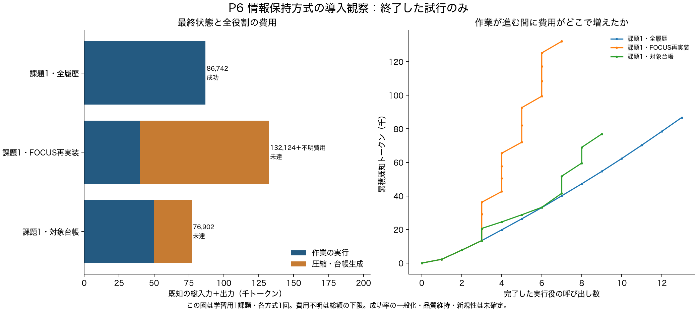
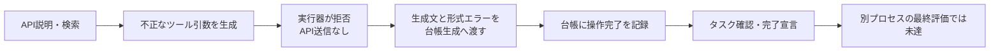

# P6：未実行の操作が台帳で「完了」になったケース

2026年10月21日。学習用の第1課題について三方式の実行と独立評価が終了した。全履歴は成功したが、対象台帳は必要な操作を行わずに完了を宣言した。台帳の費用が少なかったことを、品質を保つ効率化とは扱わない。

| 方式 | LLM呼び出し | 総入力＋出力 | 実行時間 | 独立評価 |
|---|---:|---:|---:|---|
| 全履歴 | 13 | 86,742 | 588.1秒 | 成功 |
| FOCUS再実装 | 19 | 132,124＋不明1呼び出し | 1,800.9秒 | 未達 |
| 対象台帳 | 12 | 76,902 | 1,013.5秒 | 未達 |

各方式1回の導入観察であり、一般的な成功率の比較ではない。モデル、基本ツール、課題、予算は共通だが、FOCUSは原著者の実装・モデル・実行形式をそのまま再現したものではない。時間切れと保持規則の診断は[前の記録](P6_retention_diagnosis.md)に分けて残した。

[PDF・SVG・CSV・出典ハッシュ](../reports/P6_task1_figures/)も保存した。台帳生成だけで26,818トークンを使用した。

## 観測したこと

対象台帳の公開操作を点検すると、API説明の取得と検索の後、第7ターンのツール引数が不正JSONになった。出力上限4,096トークンで終了し、引数の文字列が閉じていなかった。この操作はAPIへ送信されず、形式エラーを観測として返している。

直後の台帳更新は、第7ターンを参照して、対象の更新・認証・完了処理を「done」とした。更新前の台帳には未完了4項目、更新後にはdoneの5項目があった。その後の公開操作はタスク確認と完了宣言で、要求された更新は実行されていない。最後の台帳では完了処理を一部未確定へ戻したが、更新・認証のdoneは残った。

図は今回の処理順を表す。台帳を変えれば最終結果が改善する、という因果効果はまだ測っていない。台帳の参照IDが存在することと、その参照が操作完了を裏づけることは別だった。個人名、対象名、API引数、生成文、評価器の詳細は公開していない。

これは単純台帳の校正上の失敗例であり、新しい現象の発見や新方式の成立とは呼ばない。ツール出力形式、モデルの生成打ち切り、情報要約のどこに改善が必要かを切り分ける。

## 途中状態をどこまで再現できたか

[固定計画](../configs/P6_prefix_replay_plan_v01.json)に従い、同じ公開7ターンを新しいAppWorld環境で2回再生した。LLM呼び出しと独立評価は行わず、各回6件の公開API呼び出しと1件の形式エラーを再現した。不正引数は再生時にも送信していない。

両方とも7ターンすべての観測が原記録に一致した。新しく保存した13個のDB関連ファイルも2回間で同一ハッシュだった。[集計とハッシュ](../reports/P6_prefix_replay_measurements.json)。

一方、元の第7ターン時点のDBは保存されていない。比較したファイルには空の差分もあり、`model_hashes.json`も空のオブジェクトだった。これらを、元の全DB・Python変数・隠れた実行状態まで完全に同一という証明には使わない。元の実行へ後付けで「同一状態の分岐」を行ったとは主張しない。

## 次に変えるものと、採用しなかった案

次の[P7](experiments/P7_memory_input_probe.md)では、同じ保存済み入力を使い、記憶生成に渡す未実行部分だけを変える。環境の復元誤差が入らない範囲で、台帳の完了記録が変わるかを測る。

| 案 | 今回の判断 |
|---|---|
| 成功するまで同じ課題を再試行する | 原因を切り分けられず、失敗を成功に置き換えるため採用しない |
| 台帳側だけ時間や出力上限を増やす | P6の共通条件を変えるため、進行中の比較には適用しない |
| 未実行と明示する／生成文を退避する | 単純な対策の校正として比較する。新手法とは呼ばない |
| doneを一律に拒否する | 正当な完了も失う。記録された操作と主張の対応を先に調べる |
| 形式不備を圧縮・忘却の問題と決めつける | 実行形式と要約の影響を分けるまで保留する |

## 比較相手の強さも点検する

AppWorld公式の[関数呼び出し方式](https://github.com/StonyBrookNLP/appworld/blob/42b5bcf3cd334fee33f0c37c02070a9f5807add5/experiments/code/simplified/function_calling_agent.py)は選択したAPIごとのスキーマを渡し、複数呼び出しを処理する。現在の導入用実行器は汎用APIラッパーと1応答1操作なので、同等の強い基準とは扱えない。公式コードには正解情報でAPIを選ぶ任意モードもあるため、それを非オラクル比較へ混ぜない。

公式の[コード実行方式](https://github.com/StonyBrookNLP/appworld/blob/42b5bcf3cd334fee33f0c37c02070a9f5807add5/experiments/code/simplified/react_code_agent.py)も次の基準候補として読取確認した。まだ導入・実行・公式スコアの再現はしていない。[固定コミット・出典ハッシュ・確認範囲](../reports/P6_official_agent_interface_review.json)を残した。導入用の制約を弱い比較相手として利用し、独自方式の優位性を主張することはしない。
