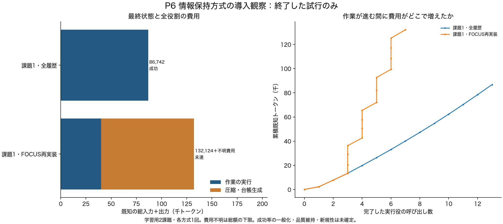

# P6：参照不備だけでは全保持を説明できない

2026年10月21日。最初の圧縮試行の保存済み出力を使った事後診断。追加のモデル呼び出しは0。実行結果や公式評価は変更していない。[集計](../reports/P6_focus_retention_diagnosis.json)、[解析コード](../scripts/analyze_focus_retention.py)。

## 問いと結果

「参照IDの不備を取り除けば、必要な対象を落とす圧縮が起きていたのか」を調べた。過去の履歴IDに、将来の計画ステップIDが混ざっていたため、診断上だけ後者を除き、残る正当な参照と救済を数えた。壊れたJSONは復元していない。

| 圧縮試行 | 入力履歴数 | 将来計画からの保持の下限 | 救済による追加保持の下限 | 合計の下限 |
|---|---:|---:|---:|---:|
| 1 | 3 | 3 | 0 | 3 |
| 2 | 4 | 3 | 1 | 4 |
| 3 | 5 | 3 | 2 | 5 |
| 4 | 6 | 3 | 3 | 6 |
| 5 | 7 | 算出できない | 算出できない | 呼び出し中に時間切れ |

4試行では、不備を除いた参照だけで全履歴が残る。第3試行には未生成・解釈不能の草案があるが、保持は和集合なので、他の草案を追加しても既に保持された履歴は消えない。これは保持集合の下限であり、修正版を最後まで実行して得た性能ではない。

3草案・閾値0.3という設定では、少なくとも1草案で引用された履歴が保持され、救済は引用回数によらず加わる。原方式のルールに従った計算であり、新しいアルゴリズムではない。[FOCUS §4・付録A.9](https://arxiv.org/html/2609.37590v1)。

## 次の対照を弱くしないための判断

参照不備の解消だけでは、今回の全保持と圧縮費用を説明しきれない。既存方式を強くする校正には、履歴IDと計画ステップを混ぜない出力契約、保持集合がもう変わらない時点での草案生成の打ち切りが候補になる。後者も一般的な計算の省略であり、独自の研究成果として扱わない。

保存済み出力では、全保持が確定した後にも6回の呼び出しが完了していた。ただし、この6回を引けば全体の費用がそのまま減るとは主張しない。後続の乱数、推論キャッシュ、実行可能な作業量が変わるため、実際の総費用と成功は新しい事前固定条件で測る必要がある。

いま実行中のP6には変更を入れない。台帳と第2課題の結果を確認してから、次の校正の必要性を決める。新手法を比較する際に、今回の未校正の失敗だけを弱い対照として使わない。

## 入力が同じでも結果が完全には一致しなかった

全履歴とFOCUSの実行役への要求は、最初の6ターンで完全一致した。公開操作の名前と引数は最初の5ターンで一致し、6ターン目から異なった。転送用のランダムなツール呼び出しIDは、操作の比較から除外した。

この間に履歴削除は起きていない。差を情報の忘却へ帰属させず、同じ種を指定しても完全な再実行が保証されない観測として残す。キャッシュや数値計算のどれが原因かは未特定であり、この照合だけで特定しない。

## 費用を可視化した途中結果

[PDF](../reports/P6_initial_figures/cost_and_progress.pdf)、[SVG](../reports/P6_initial_figures/cost_and_progress.svg)、[呼び出し単位の集計CSV](../reports/P6_initial_figures/call_costs.csv)。時点を固定した図で、後続の実行結果を含まない。原文、推論内容、評価器の詳細を図やCSVへ出していない。

圧縮のために多くの費用を使ったという観測と、情報を欠落させたという観測は別である。今回は前者を確認した。新しい保持方式の必要性を示すには、既存対策と単純な台帳を適切に動かしたうえで、後者が残る条件を確認する必要がある。
