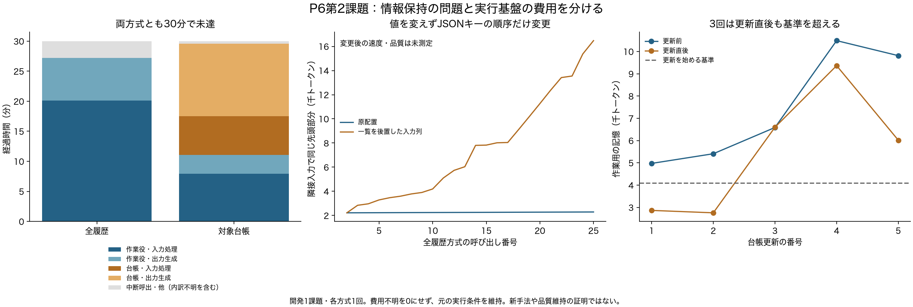
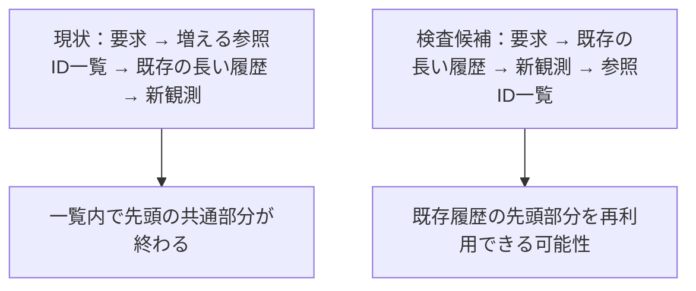

# P6第2課題：記憶の誤りと実行費用を分ける

2026年10月21日。全履歴と対象台帳の終了記録を分析した。FOCUSはこの文書の初版作成時点で進行中。両終了方式とも時間上限で未達であり、台帳の小さいトークン数を「品質を保った削減」とは扱わない。

| 記録 | 全履歴 | 対象台帳 |
|---|---:|---:|
| LLM呼び出し | 26 | 23 |
| 既知の入力＋出力 | 206,454 | 151,130 |
| 使用量不明の呼び出し | 1 | 1 |
| 実時間（秒） | 1,800.196 | 1,801.099 |
| 独立評価 | 1合格・3不合格 | 1合格・3不合格 |
| 完了宣言 | なし | なし |

同じ開発課題・各1回。使用量不明は0ではなく、費用は下限。途中の個別検査や正解情報を生成側へ戻していない。

[PDF](../reports/P6_task2_runtime_figures/runtime_diagnosis.pdf)・[SVG](../reports/P6_task2_runtime_figures/runtime_diagnosis.svg)・[数値CSV](../reports/P6_task2_runtime_figures/call_input_prefixes.csv)。中央の図はトークン列の一致であり、変更後の速度実測とは区別する。

## 全履歴では入力の再処理が大きかった

正常終了した25呼び出しで、サーバーが報告した入力処理は1,208.290秒、出力生成は422.915秒。最後の時間切れ呼び出しの内訳は不明で、これらへ推計値を足していない。第25呼び出しは入力17,682トークンのうちキャッシュ2,290、再処理15,392だった。

履歴JSONの先頭に`available_archive_ids`を置いていた。その一覧が1件増えるたび、後続の既存履歴より前で入力が変わる。固定版llama.cppの[公式仕様](https://github.com/ggml-org/llama.cpp/blob/620d2225cc436ab0b001e3200e590e3b286ef9ab/tools/server/README.md)では、キャッシュは共通の先頭部分を再利用する。この記録での再処理負担は、モデル能力や必要な情報量だけで説明できない。

入力のJSONキーの順序だけを変え、値・ツール・指示を全て維持した候補を同じサーバーでトークン化した。第24→25呼び出しの共通先頭部分は2,290から16,476トークンになり、両入力の総トークン数は変わらなかった。**これは入力列の測定であり、変更後のキャッシュ実績や速度向上の実測ではない。** JSONの内容が同じでも、LLMの出力が同じになるとは仮定しない。

## 台帳は更新後も大きく、更新が連続した

台帳生成5回は既知60,266トークン、計1,109.123秒。全実行時間の約61.6%を占めた。直近2つの観測と台帳を保持する規則のため、更新しても入力が十分小さくなるとは限らない。

| 台帳更新 | 更新前の記憶 | 更新直後の記憶 | 開始基準4,096を更新後も超えるか |
|---|---:|---:|---|
| 1 | 4,974 | 2,863 | いいえ |
| 2 | 5,408 | 2,755 | いいえ |
| 3 | 6,587 | 6,597 | はい |
| 4 | 10,488 | 9,365 | はい |
| 5 | 9,814 | 6,017 | はい |

サイズは更新入力と直後の実行役入力を固定版トークナイザーで計測した。間に新しい環境操作はない。第3回は更新費用を払っても10トークン大きくなった。保持対象を失ったから失敗したと、この結果だけから説明することはできない。

## インターフェースの失敗も分離する

全履歴では、複数のツール呼び出しを出した2応答が「1応答1操作」の規則により未実行になった。ほかに、AppWorldの実行エラー3件と外側のAPI検証エラー1件があった。台帳はそれぞれ2件と1件。従来の`api_bridge_errors`だけでは前者を数えていなかったため、元記録を変えず、今回の分析では別々に集計した。

複数操作に対応した[P8](experiments/P8_native_baseline.md)は、この比較器の制約を調べるための校正である。P8ではスキーマ、探索、プロンプトも変わるので、改善があっても複数操作だけの効果とは言わない。

## 次に何を選ぶか、その理由

1. 凍結済みのP6、P7、P8を順に実行し、途中で有利な条件へ置き換えない。
2. [P9](experiments/P9_prompt_cache_probe.md)で保存した隣接2入力の配置だけを変え、入力処理の実時間とキャッシュ量を測る。生成は1トークンに限定し、環境へ送信しない。
3. 再処理の影響を確認した後、全方式で利用できる実装改善として扱う。改善した基準方式で実課題の失敗が残るかを確かめてから、独自機構を選ぶ。

先に時間上限を大きくする案は、基盤の無駄を残したまま計算を増やすため見送る。記憶量を減らす案は情報欠落を同時に変えてしまうため、今回の校正では使わない。役割追加や学習した再編判断器も、この失敗の原因を確かめる前には追加しない。いずれも一般的に無効という判断ではない。

**研究の目的は、必要な品質を保って全体のトークンを減らすこと。今回の入力配置変更はトークン数を減らす新技術ではなく、比較の妥当性を整える基盤改善候補である。独自手法の採用・有効性はまだ確定していない。**

記録：[費用・入力列監査](../reports/P6_task2_cost_diagnosis.json)、[更新前後のサイズ](../reports/P6_task2_memory_sizes.json)。入力本文・認証情報・推論文・独立評価の詳細は公開しない。元の試行は上書きせず、計測スクリプトと入力ファイルのハッシュを残す。
