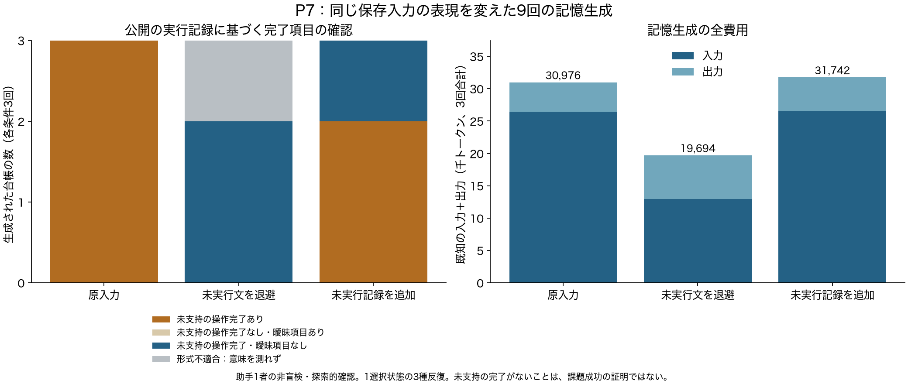

# P7：未実行の生成文が台帳へ混入する条件

同じ保存入力を3表現×3種で記憶生成した9呼び出しが終了した。**原入力では3出力全てに、公開の実行証拠が支えない操作完了の記録が残った。「未実行」と追記するだけでも3出力中2出力に残った。** 未実行の生成文を退避した条件は、形式が成立した2出力では確認されず、残る1出力は形式不備だった。

この結果は、選んだ1状態に対する探索的な比較である。最終タスクの実行・評価は行っておらず、品質維持や新規手法の有効性を示してはいない。

## なぜ行ったか

P6では、形式不備でAPIへ送られなかった操作を台帳が完了済みとして記録した。参照IDの存在やLLMによる説明だけでは、この誤りを除けなかった。新しい検証器を追加する前に、単純な入力の扱いで改善できるかを調べた。[事前計画](experiments/P7_memory_input_probe.md)、[出力前に固定した意味確認の規則](experiments/P7_review_protocol.md)。

| 条件 | 変更 |
|---|---|
| 原入力 | 元の記憶生成入力を維持 |
| 未実行文の退避 | 不正な引数で未送信となった生成文・要求を作業用入力から外す。形式エラー、原記録の参照、実観測、前の台帳を維持 |
| 未実行記録の追加 | 元の生成文を保持し、実行されなかったことを構造化した記録で追記 |

モデル・出力上限・ツール・種43–45をそろえ、実行順を循環させた。全要求を保存入力と照合し、実際の種・介入・費用が計画と一致することを確認した。9呼び出し、既知82,412トークン、使用量不明0、整合性監査エラー0。[送信内容と費用の監査](../reports/P7_conformance.json)。

## 結果

| 条件 | 形式適合 | 未支持の操作完了を含む出力 | 形式不備で意味を測れない出力 | 全生成費用 |
|---|---:|---:|---:|---:|
| 原入力 | 3/3 | 適合3出力中3 | 0 | 30,976 |
| 未実行文の退避 | 2/3 | 適合2出力中0 | 1 | 19,694 |
| 未実行記録の追加 | 3/3 | 適合3出力中2 | 0 | 31,742 |

退避条件の形式不備は、生成上限に達した未完成JSONだった。これを「誤った完了が0件」と数えたり、本文を補完して成功に直したりしていない。費用にはこの出力も含む。退避では入力長も短くなるため、費用差を意味の扱いだけの効果とは呼ばない。

## どう確認したか

この対話の助手1者が、形式適合8出力の全32件のdone項目を、元入力の時点までの公開操作と照合した。非盲検の探索的確認であり、人間専門家・複数評価者の一致率はない。最終評価・正解データ・後続操作は根拠に使っていない。

その時点の記録は文書取得4件、検索2件、不正形式による未送信1件である。検索の実観測と、その後に行う認証・対象変更・完了通知を区別した。実行証拠がないことは「その操作を実行した」とは支持できない、という意味であり、見ていない初期環境の真偽を決めるものではない。

| 項目単位の分類 | 件数 |
|---|---:|
| 公開観測が支持する調査・検索の完了 | 8 |
| 実行証拠が支えない操作完了 | 15 |
| 実行証拠が支えない追加の確認・読取の完了 | 3 |
| 複数の要求を混ぜた記述など、判定困難 | 6 |

6件は、対象集合の列挙と後続の変更を一項目に混ぜた5件、および対象説明と要求を混ぜた1件。保守的に判定困難とし、狭い操作完了の件数には入れていない。操作の種類と状態・引用の支持を別々に記録した。[ハッシュに対応づけた全注釈](../reports/P7_semantic_review.json)。引用IDだけで自動判定した件数ではない。

## 考察と次の実装判断

**未実行という追記は、この入力では一貫して効かなかった。** 生成文に含まれる操作の話と、環境で得た結果を同じ記憶生成入力へ残す構成を、注意書きだけで十分として採用しない。これは3種の結果からの局所的な判断で、どのモデルでも追記が無効という主張ではない。

**未実行文の退避は、強い単純対照として残す。** 実際の作業継続でも有効かは未確認だが、複雑な新方式を作る前に比較すべき候補となった。原記録は保持し、退避の対象は「送信されなかったと実行基盤で確認できる部分」に限定する。API実行後の失敗や、作用が不明な通信障害まで未実行として捨てる案は採用しない。失敗した要求が修正に役立つ可能性も、今後の実行比較で測る。

**これは独自アルゴリズムの発見ではない。** 実行証拠をモデルの記憶と分ける既存研究との重なりを[追加照合](runtime_evidence_overlap_20261021.md)した。単純対照を超えて残る問題がなければ、特別な新規機構を追加しない。

現在はP8で公開API別スキーマ・複数操作を使う全履歴基準を実行中。P9では入力配置の実時間を測る。その結果を踏まえ、強い基準上で退避・更新頻度・記憶方式を比較する。進行中の試行を途中で変更せず、次の計画に条件・費用・撤回基準を残す。
