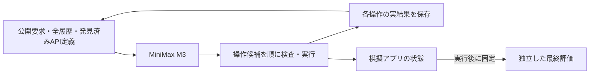
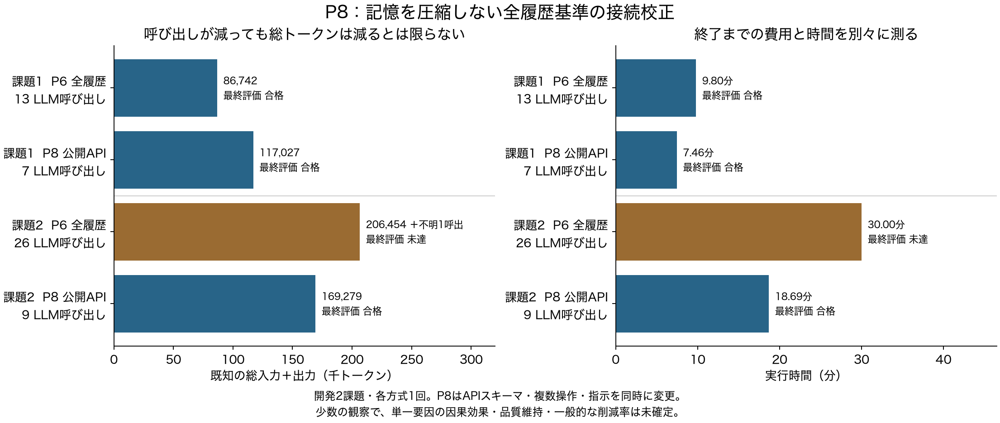

# P8：接続を変えた全履歴基準は、開発2課題を完了した

2026年10月21日06:17 JST、固定した2試行と独立評価を終了。**両課題が最終評価に合格した。合計16モデル呼び出し、286,306総トークン、API要求27回、使用量不明0回。** 記録された実行時間の合計は1,569.250秒。待機時間や独立評価の時間はこの合計に含めない。[固定条件](experiments/P8_native_baseline.md)、[全測定](../reports/P8_final_measurements.json)。

この結果で重要なのは、記憶を圧縮せずに従来の失敗課題を完了できた点である。P6の失敗をそのまま「新しい記憶方式が必要な証拠」と扱う理由は弱くなった。API接続と指示をまとめて変更した開発観察なので、どの変更が必要十分だったかや、一般的な成功率・費用削減を証明した結果ではない。

## 何を変えて比較したか

P6全履歴は汎用APIラッパーと1応答1操作。P8は公開APIごとのスキーマを渡し、同じ応答の複数操作を順に実行する。文書要求に応じて利用できるスキーマを追加する。作業の履歴、原記録の再読、同じ大型モデル、各45万トークン・30分の上限、別プロセスの最終評価は維持した。

P8でも履歴は一つのuser JSONとして渡している。assistant/toolの役割を保持する追加の基準はP10で、P8の途中には入れていない。新しいAPIスキーマや複数操作の機能を自分たちの独自技術には数えない。

## 全結果

| 課題・方式 | 最終評価 | モデル呼び出し | 既知の総トークン | 費用不明の呼び出し | 実行秒 |
|---|---|---:|---:|---:|---:|
| 課題1・P6全履歴 | 合格 | 13 | 86,742 | 0 | 588.065 |
| 課題1・P8 | 合格 | 7 | 117,027 | 0 | 447.813 |
| 課題2・P6全履歴 | 未達・時間上限 | 26 | 206,454 | 1 | 1,800.196 |
| 課題2・P8 | 合格 | 9 | 169,279 | 0 | 1,121.437 |

[CSV・PDF・SVG・出典ハッシュ](../reports/P8_figures/)。各課題・各方式1回。P6課題2の既知費用は総費用の下限で、不明分を0にしていない。課題1では呼び出しと時間が減っても総トークンが増えており、呼び出し回数だけを効率の指標にできない。

## 記録の監査と途中の失敗

課題1は8 API要求、課題2は19要求。複数操作を返した応答はそれぞれ1回と7回。公開スキーマは最大102件と82件だった。モデルの要求数・順序と操作記録、提示していないAPIの送信、完了や作用不明の後の送信を監査し、エラー0だった。費用と最終評価の対応もエラー0。[課題1監査](../reports/P8_01_dispatch_audit.json)、[課題2監査](../reports/P8_02_dispatch_audit.json)。

課題2でAPI内部の認証エラーを1回記録した。送信前の形式拒否や作用不明の通信失敗は0回。後続処理を経て最終評価には合格したため、途中の1エラーをタスク失敗とは数えない。認証値を含む12要求のうち、その1要求だけは同じ文字列がそれ以前の公開観測に見当たらなかった。ただしこれは文字列の出現確認で、値の有効性や失敗原因の確定ではない。値・引数・元の出力は公開しない。[出現確認の集計](../reports/P8_02_credential_copy_observation.json)。

## まだ残る入力処理の費用

| 記録された処理 | 課題1 | 課題2 |
|---|---:|---:|
| 総入力トークン | 115,482 | 162,985 |
| 総出力トークン | 1,545 | 6,294 |
| キャッシュされた入力トークン | 76,812 | 84,720 |
| 再処理された入力トークン | 38,670 | 78,265 |
| 入力処理秒 | 348.876 | 724.710 |
| 生成秒 | 95.436 | 392.911 |

[タイミング・費用の監査](../reports/P8_final_runtime_audit.json)。論理的総入力にはキャッシュされた部分も含める。キャッシュ利用をトークン削減とは呼ばない。API定義、入力の配置、履歴にそれぞれどれだけ費用があるかを切り分ける必要がある。P9は同じ隣接入力の配置だけを変える時間校正で、P8の成否比較とは別である。

## 採用する判断・採用しない説明

P8の接続は次の比較基盤として残す。動いた結果を見ずにP6の弱い接続へ独自の記憶方式を積み足す方針は採用しない。両課題の成功を理由に圧縮や記憶研究が不要とも結論しない。十分な履歴を維持した基準が成立したことで、これから品質と費用を比較する条件が整った段階である。

P6のFOCUS再実装と台帳を、P8の別の接続と直接比べて「P8の記憶が優れる」とは主張しない。スキーマ、複数操作、指示、取得した情報、生成の変動が異なり、強い基準との公平な記憶比較には同じ接続での実行が必要になる。

P10の標準会話形式を最後の有限な接続確認として続け、その後は基準を固定する。次の4開発シナリオは公開要求を見る前にID順で選んだ。[追加課題の選択](experiments/P11_public_task_selection.md)。集合処理の条件が異なる例と、読取中心の比較を残す。対象数・依存・情報量はまだ未知であり、この少数課題を大規模研究の主評価へすり替えない。

独自機構を選ぶ条件は、強い全履歴基準と既存の対策を同条件で比べても残る具体的な制約があり、追加の表現・更新規則が必要だと測定できること。現在はその中核が未確定であるという説明を維持する。
