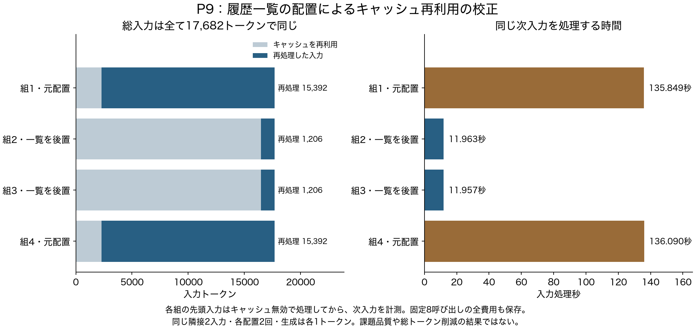

# P9：情報量を変えない入力配置の時間校正

2026年10月21日06:32 JST、固定した8呼び出しを完了。履歴参照IDの一覧を本文の後へ置くと、同じ次入力の再処理が15,392から1,206トークンへ減り、入力処理時間は平均135.969秒から11.960秒になった。**各次入力の総入力は17,682トークンで同じ。総トークン削減やタスク成功の結果ではない。**



[PDF](../reports/P9_figures/cache_probe.pdf)／[SVG](../reports/P9_figures/cache_probe.svg)／[全8呼び出しのCSV](../reports/P9_figures/all_calls.csv)／[機械監査](../reports/P9_final_audit.json)。

## 目的と方法

P6の全履歴条件では時間切れが生じた。履歴を前からまとめ直す入力形式は、情報を失っていなくてもキャッシュを再利用しにくい可能性があった。これを記憶の忘却やモデル能力と取り違えないため、既存の配置改善を測る校正を行った。[事前仕様](experiments/P9_prompt_cache_probe.md)。

P6の第2課題・全履歴の隣接する第24、第25入力だけを固定した。JSONを解釈した値は一切変えず、参照ID一覧のキーを後ろへ移す。各組の先頭はキャッシュ無効で処理し、次入力だけ再利用を許す。順序は元配置→後置→後置→元配置。生成は各1トークン、環境操作・最終評価は0回。進行中の他の生成と重ねなかった。

| 次入力の配置 | 測定2回の入力処理秒 | 再利用トークン／回 | 再処理トークン／回 | 総入力／回 |
|---|---|---:|---:|---:|
| 元配置 | 135.849、136.090 | 2,290 | 15,392 | 17,682 |
| 一覧を後置 | 11.963、11.957 | 16,476 | 1,206 | 17,682 |

先頭入力の処理は4回とも約142秒、キャッシュ再利用0。計8呼び出し・136,968入力＋出力トークン・使用量不明0。実測区間全体は876.515秒で、先頭を準備する費用も含めて保存した。モデルと推論基盤はP6/P8と同じ固定版、IQ4_XS・64K・KV q8_0。

## 解釈と採否

- この入力対では、値を保った配置変更により再処理が減った。キャッシュは物理的な再処理費用を減らすが、研究の主費用である論理的な入力＋出力の総量は減らない。
- 同じ隣接入力対の反復2回であり、独立した4課題ではない。短い生成しか行っておらず、配置による後続生成・最終品質の違いは測っていない。
- 時間上限の延長は原因を残すため、履歴削除は情報まで変えるため、この校正では選ばなかった。全入力対の総当たりも先行しない。
- 通常の入力キャッシュ最適化を独自方式とはしない。P10の標準会話基準は既に凍結済みで、途中からこのJSON配置を混ぜない。今後の方式比較では、キャッシュ再利用量・論理トークン・時間をそれぞれ記録する。

## 監査と再現

原入力・凍結ソース・実際の要求・生の応答・進捗の数値を照合した。変えてよい値は配置、生成上限1、先頭／次入力のキャッシュ指定のみ。先頭の再利用0、再利用＋再処理＝入力、使用量の一致を検査し、エラー0。監査の2対照を含む全205単体検査が合格した。

```bash
python scripts/audit_prompt_cache_probe.py --storage-root /Users/tp26013/AI- \
  --record /Users/tp26013/AI-/records/cache_probe/P9_01 --output reports/P9_final_audit.json
python scripts/plot_cache_probe.py --report reports/P9_final_audit.json --output-dir reports/P9_figures
```

完全な要求・応答と原文はローカルに保持し、公開物は数値・ハッシュ・図に限定する。監査と描画でモデルや評価器を再実行しない。
