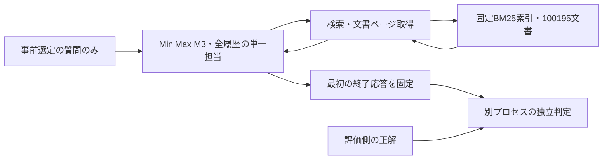

# 大規模文書側の実行・評価接続

2026-10-21。R30 / Issue #61。これは基準方式と評価分離の実装であり、独自の記憶方式ではない。実モデルによる質問回答はまだ実施していない。

## 今回作ったもの

- `search` は全コーパスへのBM25検索。最大10件、各文書の冒頭2048文字を返す。文書ID、スコア、全文長、続きの位置、全文ハッシュを付ける。
- `get_document` は数値の文書IDと文字位置を使い、最大8000文字ずつ読む。残りを再取得できる。検索対象や原文を正解文書に限定しない。
- 検索接続は専用Python・JDKの常駐プロセス。ネイティブ依存の標準出力を別記録へ送ってJSON通信と分離する。障害・タイムアウトを検索結果０件へ変換せず、接続の遅延応答も再利用しない。
- 生成側に公開する操作はこの２種類だけ。任意のパス・URL・シェル・QAファイル・評価器へ接続するツールはない。ローカルファイルの物理的分離を保証するOSサンドボックスという意味ではなく、モデルの呼び出せるインターフェースによる分離である。
- 最初の、ツールを伴わない正常終了の非空応答を提出物にする。出力上限で切れた応答は提出・実行しない。正解を見て途中回答を選び直さない。
- 最終回答は生成結果そのものと照合し、終了要約・使用量・履歴・ソースをハッシュ付きマニフェストに固定する。評価側は固定と整合を確認するまで正解を開かない。これは改変検知であり、管理者にも書換不能なストレージではない。
- 全履歴を保持し、長い原文は上記のページ単位で取得する。モデルの入力上限に達したら停止する。暗黙の履歴切捨てや無料の再試行をしない。

## なぜこの基準か

AppWorldの接続校正では、単純な全履歴でも完了できた課題があった。大規模文書でも、まず検索と原文再取得を備えた全履歴基準を確認する。圧縮や分担が必要だと先に決めない。検索器・ツール・評価器の不具合を記憶方式の問題に混ぜないため、初回は事前選定12問の先頭から少数で接続を確認する予定である。

全文を毎回返す案は１回の観測で入力枠を圧迫し得るため、位置付きのページ取得を採る。一方、冒頭だけを見せて後続を取得できない案は採らない。埋め込み検索との優劣、複数担当の価値、最適なページ長は未測定。初回の２問程度から全体精度を主張しない。

## 独立判定の設定

[固定した公式評価コード](https://github.com/texttron/BrowseComp-Plus/blob/046949032b0328319cc9a02663a759ec601d9402/scripts_evaluation/evaluate_run.py)のテンプレート・回答パーサ・引用抽出・引用指標を、ファイルSHA-256一致後に読み込む。vLLMや実行部は読み込まず、確認した関数だけを利用する。合成の肯定・否定・形式不備・空応答、引用・テンプレートを検査した。実際の採点精度を検証したものではない。

公式の既定はQwen3-32B、temperature 0.7、top_p 0.8、top_k 20、最大4096出力トークン、`enable_thinking=False`。欠けた判定は不明のまま残し、不正解０へ置き換えない。引用IDがあること、評価ラベルに含まれること、本文が主張を支持することは異なる。

Macでの候補は[Qwen公式のQwen3-32B-MLX-bf16](https://huggingface.co/Qwen/Qwen3-32B-MLX-bf16)、revision `cf84a682b91f6fe200f1000764405a6dded44f4f`。確認した重み13ファイルは65,524,328,224 bytes。これは採点用の選択で、最新の生成モデルを選ぶ問題とは分ける。BF16を候補にした理由は、単独ロードなら実機メモリ内で検証可能で、追加の量子化差を避けられるため。Q8/GGUFも候補だが、軽さが必要かをまだ実測していない。

MLXと公式vLLMは実装が異なるため、同じテンプレート・モデル系列でも公式スコアの厳密再現とは扱わない。生成用M3と採点用32Bを同時ロードしない。P14の時間測定中には重み取得・インストール・JVM起動を重ねず、まずコードと合成検査を準備する。重み未取得・モデル採点未実施。

## 確認と残作業

全259単体検査・compileallが合格。部分行の受信タイムアウトと応答IDの取り違えも検査した。公式パーサの合成４条件と引用・テンプレート確認も合格。上流ソースの`\%`がPython 3.12でSyntaxWarningを出したが、固定ソースを書き換えず記録した。質問・正解の追加閲覧やモデル生成は０。

残作業は、実索引への新しい接続の正負対照、実モデルでの入力計数と固定条件の保存、先頭の選定質問の回答生成、別プロセスの採点接続。採点モデルの実行環境と費用も別に記録する。
