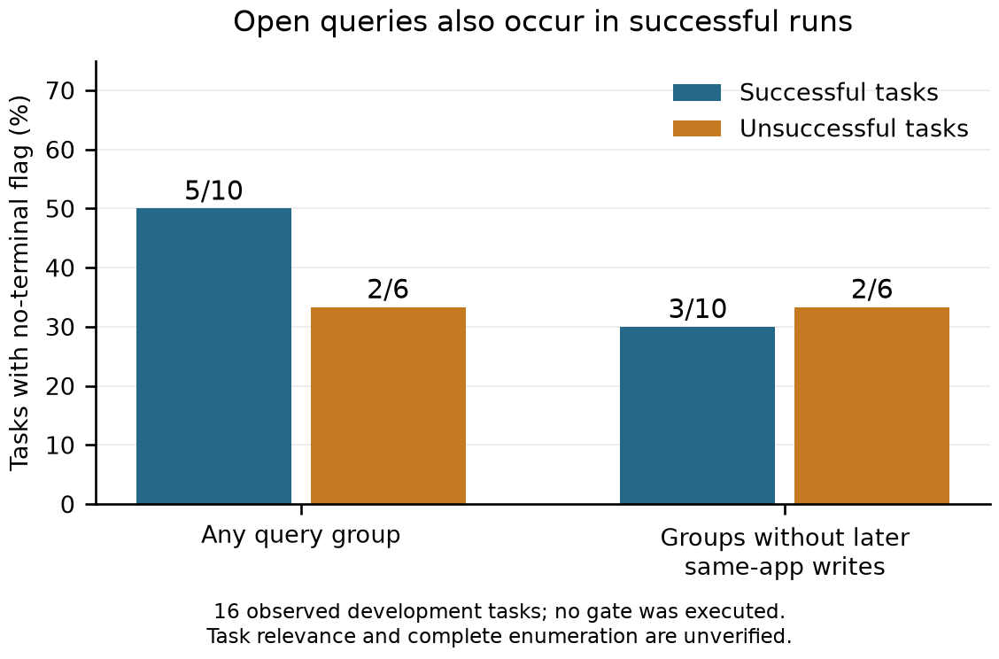

# 16課題のページ取得分析：単純な完了禁止は採らない

2026年10月21日。解析前に規則をe4e1687で固定し、解析器6463767で全16件を集計。追加のモデル生成・環境操作０。P24途中本文・確認用12件・評価器本文は未閲覧。これは既観測の開発事例に対する事後分析である。

70要求群の内訳は、連続ページの後に短い／空の返却41群、終端らしい返却なし27群、未分類２群。終端らしい返却は、検索範囲の適切さや完全な網羅を保証しない。

| Run | Success | Declared complete | Paged calls | No-terminal groups | Without later same-app write |
|---|---|---|---:|---:|---:|
| P10_01_ROLES | True | True | 2 | 0 | 0 |
| P10_02_ROLES | True | True | 12 | 9 | 1 |
| P11_01_ROLES | True | True | 2 | 0 | 0 |
| P11_02_ROLES | True | True | 4 | 3 | 1 |
| P11_03_ROLES | True | True | 4 | 1 | 0 |
| P11_04_ROLES | True | True | 1 | 0 | 0 |
| P18_01_ROLES | False | False | 0 | 0 | 0 |
| P18_02_ROLES | True | True | 5 | 5 | 1 |
| P18_03_ROLES | True | True | 2 | 2 | 0 |
| P18_04_ROLES | False | True | 6 | 0 | 0 |
| P22_01_ROLES | False | True | 28 | 0 | 0 |
| P22_02_ROLES | False | True | 5 | 0 | 0 |
| P22_03_ROLES | False | False | 6 | 6 | 6 |
| P22_04_ROLES | True | True | 4 | 0 | 0 |
| P22_05_ROLES | True | True | 0 | 0 | 0 |
| P22_06_ROLES | False | True | 1 | 1 | 1 |

図は観察済みの開発事例の割合。実際の完了禁止や修復を行った実験ではない。

## 観察されたこと

成功10件のうち５件に、終端らしい返却を確認できない検索が残った。その後に同一アプリへの変更がないものへ限定しても３件に残る。したがって、これを一律に未完了として禁止すると、今回の独立評価に合格した実行にも介入する。実際に強制継続した際の品質低下や追加費用は、まだ測っていない。

失敗６件のうち同じ検出に反応したのは２件で、そのうちP22_03は予算停止で完了を宣言していない。P22_06では宣言完了時に終端未確認のプレイリスト取得がある。一方、P22_01は28要求群に終端らしい返却があるが失敗しており、選んだ集合が要求の意味に合うかは別問題である。

この16件から検出器の一般的な精度や因果効果は算出しない。失敗原因が全て列挙不足とは限らず、存在しない未取得対象をDBで補ってもいない。成功例では途中の探索だけで目的の対象を発見できる場合があり、すべての検索を尽くすことが要求ではない。

## 次の機構に必要な条件

「全ページを取ったか」だけのゲートは採らない。新たな制御を設計する場合は、その検索範囲が最終判断・操作に必要か、どの条件を満たせば追加取得が不要かを表現し、実際の返却へ結び付ける必要がある。ただし問合せの完全性・完了契約には近接研究があるため、この必要条件自体を新規性としない。

比較すべき単純対照は、一般指示（実行中のP24）、未取得ページの一律通知、通常の計算・探索である。課題の正解集合を別途与える方式とは比較しない。候補を採るには、不要な探索への介入を減らしつつ必要な未取得を残さない固有の規則を示し、同じ情報・予算で反証する。

## 記録と限界

[全機械集計](../reports/collection_frontier_audit_20261021.json)、[解析前の規則](experiments/collection_frontier_audit_20261021.md)、[検査・原記録](../reports/collection_frontier_preflight_20261021.json)、[近接研究](collection_scope_review_20261021.md)。

397検査合格、うち10件が引数・飛び番・変更・再返却・秘密値の非出力を扱う。未分類２件は元の返却がJSONリストでないものとして残した。追加の形確認は最初にJSONを仮定して停止したが、解析器は非JSONを未分類として扱うため集計を変更していない。資料作成の一度目は文字コードの構文エラーで実行前に停止し、別の編集へ分けた。実験・解析結果への影響はない。

変更の区切りは同一アプリのHTTPメソッドに基づく保守的な近似で、アプリ間・外部の変更や結果順の安定性を保証しない。状態変更後の再取得義務や、自然言語の範囲の正解も推定していない。P24の固定291ファイルは変更０。
