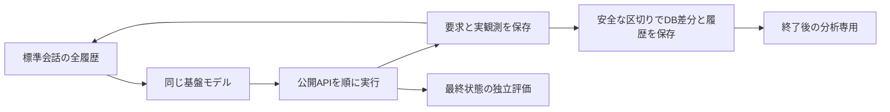

# P11：追加4シナリオの全履歴観察

目的は、繰り返し使った2開発課題から離れ、成立を確認した同じ実行基準で情報保持の負担と失敗条件を観察すること。新しい記憶方式の有効性を測る比較実験ではない。実行計画とソースを固定してから、各課題を1回ずつ実行する。

## 対象と基準の選択

公開要求を読む前に固定した[選定規則](P11_public_task_selection.md)に従い、287e338_1、29caf6f_1、2a163ab_1、302c169_1をこの順に使う。読取集約、複数アプリを使う応答、条件付き集合更新、指定対象と補集合の異なる更新を含む。実際の対象数・難度は未測定。成否や本文を理由に入れ替えず、読み取り中心の課題も残す。

P10は両課題が最終評価合格で、履歴・費用・順序の監査もエラー0だったため、標準会話形式を共通基準に固定する。P8よりトークンは多かったが、役割と実観測の対応が明示され、入力の再構成を検査できる基準を優先する。[全結果と選択理由](../P10_findings.md)。課題ごとにP8/P10の良い結果を選ぶ方式にはしない。P11の結果による基準の事後変更や成功までの再試行もしない。

## 実行条件

- 同じMiniMax M3 IQ4_XS、llama.cpp b11669、64K、KV q8_0。推論設定と種42からの呼び出し順をP10と合わせる。
- 1課題あたり80モデル呼び出し、80公開API要求、総入力＋出力450,000、1,800秒、1生成最大4,096。4試行の合計上限は320呼び出し・1,800,000トークン。上限まで必ず使う計画ではない。
- APIの公開仕様、発見規則、指示文、24,000文字の原観測ページ、複数操作の逐次処理をP10と合わせる。タスクの全原環境を保ち、正解対象だけを選んで渡さない。
- 全履歴を保持し、圧縮・台帳作成・正解APIの事前選択を加えない。完了宣言は成功とせず、終了後の独立評価を用いる。
- 推論や通信の作用不明な失敗は、無料で再試行しない。既知費用と不明呼び出しを分ける。時間・トークン・容量による未完了も結果に含める。
- P10終了後、同じ設定で稼働期限を更新したサーバーを使う。4試行の最大時間に、各独立評価180秒と余裕180秒を加えた8,100秒が残っていることを確認して開始する。

## 途中状態の記録

最初と各応答の処理後、AppWorldが既に保存したDB変更ファイルと、ハーネスの履歴・公開タスク・計画・費用を内容ハッシュで保管する。変わらない内容は再利用する。作用不明な通信が起きた区切りは、確定した保存点として登録しない。保存物はモデルへ返さず、モデルに理由の追加生成も要求しない。

保存時間は試行全体の時間に含め、失敗した保存の時間も別途記録する。新しい内容は1保存点128MiB、1試行512MiBまで。必要な証拠を黙って省略せず、超えた場合は停止して記録する。原データや過去記録を削除して容量を作らない。

**これはDBとハーネスファイルの保存であり、完全なプロセス状態の保存ではない。** Python変数・乱数状態・ライブキャッシュは未捕捉。元の途中状態がなかったP7と区別して実ファイルを残すが、同じ後続動作を復元できるかは別に検査する。復元前に同一状態の因果比較が可能だと主張しない。

既閲覧課題で公開文書APIを2回だけ呼び、実際の区切り3点を保存し、プロセス終了後も含め4回のハッシュ照合を行った。モデル生成・評価0回、原典側の正解読込なし。保存は約0.0012〜0.0015秒、初回14,830バイト、その後の重複内容の追加0。これは短い文書操作での接続確認で、4課題の保存負荷の予言ではない。[記録](../../reports/P11_boundary_controls_v01.json)。

## 調べることと見送った案

最終成功、総トークン、API回数、入力処理・生成時間、対象の探索と更新、同じ情報の再取得、記憶を必要とする時点を記録する。後から隠し評価を読んで正しい対象の台帳を作り、それを提案方式へ与えることはしない。対象数は公開観測から分かる範囲で集計し、未取得集合の完全性とは分ける。

全30シナリオの一括実行、実行前の方式追加、大量の自己説明要求、毎回の全プロセス複製は、費用と測定対象を増やすため見送る。まず同じ4課題の全結果を残し、記憶比較で操作する情報と必要な保存範囲を具体化する。

P11も開発観察であり、主研究を小課題へ変更するものではない。大規模・相互依存の主実験、品質許容差と反復数、独自の表現・更新規則は別途確定する。通常のAPI接続・状態保存・キャッシュ再利用を新規性として扱わない。
