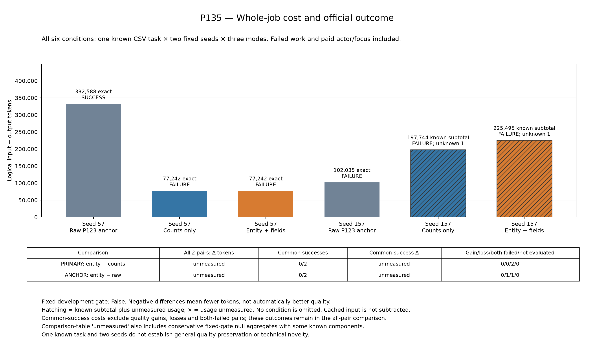
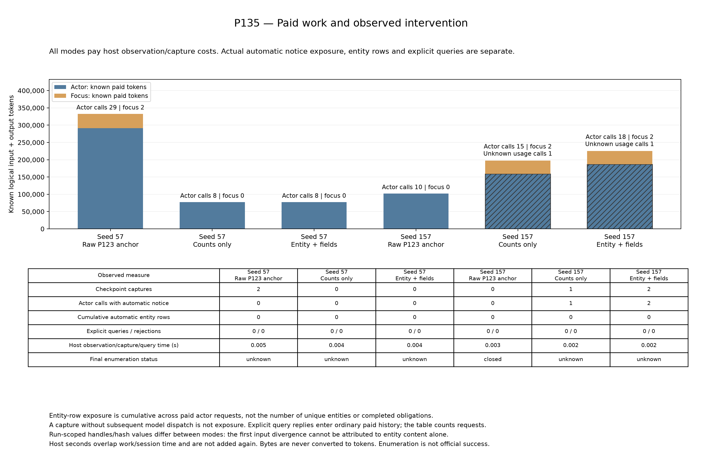

# P135 全6条件：品質保持と全仕事費用削減は確認できなかった

既知CSV1課題、固定seed57/157の全6条件を実行・評価し、所有serverを停止した。通常のraw anchorは1/2成功、残件数のみ（counts）と対象ID＋不足field（entity）はともに0/2成功だった。主比較に共通成功はなく、entityはrawに対してseed57の成功を失った。未知usageが2件あり、両比較の全仕事token差は`null`、固定採用gateは**false**である。

対象ID＋不足fieldの自動表示は全条件で0行、明示queryも0回だった。通知そのものの露出と、候補の詳細行が使われたことを区別する。この結果は品質を保った削減や新規技術の有効性を支持しない。追加seedやids-only比較をこの結果の救済として起動していない。

[全6条件CSV](../../materials/20261027_p135_results/conditions.csv)／[集計JSON](../../materials/20261027_p135_results/summary.json)／[資料入口と再描画](../../materials/20261027_p135_results/publication_index.md)／[元監査](../../reports/P135_comparison.json)／[独立検算の公開投影](../../reports/P135_closed_independent_audit_20261027.json)。

## 品質と費用

| 方式 | 予定／評価 | 成功 | 既知logical input+output小計 | unknown calls | 正確な全条件費用 |
|---|---:|---:|---:|---:|---:|
| raw anchor | 2／2 | 1／2 | 434,623 | 0 | 434,623 |
| counts only | 2／2 | 0／2 | 274,986 | 1 | null |
| entity + fields | 2／2 | 0／2 | 302,737 | 1 | null |

失敗・要約・制御・復旧も全仕事の費用に残し、cached inputを差し引いていない。全6条件の既知入力957,570＋出力54,776＝1,012,346 tokens、未知usage2件、model呼出し94回、実API364回、独立評価6件。未知の終端使用量を0と置かないため、全6条件の正確な総費用も不明である。1課題を2seedで反復した比較であり、6独立課題ではない。

| seed | 方式 | 公式成功 | 既知小計 | unknown | model／API | 停止 |
|---|---|---|---:|---:|---:|---|
| 57 | raw | true | 332,588 | 0 | 31／76 | 完了宣言 |
| 57 | counts | false | 77,242 | 0 | 8／80 | API上限 |
| 57 | entity | false | 77,242 | 0 | 8／80 | API上限 |
| 157 | raw | false | 102,035 | 0 | 10／80 | API上限 |
| 157 | counts | false | 197,744 | 1 | 17／23 | モデル呼出し中の作業時間上限 |
| 157 | entity | false | 225,495 | 1 | 20／25 | モデル呼出し中の作業時間上限 |

seed57ではcounts/entityが通知前にAPI上限へ到達した。rawより小さい77,242 tokensは、成功を失った失敗実行の費用であり、品質保持の削減ではない。seed157の主2方式はともに終端usageが未知で、既知小計の差を正確な全仕事差とは扱えない。

## 固定比較と実際の介入

| 比較 | 成功喪失 | 共通成功 | 全2組の正確なtoken差 | 共通成功の差 |
|---|---:|---:|---:|---:|
| 主比較：entity − counts | 0 | 0／2 | null | null |
| 補助比較：entity − raw | 1 | 0／2 | null | null |

主比較のseed57の既知差は0だが、全体の品質保持・費用削減判定は満たさない。空の共通成功群を0削減としない。固定gateは全6既知費用、両対照への成功喪失なし、主比較全体と共通成功での削減、raw全体に対する削減、共通成功上のentity行露出を要求した。[固定仕様](P135_whole_task_observed_obligations.md)の条件は結果後に変更していない。

| seed・方式 | checkpoint capture | 通知を受けた有料actor呼出し | 累積entity表示行 | 明示query |
|---|---:|---:|---:|---:|
| 57 raw | 2 | 0 | 0 | 0 |
| 57 counts | 0 | 0 | 0 | 0 |
| 57 entity | 0 | 0 | 0 | 0 |
| 157 raw | 0 | 0 | 0 | 0 |
| 157 counts | 1 | 1 | 0 | 0 |
| 157 entity | 2 | 2 | 0 | 0 |

全方式でtyped観測とcaptureを実施し、host時間は元の仕事時間に含めた。capture、通知の有料露出、entity行、queryを加算して同一の「介入回数」にしない。累積表示行はunique entity数ではなく、観測fieldや列挙の完備も公式課題成功の代わりにはならない。

主2方式のguideとquery能力は共通だが、rawはP123の元interfaceを保つ。scopeに依存するhandle hashが条件間で異なるため、最初の入力差や後続費用差をfield内容だけの因果効果とは断定できない。詳細行が一度も発動していない以上、field対応付けの有効性は今回測定できていない。

## 閉鎖後の限定診断

[固定した3補助診断の公開集約](../../reports/P135_postclose_diagnostics_public_summary_20261027.json)は、全件閉鎖・独立review PASS後に各1回だけ実施した。追加model/API/tokenizer/evaluatorと保存生成コード実行は0で、科学gateや全仕事費用を変更していない。

- 主比較内では、seed57の全8要求、seed157の最初の通知前の10要求はそれぞれ同bytesだった。seed157の最初の要求差はcall11で、通知を除いたpayloadは同一、通知の差はscope別handleだけだった。entity行や選択情報の差はなかった。これを後続行動の原因と断定しない。
- 元response/completionのhashはcall1から異なるが、opaqueなtool-call IDなどを正規化していない。意味的な生成コードや推論の分岐を示す証拠とはしない。
- counts/entityの列挙は通知時にunknownであり、詳細行を開示しなかった。実表示0は「義務なし」や「field maskが冗長」の意味ではない。unknownのmask割当数はnullである。
- raw seed57の最初のcaptureだけは列挙closedでpending47、title不足44、artists不足47だった。固定された集約からの割当数16,215は実表示も成功効果も測っておらず、情報量・token削減・新規性の根拠にしない。
- seed157の既知の直接通知入力増分はcounts107、entity224 tokensだった。全仕事費用に含まれ、控除しない。共通guide/query toolの初期native inputはrawより各seed383 tokens多い。この初回差を後続全呼出しへ外挿しない。
- rawと主2方式は通知前からguide/query toolが異なる。同要求という結果はcounts対entity内のものであり、rawも同一入力だったという意味ではない。明示queryは使われず、その限界入力費用は未計測である。

## unknownを生じた契約上の制限

[別担当の科学レビュー](../../reports/P135_closed_scientific_review_20261027.json)でも全6行を独立算術で照合した。これとは別に、rootが閉鎖capture/eventを直接照合した集約では、主2方式のseed157の全3通知captureでsourceの3分類はcompleteだったが、`unhandled_source_effect`によりunknownとなっていた。この直接観測を別担当の独立算術検査に加算しない。

固定公開実装の`spotify.show_liked_playlists`はGETの補助readで、endpointとserializerに対象sourceを作成・更新・削除する処理は確認されなかった。一方、当時のmonitorはその成功readを未対応作用としてtaintし、詳細行を非開示にした。列挙の未取得と、補助readの契約未対応は区別が必要である。任意の外部変更やframework全体の無作用を証明したという意味ではない。

liked playlistの集合と所有playlist libraryの集合は別である。補助readが非変更であることから、その値を課題対象unionに追加してよいとは導けない。今回の記録・unknown・gateは遡及修正しない。通常の契約対応そのものを新規技術とは呼ばない。

初期raw interfaceを共通に保ち、checkpoint後の同じID列の再提示に対する不足fieldの追加寄与を調べる別設計を検討しているが、この公開時点では未起動である。P135の成績を追加seedで救済する比較とは区別する。

## 閉鎖・図・来歴

2026-10-27 08:15:47 JSTに起動し、09:58:25にpipeline終了、audit/session/reportは0/0/0、09:58:27にcollector完了、09:58:32に独立review完了、09:58:43に図生成完了を確認した。全6評価・監査エラー0、独立検算18,274項目はPASS。これは会計・記録の整合の確認であり、方式の採用を意味しない。独立検算は既存producerによる履歴再構成と共通monitor/notice encoderにも依存する。

実行head `d87880f474c05541d8d0cde0ec318fd262d9fa0e`、plan SHA `5a5b5338773f4a5b80ab61f9ccae9a3591c4f42ef8f458f2c38e4bc8894d8a2e`、1,498 source、開始190台帳/2,300束縛を維持した。後日のglobal台帳を開始時点へ遡及していない。[P133の元報告失敗と別回収](P133_findings.md)、モデル未開始だったP134待機失敗を保持し、P135では科学条件・乱数・機構を変更せず別namespaceで実行した。

図の斜線は既知小計に未測定usageが残る条件を示す。比較表の`unmeasured`は固定判定で集約値がnullであることを含み、すべての成分が物理的に未計測という意味ではない。PNG/SVG/PDFと元データは同bytesコピーし、実験・監査・図生成を公開時に再実行していない。[copy manifest](../../reports/P135_results_copy_manifest_20261027.json)に出所を残した。

新規性、一般的品質維持、レター採択を保証しない。原稿本文はユーザーが作成する。[P123以降の先行一覧](../closed_results_index_20261027.md)はその公開時点の固定資料であり、P135欄の未収録記録を上書きせず、この閉鎖結果へ接続する。
