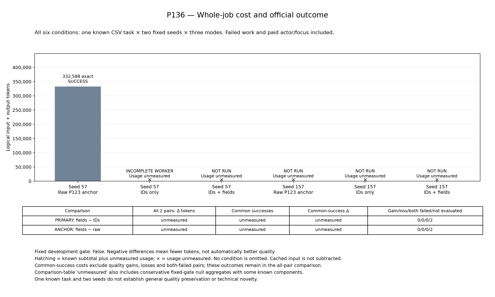
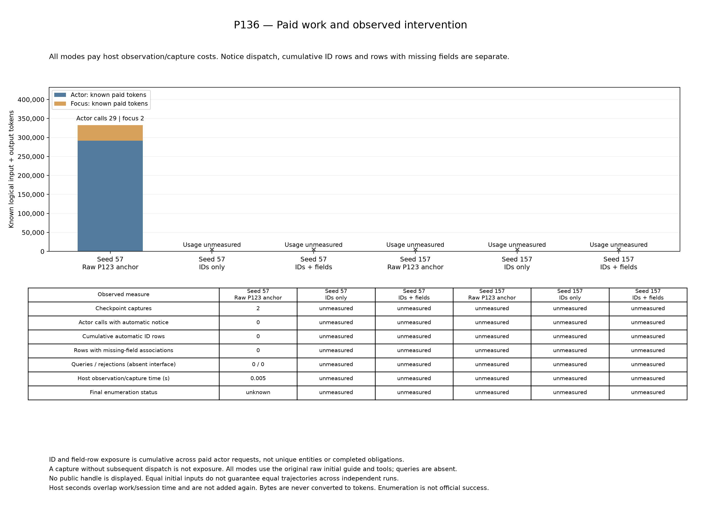

# P136：予定6条件を保持して停止、方式間比較は未成立

P136は既知CSV1課題・固定seed57/157の6条件を予定したが、raw seed57の評価後、IDs-only seed57のworkerが完了記録を残せず停止した。評価完了は1件、worker未完1件、未実施4件である。所有processと集計を閉鎖し、予定6行をすべて公開した。**全6条件を実行・評価できたという意味の閉鎖ではない。**

評価済みraw seed57は成功し、全仕事費用は332,588 logical tokensだった。主比較とraw対照の費用差・成功喪失・共通成功比較はいずれも判定不能で、固定採用gateは**false**。この未完比較からfield追加の有効性や相対性能による棄却を結論しない。

[全6予定行CSV](../../materials/20261027_p136_results/conditions.csv)／[元集計JSON](../../materials/20261027_p136_results/summary.json)／[資料入口](../../materials/20261027_p136_results/publication_index.md)／[元監査](../../reports/P136_comparison.json)／[独立検算の公開投影](../../reports/P136_closed_independent_audit_20261027.json)。

## 予定・評価・欠測

| seed | 方式 | 元記録の状態 | 公式成功 | 認証済みlogical tokens | model／API |
|---|---|---|---|---:|---:|
| 57 | raw anchor | evaluated | true | 332,588 | 31／76 |
| 57 | IDs only | incomplete_worker | null | null | null／null |
| 57 | IDs + fields | not_run | null | null | null／null |
| 157 | raw anchor | not_run | null | null | null／null |
| 157 | IDs only | not_run | null | null | null／null |
| 157 | IDs + fields | not_run | null | null | null／null |

rawは予定2件中1件を評価し、その1件が成功した。IDs-onlyとIDs＋fieldsは各予定2件とも公式評価未完了であり、0/2失敗と分類しない。1つの既知課題の条件比較であり、6独立課題ではない。

認証済み費用小計は入力319,446＋出力13,142＝332,588 tokensで、これはraw seed57の1件だけからなる。cached input235,825を差し引いていない。元summaryの`recorded_unknown_usage_calls=0`と`unknown_usage_count_missing_conditions=5`を併記する。前者は報告された1件の値であり、全6件の使用量既知を意味しない。全条件の正確な総費用、model/API総数はnullである。

IDs-onlyとfieldsの集約に現れる既知小計0は「報告可能な条件が0件の和」であって、実際の処理費用0の測定ではない。途中workerの保存usageを調べる別診断は、公式評価と全仕事会計を伴う元表へ無断で足さない。未完・未実施のnullを0へ補完しない。

## 固定比較と機構の測定範囲

| 比較 | 評価済みpair | 成功喪失 | 共通成功pair | 全条件token差 | 共通成功token差 |
|---|---:|---|---|---|---|
| 主比較：fields − IDs | 0／2 | null | null | null | null |
| 補助比較：fields − raw | 0／2 | null | null | null | null |

元gateは全6条件の評価・既知費用、両対照への成功喪失なし、主比較全体と共通成功での削減、raw全体に対する削減、主比較の共通成功上でのfield行露出を要求した。[固定仕様](P136_whole_task_late_obligations.md)は結果後に変更していない。欠測で全件契約条件も満たさず、`mechanism_contracts_intact=false`になっている。これだけでfield機構の意味保存違反を実証したとはしない。

認証済みraw seed57ではcheckpoint/capture各2回、actorへの通知・ID行・field行・queryは各0。rawは表示しない対照なので、この0を候補機構の不適用と呼ばない。残り5行の機構計数は未認証または未実施のnullを保ち、全方式の表示行が0だったとは断定しない。capture、実actor露出、累積ID行、fieldを含む行を別々に扱う。

全方式の初期guide/toolsは元raw interfaceと同じで、新query・公開handleを追加しない。採用されたcheckpoint後のみ次actorへ一度提示する。同じclosed pending-ID列を条件に同じprefixを選び、fields側だけ不足fieldを添える設計である。これは独立runの実ID列が同一だったという測定結果ではない。累積表示行はunique entity数ではなく、観測field完備は公式課題成功の代わりではない。

通知JSON bodyは最大2,048 UTF-8 bytesで、改行を含む固定heading43 bytesを別途加える。追加system contentの上限は2,091 bytesとなる。HTTP全payloadやtoken数の上限ではない。headingを含む全message viewをnative count・admission・実送信に使用し、表示費用を全仕事費用から控除しない。元builder READMEのbytesは保存し、この補足で上限の範囲を明確にする。

## 閉鎖と記録の限界

2026-10-27 10:46:31 JSTに開始し、11:42 JSTにbatch/pipelineが停止した。元pipeline終了値1、所有server停止、audit/session/reportは0/0/0、collector完了、独立検算57,099項目PASS、図生成完了を確認した。PASSは予定6行・失敗・欠測・会計境界を整合して保持できたことを示し、全条件評価や方式採用を意味しない。元producerによる履歴再構成と共通monitor/encoderへの依存も残る。

[未完workerの限定診断](../../reports/P136_incomplete_worker_public_20261027.json)は保存された18件の正常終端usageとraw responseを照合し、既知小計223,145 tokens（actor16回・focus2回）を確認した。第19要求にはclientの送信試行記録があるが、終端usageは欠測で、server受理や最終生成量を確定しない。保存イベントに含まれる送信済みAPI要求は47件だった。rawの認証済み332,588と別診断223,145の和555,733は補助的な既知小計に限られ、元cohortの認証済み小計や全仕事費用を置き換えない。

同診断では2 captureがclosed・taintなしだった。第1通知の16 ID行は正常終端記録と保存viewがある。第2通知も保存要求内に16 ID行を持つが、終端usageと最終viewがなく、同じ確度の有料露出として加算しない。API prefix全体の再認証はしておらず、formatterもproducerと共有する。pending数の減少は公式課題成功ではない。

固定driverにSIGALRM handlerがなく、production transportがSIGALRMを設定する経路を確認した。同sourceの手書き再現ではhandlerなしでsignal終了・終端記録なし、handlerありで例外処理・記録保存へ進んだ。これは実停止と整合する再現済みのsource上の機序である。ただし実workerの終了signal値は保存されておらず、実際にSIGALRMで終了したことを直接観測したとは書かない。元worker失敗・null・gateは遡及修正せず、復旧比較は別namespaceと有限仕様で扱う。

[rootの閉鎖解釈と別cleanup確認](../../reports/P136_closed_root_interpretation_public_20261027.json)では、元sessionのactive/removal-false記録を残したまま、所有ラベル・固定image・IDを確認した既に終了済みのcontainerだけを1回除去した。最初のabsence判定は不確定として保存し、後のexact-ID一覧で不在を別確認した。これを元workerの正常cleanupへ読み替えない。

[事前固定first-notice診断の公開投影](../../reports/P136_first_notice_diagnostic_public_20261027.json)は閉鎖後に一度実行され、診断エラー0だが両seedの主pairはunavailable、`all_six_accounted=false`だった。診断処理の完了と比較成立は別であり、field情報・因果効果・新規性の支持にはならない。追加model/API/tokenizer/evaluatorと保存生成code実行は0。

実行head `e65fa22d32bd63e80005e7bf807b2c91624e6824`、plan SHA `ff442f59f9012af6932974469fc5b2fbcb08afc3e8dd9cba4a480a9cc5f36f6a`、1,527 source、開始194台帳/2,389束縛を維持した。開始記録公開後の195/2,401を実験開始へ遡及しない。[開始記録](P136_execution_start_20261027.md)はその時点の事実として保存する。

## 既閉鎖P135の補足は別証拠

[P135 rawのAPI上限診断](P135_raw_API_frontier_public_note_20261027.md)と[公開集約](../../reports/P135_raw_API_frontier_public_20261027.json)、[限定root review](../../reports/P135_raw_API_frontier_public_root_review_20261027.json)を追加した。P135 raw157の80 API/action・返却・状態・callと10 program sourceは旧P122の閉鎖軌跡と一致し、その範囲の既存診断を再利用できる。同じ軌跡を独立反復として加算しない。

これはP136の軌跡・効果を示す証拠ではない。元P135 findings/ledgerは変更せず、値・認証引数・program本文・private request hashを公開しない。既存API反復やID不一致を、無条件に新規性・token削減・品質保持の根拠へ転用しない。

## 図と公開来歴

図の未測定記号と比較表のnullを0削減と読まない。比較表の`unmeasured`には、既知成分があっても固定判定として集約差がnullである場合を含む。PNG/SVG/PDF、元README、CSV/JSONは同bytesコピーし、実験・監査・図生成を公開時に再実行していない。[copy manifest](../../reports/P136_results_copy_manifest_20261027.json)と[公開provenance](../../reports/P136_results_provenance_20261027.json)に依存hashを残す。

原稿本文はユーザーが作成する。新規性、一般的な品質維持、レター採択は未確立である。[引継ぎ後の結果一覧](../closed_results_index_20261027.md)は元の時点を保持し、この別資料へ接続する。
