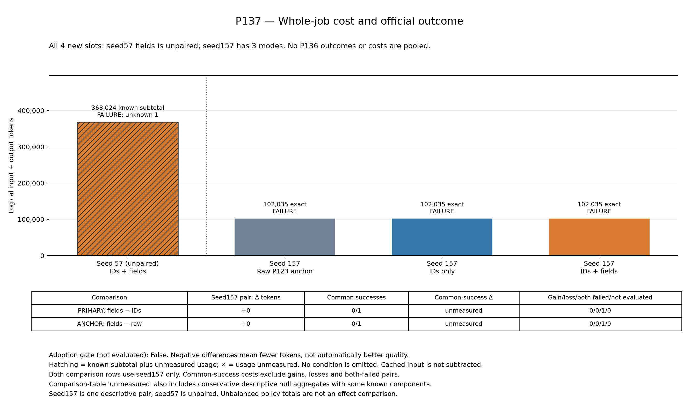
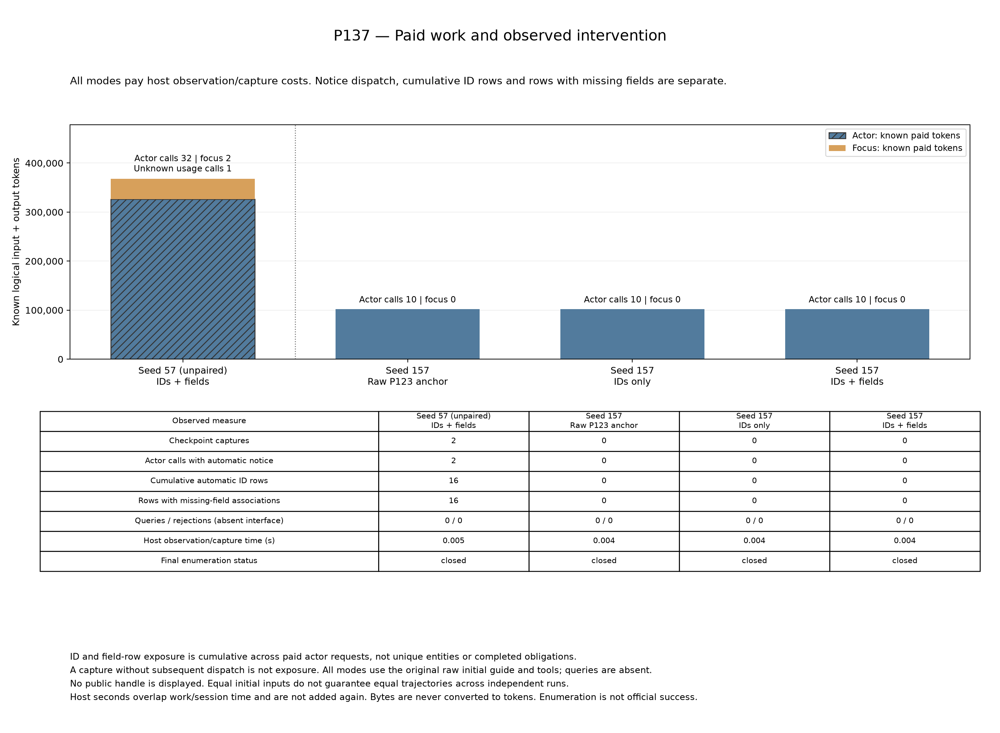

# P137：未実施4条件を追加観測、全4件失敗で技術効果は未支持

P137は、P136で未実施だった既知CSV1課題の4条件だけを別cohortで観測した。**全4件を公式評価まで閉鎖したが成功は0件。** seed157の3方式は各102,035 logical tokensで、主比較とraw対照の差は0。いずれも双方失敗で共通成功は0組のため、共通成功上の費用差はnullである。seed57のfieldsは対照のない単独結果で、368,024既知tokensにunknown 1呼出しが残った。

`development_gate_met=false`、`scientific_adoption_evaluated=false`は、この不均衡な追加観測では採用判定を行わないという事前固定値である。それ自体を観測失敗の証明とはしない。一方、公式成功0件と主比較で通知未到達という結果から、今回の新技術の有効性を支持する証拠は得られなかった。

[全4行CSV](../../materials/20261027_p137_results/conditions.csv)／[元集計JSON](../../materials/20261027_p137_results/summary.json)／[資料入口](../../materials/20261027_p137_results/publication_index.md)／[元監査](../../reports/P137_comparison.json)／[独立検算の公開投影](../../reports/P137_closed_independent_audit_20261027.json)。

## 全予定行と費用

| seed | 方式 | 状態／公式成功 | logical tokens | model／API | capture／通知／累積ID行／field行 | 停止理由 |
|---:|---|---|---:|---:|---:|---|
| 57 | IDs＋fields | evaluated／false | 368,024既知＋unknown 1 | 34／71 | 2／2／16／16 | model呼出し中のwall上限 |
| 157 | IDs＋fields | evaluated／false | 102,035確定 | 10／80 | 0／0／0／0 | API上限 |
| 157 | IDs only | evaluated／false | 102,035確定 | 10／80 | 0／0／0／0 | API上限 |
| 157 | raw anchor | evaluated／false | 102,035確定 | 10／80 | 0／0／0／0 | API上限 |

全4条件の認証済み既知小計は入力646,903＋出力27,226＝674,129 tokens。記録済unknownは1呼出し、usage件数欠測条件は0で、厳密総費用はnullである。model64要求、API311要求、公式評価4件を保持する。cached input497,206を控除せず、actor/focus・失敗・通知の費用を残す。既知小計を全仕事の確定総費用と呼ばない。

seed57はactor32要求・focus2要求、checkpoint採用とcaptureは各2回、通知は2 actor要求に含まれた。累積ID行16、field対応を含む行16は、各通知が16行だった意味でも、unique entity数でも、完了した義務数でもない。queryは全4条件で0。seed157は3方式ともcheckpoint/capture/通知が0のままAPI80で停止したため、field追加の直接比較は発動していない。

## 比較範囲と解釈

| 同P137 seed157の比較 | 評価・既知pair | 品質遷移 | 全pair token差 | 共通成功pair | 共通成功token差 |
|---|---:|---|---:|---:|---|
| 主：fields − IDs | 1／1 | 双方失敗 | 0 | 0 | null |
| 補助：fields − raw | 1／1 | 双方失敗 | 0 | 0 | null |

成功喪失0は、両方失敗したこの1組の状態を表すに留まり、成功維持の実証ではない。元auditの空quality groupにあるtoken差0は空和の帳簿値で、空の共通成功群における効果0の測定ではない。正式な`paired_successful_token_difference`のnullと、図の`unmeasured`を保持する。

seed57 fieldsは単独であり、seed157のpairへ混ぜない。方式別総和はraw1件、IDs1件、fields2件と不均衡なので、その総和同士を効果比較に使わない。P136の評価済みraw57・中断IDs57、元6行・null・gate falseを置換せず、別補足223,145 tokensもP137へ加算しない。`prior_results_pooled=false`、`original_P136_gate_replaced=false`を維持する。

初期guide/toolsは全方式とも元raw interfaceで、新queryや公開snapshot handleを追加しない。採用checkpoint後の次actorだけに表示し、同じclosed pending-ID列を条件に同じprefixを選び、fields側だけ不足fieldを添える設計である。独立runの全軌跡や実ID列の一致を無条件に仮定しない。

通知JSON body上限は2,048 UTF-8 bytesで、固定heading43 bytesを加えた追加system content上限は2,091 bytes。HTTP全payloadやtoken上限ではない。heading込みの全message viewをnative count/admission/sendに使い、その費用を控除しない。元builder READMEは同bytesで保持し、この範囲説明を別に補う。

## field完備後に残った作業の限定補足

[seed57の保存記録による補足](../../reports/P137_seed57_field_completion_gap_20261027_v02.json)では、2回目captureで対象72件のtitle/artistsが72件とも観測済み、pending0・taintなしだった。続く通知call023は実dispatchと既知の終端usageを持つが、ID/field行の表示は0。field完備を通知していても、公式課題成功を主張したpacketではない。

その後の保存11 programは正常6・実行error5で、送信済みAPI要求11件（returned7・raised4）と未送信拒否1件を含む。対象のfile create/updateとaccount deletionの送信は0件で、file-serviceの調査・認証・directory操作が続き、call034のmodel wall上限で終端usageがunknownになった。5errorは提示schema外toolの未送信拒否1、token欠如/不正と報告されたHTTP401が3、login認証拒否401が1で、認証値・原文・さらに具体的な原因は公開・推定しない。

これは必要metadataの観測完備と、出力作成・アカウント処理の完了が別であるという保存記録上の隔たりを示す。directory APIのreturnedをdirectory存在や部分目標の成功へ読み替えない。限定API記録と11 ASTに基づくため任意のfilesystem作用が一切なかったという一般証明ではなく、私有推論・評価本文・DB状態は読んでいない。元の失敗・unknown・費用を変更せず、追加費用を計上する診断でも、新方式の因果効果の証明でもない。

## 閉鎖後のprefix補足

[事前固定診断の公開投影](../../reports/P137_first_notice_prefix_public_20261027.json)は閉鎖後に一度実行され、診断エラー0、追加model/API/tokenizer/evaluator・保存生成code実行0だった。元cohortの費用・成否は変更していない。

同P137のseed157主2方式は、保存された全10要求のbytes/payloadが一致し、通知はどちらにもなかった。保存responseやassistant completionの厳密一致はfalseで、opaque tool-call IDを含む差を正規化した意味的同値の証明ではない。通知がないため、first-noticeでfield差の効果を観測したとはしない。raw157はこのprefix診断の対象外だが、正式4行には保持する。

別cohortのP136未完IDs57とP137 fields57の探索的照合では、通知前13要求のbytesが一致し、最初の通知は両方call14だった。通知を除いたbase payload、descriptor、選択ID prefix、選択metadataは一致し、通知bodyは異なった。ただし保存assistant/responseは厳密一致せず、worker timeout入口も別で、厳格なprefix一致と因果差位置の支持はfalse。P136のcall019終端unknown、公式成功null、厳密費用nullはそのままで、P137 seed57をpaired比較へ変更しない。

その限定された最初のsnapshotはpending47、missing title44、missing artists47、選択16行だった。固定field文法・counts・同じordered IDsだけに条件付けると、全体への対応付けは16,215通り、選択prefixのmask列は697通りで、16 field行を条件に残る全体対応付けは31通りだった。これは制限された組合せ計数であり、全model履歴が持つ情報、確率分布、entropy、情報利得、意思決定の有用性、品質・token効果を測っていない。単独fields57の失敗とunknownを打ち消す根拠にはしない。

## 閉鎖・図・来歴

2026-10-27 12:29:26 JST開始、13:18:40 JSTにbatch完了。元pipeline/audit/session/reportの終了値は0/0/0/0、所有process不在、collector完了、固定独立検算46,808項目PASS、図生成完了を確認した。監査PASSは会計・全4行・unknown・境界の整合を示し、方式採用や意味保存の一般証明とは別である。履歴再構成は固定producer監査、notice encoderと公開monitorは共通実装への依存を残す。

実行head `a6c088f8f382521010ff264ffe22f52d2146314e`、plan SHA `9b8b020c83bf1d996b4d977a628831c46da4d7a0e469a3cf2b8f0e18916720f1`、1,547 source、開始196台帳/2,433束縛を保持した。公開時の198/2,458を開始時点へ遡及しない。[固定仕様](P137_remaining_late_obligations.md)と[開始記録](P137_execution_start_20261027.md)も不変である。

元v01の18ファイルはすべて同bytesコピーし、元renderer・producer・独立監査は再実行していない。上のv02は同じfigure_dataを使い、paid-work図のlegendを左上から右上へ移しただけの別layout版である。元v01も[そのまま保持](../../materials/20261027_p137_results/figures/README.md)し、[v02検証](../../reports/P137_layout_v02_verification_20261027.json)に原図不変・同data・変更箇所を残す。科学値・軸・比較は変更していない。

[copy manifest](../../reports/P137_results_copy_manifest_20261027.json)／[公開provenance](../../reports/P137_results_provenance_20261027.json)で依存を結ぶ。[旧結果一覧v02](../closed_results_index_20261027_v02.md)は9cohort・68予定という元時点を保持し、このP137追加観測は別資料である。原稿本文は書かず、追加seedや同条件再実行でこの結果を救済しない。新技術の成功保持・全仕事token削減、新規性、一般化は未確立である。
