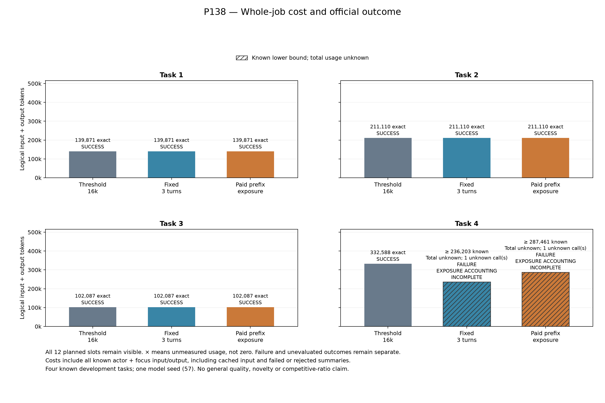
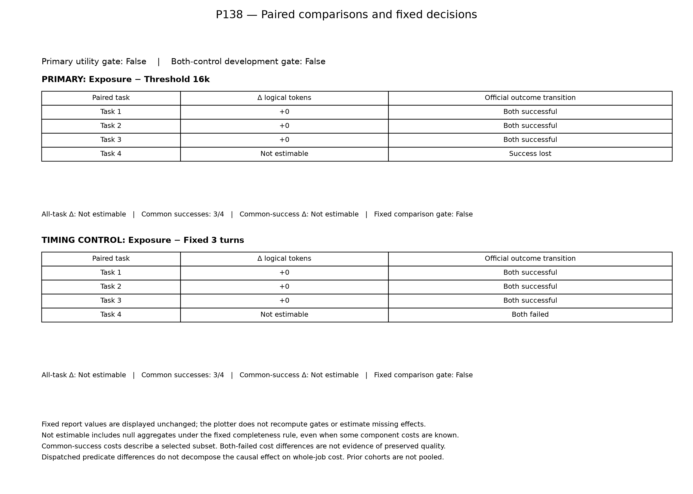

# P138：再要約の時点は変わったが、成功保持と全仕事の削減は不成立

既知4課題・model seed57で、通常の16k閾値、固定3turn、累積raw-prefix再提示量による再要約を全12条件で比較した。**通常方式は4/4成功、固定間隔と提案方式は各3/4成功。提案方式は通常方式の成功を1件失った。** 共通して成功した3課題では、各課題の費用差も実dispatchを伴う判断差も0だった。今回の候補を、精度を維持してトークンを削減する方式として採用しない。

2つの失敗条件はmodel呼出し中に作業時間上限へ達し、終端usageが各1件不明である。既知小計が低いことを削減効果とは扱わず、固定された主gateと両対照gateのfalseを保持する。これは4既知課題・単一seedの開発結果であり、一般的な品質維持や新規性の成立を示さない。元READMEの「unmeasured timing control」はP138開始前の位置づけであり、固定間隔対照も今回の12条件で測定した。

[全12行CSV](../../materials/20261027_p138_results/conditions.csv)／[元集計](../../materials/20261027_p138_results/summary.json)／[資料入口](../../materials/20261027_p138_results/publication_index.md)／[元監査](../../reports/P138_comparison.json)／[独立検算](../../reports/P138_closed_independent_review_20261027.json)。

## 全予定条件

全12件を公式評価した。tokensは全roleの論理入力＋出力で、cached inputも含む。「既知＋不明1」は下界であり、確定総費用ではない。

| 課題 | 方式 | 成功 | logical tokens | model／API要求 | 採用要約数 |
|---|---|---|---:|---:|---:|
| 34d9492_1 | 16k閾値 | true | 139,871確定 | 17／102 | 1 |
| 34d9492_1 | 固定3turn | true | 139,871確定 | 17／102 | 1 |
| 34d9492_1 | 累積再提示量 | true | 139,871確定 | 17／102 | 1 |
| 3c13f5a_1 | 16k閾値 | true | 211,110確定 | 24／25 | 0 |
| 3c13f5a_1 | 固定3turn | true | 211,110確定 | 24／25 | 0 |
| 3c13f5a_1 | 累積再提示量 | true | 211,110確定 | 24／25 | 0 |
| 60d0b5b_1 | 16k閾値 | true | 102,087確定 | 13／13 | 0 |
| 60d0b5b_1 | 固定3turn | true | 102,087確定 | 13／13 | 0 |
| 60d0b5b_1 | 累積再提示量 | true | 102,087確定 | 13／13 | 0 |
| 6104387_1 | 16k閾値 | true | 332,588確定 | 31／76 | 2 |
| 6104387_1 | 固定3turn | false | 236,203既知＋不明1 | 22／41 | 2 |
| 6104387_1 | 累積再提示量 | false | 287,461既知＋不明1 | 28／76 | 2 |

通常方式の4行はすべて費用既知で、小計785,656 tokens。固定間隔は既知689,271＋不明1、提案方式は既知740,529＋不明1である。元集計の`total_tokens_by_mode`は全12件の完全性を要求するため、通常方式を含め全方式nullのまま保持する。上の行単位の完全性と、固定集計欄の完全性規則を混同しない。

全cohortは入力2,133,884＋出力81,572＝既知2,215,456 tokens、記録済unknown2呼出し、usage件数欠測条件0。model243要求、API613要求、評価12件。actor233要求の既知費用2,030,621とfocus10要求の既知費用184,835を含み、未採用要約と失敗末尾も除かない。cached input1,637,699を控除しない。全仕事の確定総費用はnullである。

## 対応比較と固定判定

| 提案方式の対照 | 成功喪失 | 共通成功 | 各共通成功課題のtoken差 | 全課題／共通成功の固定集計差 | gate |
|---|---:|---:|---|---|---|
| 16k閾値 | 1 | 3 | 0、0、0 | null／null | false |
| 固定3turn | 0（残る1組は双方失敗） | 3 | 0、0、0 | null／null | false |

元比較の共通成功集計も、全4pairの費用既知という固定条件を満たさないためnullである。独立検算の別記述では共通3課題の費用は各方式453,068・差0と加算できるが、固定集計のnullを置換しない。共通成功上の実判断差は0であり、未知費用だけを補えば提案の効用が成立する結果でもない。過去P123の対照や他cohortを合算していない。

## 判断時点と失敗機序の範囲

課題6104387_1の初回focusは全方式で通算call12の後。次のfocusは固定間隔がafter16、提案方式がafter19、通常方式がafter22で、固定間隔だけafter20にも3回目を送った。番号はactorとfocusを含む通算model要求番号で、fresh actor turn数そのものではない。

提案方式の実dispatchを伴う判断差は、同課題で通常方式に対して1回、固定間隔に対して8回だった。成功した3課題では0回。これは実現した履歴上の判断と次要求の対応を表し、他方式の反実仮想rolloutや費用差の因果分解ではない。

通常方式と提案方式の有料focusは各2回で、既知focus費用は41,075対38,370 tokens。提案の2回目は16,951、通常の2回目は19,656だった。したがって提案の失敗を「要約回数や要約tokenだけが増えたため」とは説明できない。固定間隔は有料focus3回・採用2回で、採用記録のない最後の15,224 tokensも費用へ含む。要約する位置、作成された要約、その後の生成・行動軌跡、時間上限の寄与はこの比較だけでは分離されない。

Eは、既知有料actor入力から新たに要約可能なraw prefixだけを除いたnative count差の正部分累積である。Cは直前の有料focusの入力＋出力実費。未知2呼出しはE/Cへ代入せず、その時点で停止した。構造契約違反は0だが、失敗2条件の露出会計は不完全のまま残す。全方式に共通の追加native計数は33回で、その制御時間は作業時間の内数。Eを将来の実現可能な節約額や、次回費用の上界と解釈しない。

## 技術差と次の判断

費用を考慮する適応的圧縮や、要約費用を含めた節約会計自体は既存である。[SelfCompact](https://arxiv.org/html/2606.23525v1)、[StateComp Appendix E.4](https://arxiv.org/html/2609.27298v1)、[TurnCost §3.3](https://arxiv.org/html/2610.15093v1)との相違を、具体的な起動規則の範囲で考える必要がある。追加確認した[Hermes](https://github.com/NousResearch/hermes-agent/blob/main/website/docs/developer-guide/micro-compaction.md)には周期的圧縮、[LangWatchの著者分析](https://langwatch.ai/blog/context-tax-when-to-compact)には実測費用に基づくcontext-size閾値の検討がある。

今回確認した資料の範囲では、過去のnative削除差の正部分Eを直前の実費Cと比較する同一規則は確認できなかった。ただし全実装・初出・優先性を確認したものではなく、不在証明や新規性の成立ではない。今回の開発比較では、その規則による成功保持と費用削減も支持されなかった。

保留12課題をこの候補の救済に使わない。同条件の完了までの再試行やseed探索で今回の失敗を置換しない。次は保存資料を用いて要約表現と後続動作を切り分け、追加実験が識別する差と有限条件を別に固定する。旧要約保持＋delta追加などの表現比較は検討段階で、既存のincremental memoryに近く、それ自体を新技術と断定しない。原稿本文はユーザーが執筆する。

## 閉鎖と検証

2026-10-27 14:31:09 JST開始、17:09:07 JSTに全12条件と閉鎖処理を終了。pipeline/audit/session/reportは0/0/0/0、所有process不在、元audit errors0。固定head `919b34e9c1a50729bbd83527263e21a407b04499`、plan SHA `52ef2cbf864a581f4f3b93500d961f982a5a19b3e40ffb818df8225f487669cb`、1,563 sourceを保持した。開始199台帳/2,497束縛と、結果公開前200台帳/2,516束縛を区別する。

独立検算15,073照合はPASS。保存dispatch・usage台帳・hash・E/C算術・判定差・固定gateの整合確認であり、native tokenizer、メッセージ再構成、summary意味保存、評価器やDB状態の独立再検証ではない。原producerは再実行していない。独立検算の初回はsystem Pythonの互換性で失敗し、同じ検算sourceを既存Python3.12環境で実行した来歴と初回logを保持した。[検算来歴](../../reports/P138_closed_independent_review_execution_lineage_20261027.json)。

元10資料と図7資料は同bytesを保持した。図は全12枠・失敗・unknown下界・固定nullを表示し、PNG2枚を目視確認した。[元資料copy manifest](../../reports/P138_results_copy_manifest_20261027.json)／[図の確認](../../reports/P138_actual_figures_review_20261027.json)。過去の閉鎖結果一覧は元時点の範囲を保持し、このcohortを遡及加算しない。
