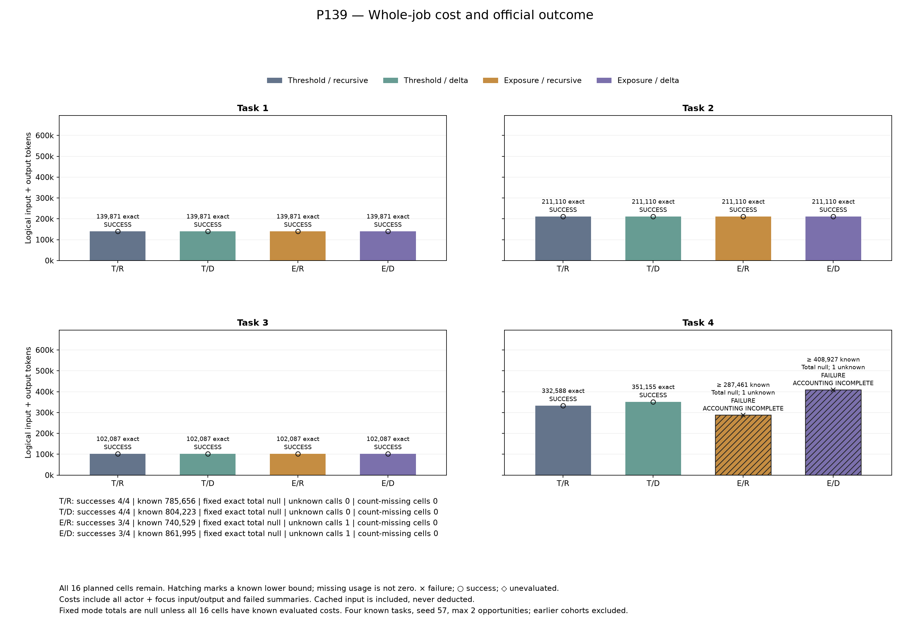
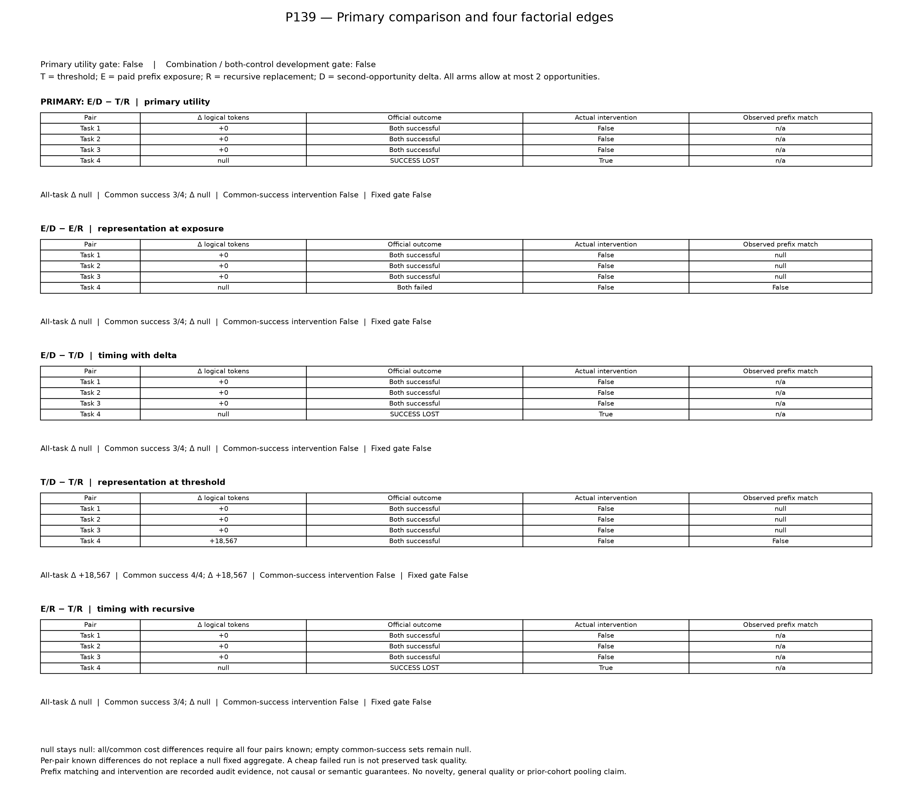

# P139：再要約時点と差分保持の16条件比較は、成功維持と削減を支持しなかった

既知4課題・model seed57で、再要約時点2方式と第二要約表現2方式を組み合わせた全16条件を公式評価した。**通常の閾値＋再帰要約は4/4成功、閾値＋差分保持も4/4成功だが18,567 tokens増加。累積再提示量による時点制御は、再帰要約・差分保持とも3/4成功だった。** 全5比較と組合せの固定採用基準はfalseであり、今回の候補を「品質を維持して全仕事のトークンを減らす新手法」として採用しない。

これは既知課題・単一seedの開発結果である。原稿の結果表と限界の材料には使えるが、肯定的な効用、新規性、一般的な品質維持、採択可能性の確立とは区別する。原稿本文はユーザーが執筆する。

[全16条件CSV](../../materials/20261027_p139_results/conditions.csv)／[全20対応行CSV](../../materials/20261027_p139_results/pairs.csv)／[元監査](../../reports/P139_comparison.json)／[資料入口](../../materials/20261027_p139_results/publication_index.md)。

## 全予定条件の費用と成功

費用はactorとfocusを含む全roleの論理入力＋出力で、cached inputも控除しない。失敗、未採用要約、時間上限直前の呼出しも除かない。「既知＋不明」は確定総費用ではない。

| 再要約時点／第二表現 | 成功 | 既知token小計 | usage不明呼出し |
|---|---:|---:|---:|
| 16k閾値／再帰要約（T/R） | 4/4 | 785,656 | 0 |
| 16k閾値／旧要約保持＋delta（T/D） | 4/4 | 804,223 | 0 |
| 累積再提示量／再帰要約（E/R） | 3/4 | 740,529 | 1 |
| 累積再提示量／旧要約保持＋delta（E/D、主候補） | 3/4 | 861,995 | 1 |

最初の3課題は全方式で成功し、課題ごとの費用も139,871、211,110、102,087で一致した。比較する実介入は起きていない。残る課題6104387_1が次の結果だった。

| 方式 | 成功 | logical tokens | model／API要求 | 採用checkpoint | 採用delta／deltaを受けた既知actor要求 |
|---|---|---:|---:|---:|---:|
| T/R | true | 332,588確定 | 31／76 | 2 | 0／0 |
| T/D | true | 351,155確定 | 32／77 | 2 | 1／9 |
| E/R | false | 287,461既知＋不明1 | 28／76 | 2 | 0／0 |
| E/D | false | 408,927既知＋不明1 | 31／74 | 1 | 0／0 |

失敗2条件はmodel呼出し中に作業時間上限へ達し、それぞれ最後のactor usageが不明だった。全16条件は入力3,086,271＋出力106,132＝既知3,192,403 tokens、unknown2呼出し、usage件数欠測条件0。model338要求（actor326＋focus12）、API863要求、評価16件。cached input2,415,390を費用から引かない。

元集計の`total_tokens_by_mode`は全16件の使用量既知を要求するため、全方式nullのまま保持する。T/RとT/Dの行単位の確定小計と、この固定集計の完全性規則を混同しない。全cohortの確定総費用も不明である。

## 固定された5比較

| 対照 → 候補 | 成功喪失 | 共通成功課題数 | 全課題／共通成功の固定token差 | gate |
|---|---:|---:|---|---|
| T/R → E/D（主比較） | 1 | 3 | null／null | false |
| E/R → E/D（E時点内の表現比較） | 0（第4課題は双方失敗） | 3 | null／null | false |
| T/D → E/D（delta内の時点比較） | 1 | 3 | null／null | false |
| T/R → T/D（閾値内の表現比較） | 0 | 4 | +18,567／+18,567 | false |
| T/R → E/R（再帰要約内の時点比較） | 1 | 3 | null／null | false |

T/Dの増加は4課題合計で+2.36%、第4課題では+5.58%。第二focusだけは19,656から18,737へ919 tokens減ったが、actor費用は19,486増え、全仕事では18,567増えた。局所の要約費用減少を、全仕事の削減として扱わない。

その他4比較では、共通成功3課題の記述的な小計は各453,068、差0である。しかし固定集計は全4pairの使用量既知を前提とするため、そのnullを0へ置換しない。過去P123、P133、P138等の対照を合算していない。

## 表現比較の帰属と限界

第4課題のT/Dではdeltaが1回採用され、9回の既知actor要求に渡った。ただしT/Rとの厳密な介入前prefix照合はfalseだった。図・元比較の`Actual intervention=False`は、**delta送信に加えてprefix一致も必要とする比較用の判定**であり、deltaが一度も送られなかったという意味ではない。したがって18,567の増加をdelta表現だけの因果効果として分離できない。

同じ時点方式内では、それまでの要求SHA列と最初のcheckpointは一致した一方、assistant message SHAは閾値の21/22件、累積再提示量の18/19件で不一致だった。本文を読んでいないため、差が不透明なIDだけか意味内容にも及ぶかは未判定である。結果を見た後の正規化で固定prefix不一致を一致へ変更しない。

E/Dでは第二focusへ17,079 tokensを支払ったが、auditには第二採用の記録がなく、実際のdelta配信も0だった。第二の`checkpoint_decided`・`accepted`・`reason`は収録されておらず、採用に至らなかった具体的理由はこの公開auditから特定できない。E/Rとの`all_activated_representation_prefixes_match=true`は対象となるdelta介入がないときの真であり、一致した表現比較の証明にはならない。組合せの救済効果も認められない。

Eは既知の有料actor入力から新たに要約可能なraw prefixを除いたnative count差の正部分累積、Cは直前の有料focusの入力＋出力実費である。E≥Cによる時点変更は第4課題で発動したが、共通成功3課題には判断差がなかった。Eは将来の実現節約額でも、Cは次回要約費用の上界でもない。構造契約違反は0だが、失敗2条件の会計は不完全のまま保持する。

## 閉鎖、独立検算、途中閲覧の開示

2026-10-27 18:22:59 JST開始、21:51:44 JSTに全16条件とpipeline/audit/session/reportを終了（全stage exit0）。21:52:06 JSTに一回限りの独立検算と作図を終了した。所有process不在を確認し、実験・評価・元集計・rendererの再実行はしていない。固定headは`a203874f0fafbaa76f76cfab3603eb43c623916f`、plan SHAは`e05b7a0fc0128d972cc2a63afe013fd21d28127c3a74ef9632918b2586b17657`、sourceは1,617件。実験開始201台帳/2,545束縛と、結果公開前202台帳/2,563束縛を区別する。

[独立検算の公開用射影](../../reports/P139_closed_metadata_review_20261027.json)は27,230照合PASS。[別担当による数値確認](../../reports/P139_closed_scientific_metadata_peer_20261027.json)は1,107照合PASS。[図表確認](../../reports/P139_actual_figures_review_20261027.json)は1,483照合と実際のPNG/PDFの確認を記録する。これらは保存済みのusage・dispatch・hash・固定判定の整合確認であり、native tokenizer、生成意味、評価器、DB状態の独立再検証ではない。検算PASSは科学的採用基準のPASSではない。

**19:44:59 JST、root担当者が進捗表示を誤って広く出力し、完了9条件の成否とusageを全体閉鎖前に閲覧した。** 生成本文は読んでいない。担当者はこれを受けたsource・計画・順序・予算・再試行の変更はしていないと報告しているが、継続的な非適応の独立証明ではない。[開示記録](../../reports/P139_interim_exposure_disclosure_20261027.json)を保持し、rootが全期間盲検だったとは主張しない。自動wrapper等の未閲覧flagは当該processの範囲だけを示す。

## 原稿に使える範囲と次の判断

保存済み資料は、時点制御と差分保持を組み合わせても今回の開発比較で成功維持・削減を満たさなかったこと、局所の要約節約と全仕事の費用が一致しなかったことの根拠になる。これは限定的な否定結果であり、手法一般の無効性を示すものでもない。

費用を考慮する適応的圧縮やincremental memory自体は既存である。[先行方式との限定比較](../../reports/P139_method_prior_scope_20261027.json)は今回確認した資料・箇所と未確認範囲を記録している。同じE/C規則がその箇所で見つからなかったことを、初出や新規性の証明にはしない。4方式の採用基準も統計的な交互作用検定ではない。

保留12課題は未読のまま維持する。この結果を成功するまでの再試行、seed探索、使用量不明の補完で置換しない。追加実験は、保存metadataと実装から変更理由・識別したい差・対照・有限予算を別に定めてから開始する。本結果の閉鎖は研究全体の完了を意味しない。

