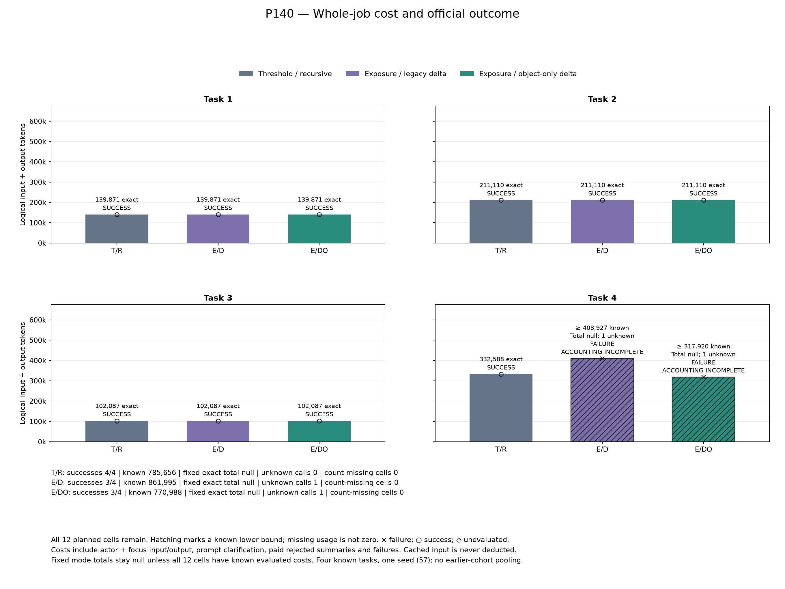
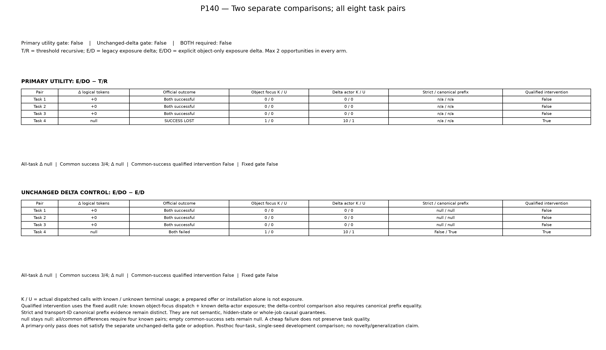

# P140：delta の object 出力指定は配信に到達したが、成功維持と全仕事の削減を満たさなかった

既知4課題・model seed 57・3方式の全12条件を公式評価した。**通常の閾値＋再帰要約（TR）は4/4成功、未変更の累積再提示量＋delta（ED）と、第二focusに「delta JSON objectのみ」を明示した候補（EDO）はともに3/4成功だった。** 主比較、未変更delta対照との比較、両対照を要求する採用gateはすべてfalseである。今回の結果は、候補が品質を維持して全仕事のトークンを減らしたという主張を支持しない。

EDOは第4課題で第二deltaの採用とactorへの配信に到達した。しかし、その課題は時間切れで失敗し、最終actor usageが不明だった。最初の3課題では変更対象の介入が発動せず、方式間の費用も一致した。非発動の成功を、変更機構の有効性の証拠として数えない。

[全12条件CSV](../../materials/20261028_p140_results/conditions.csv)／[全8対応行CSV](../../materials/20261028_p140_results/pairs.csv)／[元監査](../../reports/P140_comparison.json)／[結果資料索引](P140_results_20261028_index.md)。本資料は結果・設定の参照資料であり、原稿本文はユーザーが執筆する。

## 全予定12条件

費用はactorとfocusを含む全roleの論理入力＋出力tokensで、cached inputを控除しない。失敗と採用されなかった有料focusも含む。「既知＋不明」は確定総費用ではない。全12条件が評価済みで、未実施・usage件数欠測は0、usage不明呼出しは2件だった。

| 課題 | 方式 | 公式成功 | logical I/O tokens | model / API要求 | 採用checkpoint / delta |
|---|---|---|---:|---:|---:|
| 34d9492_1 | TR | true | 139,871 確定 | 17 / 102 | 1 / 0 |
| 34d9492_1 | ED | true | 139,871 確定 | 17 / 102 | 1 / 0 |
| 34d9492_1 | EDO | true | 139,871 確定 | 17 / 102 | 1 / 0 |
| 3c13f5a_1 | TR | true | 211,110 確定 | 24 / 25 | 0 / 0 |
| 3c13f5a_1 | ED | true | 211,110 確定 | 24 / 25 | 0 / 0 |
| 3c13f5a_1 | EDO | true | 211,110 確定 | 24 / 25 | 0 / 0 |
| 60d0b5b_1 | TR | true | 102,087 確定 | 13 / 13 | 0 / 0 |
| 60d0b5b_1 | ED | true | 102,087 確定 | 13 / 13 | 0 / 0 |
| 60d0b5b_1 | EDO | true | 102,087 確定 | 13 / 13 | 0 / 0 |
| 6104387_1 | TR | true | 332,588 確定 | 31 / 76 | 2 / 0 |
| 6104387_1 | ED | false | 408,927 既知＋不明1 | 31 / 74 | 1 / 0 |
| 6104387_1 | EDO | false | 317,920 既知＋不明1 | 31 / 78 | 2 / 1 |

表は読みやすさのため各課題内をTR / ED / EDO順とした。実際の回転順序とrun IDは元CSVに保持している。

| 方式 | 成功 | 既知token小計 | usage不明呼出し | 元集計の固定total |
|---|---:|---:|---:|---|
| TR | 4/4 | 785,656 | 0 | null |
| ED | 3/4 | 861,995 | 1 | null |
| EDO | 3/4 | 770,988 | 1 | null |

元`total_tokens_by_mode`は全12件のusage既知を要求するため、TRを含め全方式nullのまま保持する。TRの4行自体はすべて既知で、その確定小計785,656と固定集計の完全性規則を区別する。EDOの小計770,988がTRより小さいことは、未知を含む仕事全体の削減を意味しない。

全条件の既知入力2,336,172＋既知出力82,467＝既知小計2,418,639 tokens、model255要求（actor246＋focus9）、API648要求、公式評価12件。cached input1,834,106は控除していない。cohort全体の確定総費用は不明である。

## 固定された2比較

| 対照 → 候補 | 成功喪失 | 共通成功課題 | 固定の全課題差 / 共通成功差 | gate |
|---|---:|---:|---|---|
| TR → EDO：主比較 | 1 | 3 | null / null | false |
| ED → EDO：未変更delta対照 | 0（第4課題は双方失敗） | 3 | null / null | false |

共通成功3課題の記述的な小計は各方式453,068、各課題の対応差も0である。ただし固定集計は全4pairの使用量既知を要件にしており、元の`common_success_token_difference=null`を0へ置換しない。共通成功上で変更介入が発動した課題も0である。主比較では成功を1件失い、両比較で全使用量既知・全仕事の削減・共通成功上の変更介入という条件が成立しなかった。両対照の採用gateもfalseである。

第4課題のED / EDO間は、元監査のstrict prefix一致がfalse、validated transport IDだけを正規化したcanonical prefix一致がtrueだった。これはP140前に固定した別々の判定であり、strictをtrueへ書き換えない。本文・引数・観測値等を任意に同一視する規則ではなく、一般的な意味同一性や独立反復の証明でもない。canonical一致は今回の比較条件の一つを満たすが、成功や削減を代わりに成立させない。

## 第4課題で到達した機構と残った失敗

| 方式 | actor既知tokens | focus既知tokens | 第2focus費用 | 第2focus後のdelta配信 |
|---|---:|---:|---:|---|
| TR | 291,513 | 41,075 | 19,656 | delta方式ではない |
| ED | 370,429 | 38,498 | 17,079 | 採用0、配信0 |
| EDO | 280,588 | 37,332 | 15,913 | 採用1、既知actor10＋未知actor1 |

EDOでは第2focusのobject指定が実際に1回送信され、既知の応答を受けた。採用時の保存native countは通常view14,027に対し圧縮view6,058で、旧summaryを保持した2 fragmentのdelta viewへ移った。これは入力表示の短縮と配信到達の記録であり、要約の意味的忠実性や最終課題成功の保証ではない。EDでは第2focusの費用は既知だが、公開scalar controlsに第二の`checkpoint_decided`がなく、delta採用・配信は0だった。この限定診断では具体的な内容上の不採用理由を推定しない。

EDとEDOのstop reasonはいずれも`wall_limit_during_model_call`。作業wallはそれぞれ約1,799.93秒、1,799.12秒だった。TRは約1,518.62秒で終了した。wall差は観測された時間であり、機構だけの因果効果を分離した測定ではない。

[閉鎖後のscalar診断](../../reports/P140_closed_failure_scalar_diagnosis_20261028.json)では、EDOの最後のcall031直前の残時間snapshotは143秒、呼出しwallは143.0025秒、planned native inputは13,801、selected output capは4,096だった。実際のinput / output / cacheはnullのままである。既知prefix317,920に同じ入力13,801を持つ呼出しが正常完了すると**仮定**した場合だけ、331,721となり、TR332,588を厳密に下回るには出力と後続logical I/Oの合計が866 tokens以下である必要がある。これは計画上の条件付き算術であり、実際の未知費用の測定・下界・上界・補完ではない。時間上限を最初から変えれば予算表示や軌跡も変わりうる。延長で成功・節約できるとは結論しない。EDは既知小計だけでTRを76,339超えている。

## 閉鎖、検算、資料の範囲

固定実行headは`827298fa4219aa4e500d604dfb771f6fe6b815c8`、plan SHAは`635730afeb8baa5c34d80ddb12a9f85b7823944b4c72064c0a46621327d163dc`、計画sourceは1,675件。開始時203台帳 / 2,592束縛を保存し、その後の公開台帳数で置き換えない。2026-10-27 22:46:56 JSTに開始し、翌28日01:26:12 JSTまでにpipeline / audit / session / reportが全てexit0で閉じた。rootは01:27:54 JSTの記録で、元checker PASS、元図の完了、記録された所有PIDの不在を確認した。

[独立metadata検算の公開射影](../../reports/P140_closed_metadata_review_20261028.json)は25,307照合PASS、[別担当の数値確認](../../reports/P140_closed_scientific_metadata_peer_20261028.json)は5,285照合PASS、[実図確認](../../reports/P140_actual_figures_review_20261028.json)は689照合PASSである。これらは保存metadata・hash・算術・固定判定の確認であり、native countやcanonical prefixの原trace導出は凍結producer監査に依存する。生成意味、評価器、DB、モデル挙動を独立に再実行した検査ではない。検算PASSと科学的採用gateのfalseを区別する。

原producer10件は閉鎖manifestのhashとrun / preparationの同bytesを確認して収録した。実験・監査・checker・元rendererを結果執筆のために再実行していない。rootはP140の途中成否・usage・生成本文を読まず全体閉鎖後に確認したと記録しているが、継続的な非適応の独立証明を主張しない。P139の途中閲覧の開示や、その既知失敗に基づくP140の事後設計を取り消すものではない。

## 原稿に使用できる主張と限界

今回示せるのは、object出力指定が既知第4課題でdelta採用・配信へ到達した一方、通常対照の成功を維持できず、全仕事の削減も判定・採用できなかったという限定的な開発結果である。3つの非発動成功課題だけを選び、品質維持や削減を主張しない。

[設定参照表](../../materials/20261028_p140_results/methods_reference.md)と[そのsource検証](../../reports/P140_methods_reference_source_validation_20261027.json)を併記する。[host snapshot](../../reports/P140_host_hardware_snapshot_20261028.json)は起動後の現在host観測であり、全要求時点のhardware不変や事前登録を証明しない。[先行方式との限定比較](../../reports/P140_method_prior_scope_20261027.json)と[過去方式の追補](../../reports/P140_method_prior_historical_addendum_20261027.json)に示す通り、明示的なJSON object要求だけを新しい圧縮・記憶アルゴリズムとは位置づけない。

既知4課題・単一seedの事後的な開発比較であり、過去cohortを合算せず、独立反復、一般的非劣性、相乗効果、新規性や採択可能性を主張しない。保留12課題の要求・データ・goldは未読のまま維持する。[確認実験の準備条件](../../reports/P140_reserved_confirmation_feasibility_20261027.json)は実行済み確認結果や候補採用の承認ではない。未知を埋めたりgateを緩めたりせず、次の研究判断と区別して本結果を保存する。

