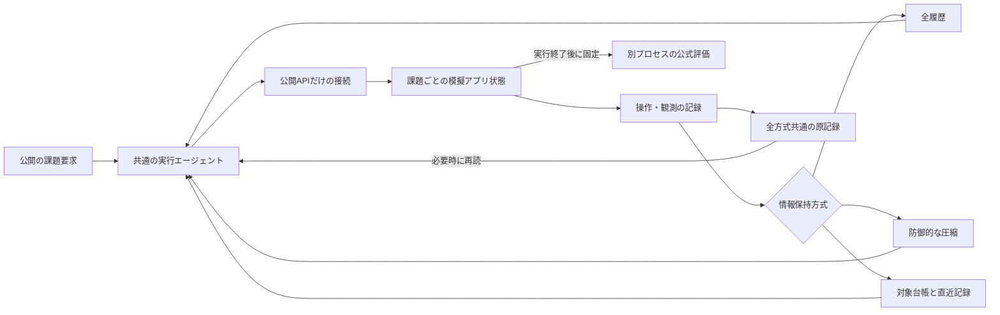

# P6：実タスクにおける情報保持方式の導入比較

2026-10-21。新規方式の提案前に、既存対策で問題が残るか調べる。[Issue #30](https://github.com/sophiria1225/AI-/issues/30)。

## 実行前に決めたこと

[固定計画](../../configs/P6_context_plan_v02.json)の学習用2課題・3方式・各1回から始める。公開の要求だけを読み、ソート先頭12課題から、最初の全対象処理と最初の複数アプリ間の集合照合を選んだ。同一シナリオの派生課題を増やさず、それぞれ`_1`だけを使う。正解対象・解法・難度メタデータ・モデル結果で選ばない。原論文の失敗シナリオは学習集合になく、この導入比較をその失敗の完全再現とは呼ばない。

| 方式 | 保持と更新 | 費用 |
|---|---|---|
| full | 全操作・観測を保持 | 実行時の入力・出力 |
| focus | 将来計画で参照した操作・観測と、防御的確認で救済した記録を保持 | 実行＋各圧縮時の3回の草案 |
| ledger | モデルが観測から対象・条件・進捗・不明点を抽出し、直近2記録と併用 | 実行＋台帳更新 |

全方式で同じ大型ローカルモデルとAPI、原観測の再読手段、総予算を使う。全記録は外部に残し、忘れた情報を取り直して完了できれば最終成功とする。単純台帳は比較対象であり、新技術とは主張しない。

## 原方式からの変更

[FOCUS原稿v1](https://arxiv.org/html/2609.37590v1)の付録A.9では、一つの草案に計画と救済を含める。今回はその3回の出力を使い、参照頻度0.3以上と救済集合の和集合を残す。独立した4回目の検証呼び出しを追加する方式との曖昧さがあるため、再実装の選択として明記する。プロンプトは機能を保った独自の言い換えで、出力をネイティブ関数の引数へ変更した。

基盤モデル、トークナイザー、温度、API呼び出し型エージェントは原論文と異なる。観測単位には公開の応答とAPI操作・結果を入れ、モデル内部の推論を再入力しない。原著者の数値の再現や優劣をこの比較から主張しない。

## 実行・評価の分離



AppWorld 0.1.3.post1を専用Python環境・専用データルートへ導入。生成用プロセスは`load_ground_truth=False`で起動し、公開API名・引数だけを受け付ける。自由なPythonやシェル操作、評価器の呼び出しはモデルへ渡さない。ハーネスが引数をPythonリテラルとして埋め込み、AppWorldの標準保護を有効にしたまま実行する。

正解や評価器は終了後の別処理でのみ使う。完了宣言と最終正解を分ける。モデルは各APIのドキュメントを取得できるが、初めから正解のAPI一覧は与えない。公式配布物の本文・解答・軌跡はGitへ公開しない。

初期DBから方式ごとに起動する全体比較であり、途中状態を完全復元した因果介入とは呼ばない。1応答1 API操作という導入用接続の制約があるため、コード実行型の強いエージェントと同等とは扱わない。

## 記録と判定

全モデル呼び出しを用途別に記録し、台帳作成や圧縮の入力・出力も合計する。取得前の入力数＋出力予約が予算を超える場合は停止する。不正な圧縮結果は費用を計上して元の記憶を維持する。失敗・未完了・不明費用を除外しない。

長い観測は全方式共通のページ表示と原文再読にする。最大入力枠と仕事全体の予算は別。全文保持も情報量・呼び出し・費用の制約を受ける。

最終成功、完了宣言、総トークン、圧縮回数、形式エラー、API操作失敗をまず比較する。個々の対象の脱落は、観測と最終評価を突き合わせて確認できる範囲に限る。自動抽出した台帳の項目数を真の対象数とはみなさない。

圧縮が起きない場合は機構を評価できていない。全文保持も失敗する場合は、ツール接続・モデル・予算の問題を先に切り分ける。既存の防御的確認や単純台帳で足りる場合は、追加の独自機構を提案しない。この2課題の結果を大規模・複数領域での性能へ一般化しない。

## 起動時の修正

v01の最初の起動は、仮想環境のPythonパスを実体へ解決してしまい、AppWorldを導入した環境を外れたため停止した。モデル呼び出し0回。実行ファイルのパスを維持する修正を行い、条件は同じままv02の新しい実行IDで開始する。失敗記録とv01仕様は保存する。[修正記録](../../reports/P6_launch_correction.json)。

評価の導入確認でも、保存DBのパスから`tasks`階層が抜けていることを検出した。公式評価器の公開ソースに合わせて修正し、APIドキュメントだけを取得した未処理状態が1項目合格・4項目不合格になることを確認した。これは負の対照であり、評価器の完全な正しさの証明ではない。生成中のコード・条件は変更していない。評価後も凍結DBのハッシュが変わらないことを検査する。

## 再実行と監視

ローカルのモデル・データ・専用環境が必要。配布データの本文や完全な履歴は公開しない。AppWorldの導入は研究リポジトリ直下で行わず、既存データを持たない専用ルートへ限定する。

```bash
python scripts/run_context_batch.py \
  --plan configs/P6_context_plan_v02.json \
  --freeze-record reports/P6_execution_controls.json \
  --storage-root /Users/tp26013/AI- --batch-id P6_batch_v02
python scripts/watch_context_pilot.py --storage-root /Users/tp26013/AI- --publish
```

保存済み実行IDの上書きは禁止。監視器はIssue #30の一つの進捗コメントだけを更新し、モデル呼び出し、再試行、パラメータ変更、Git操作、Issueの完了処理は行わない。公式評価は終了済み試行にだけ適用する。全6試行の終了・基盤異常・4時間上限のいずれかで監視を終了する。
