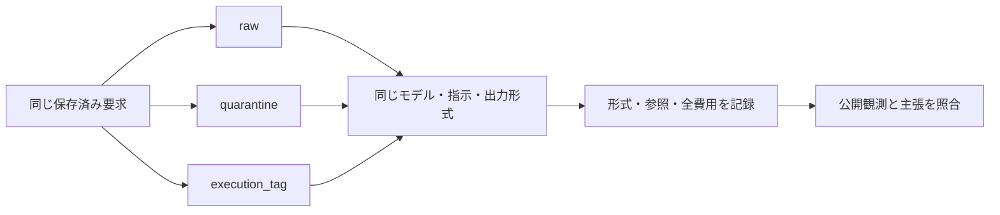

# P7：未実行部分の表現を変える記憶生成の校正

2026年10月21日、実行前の計画。[P6の台帳診断](../P6_ledger_diagnosis.md)で選んだ1つの入力について、記憶更新だけを比較する。失敗を見た後に選んだ開発ケースであり、未調整の確認実験ではない。

目的は「不正な生成文を実行済み事実と扱う台帳が、実行記録を明示するだけで改善するか」を調べること。これで十分なら独自の機構を追加しない。新規性・最終タスク成功・費用削減を検証したとは扱わない。

## 固定する入力と条件

元入力は`P6_01_LEDGER_V03`の第2回台帳更新（`call_009`）。要求、前の台帳、実際の公開API観測、形式エラー、参照ID、モデル、システム指示、出力スキーマを固定する。元要求と実験条件のSHA-256は[計画JSON](../../configs/P7_memory_input_probe_v01.json)へ保存した。

| 条件 | 変更するもの | 残すもの |
|---|---|---|
| raw | 変更なし | 元の要求ペイロード。最初の種43では完全一致を検査 |
| quarantine | 未実行ターンの生成文と不正引数を入力から外す | 形式エラー、ターンID、原記録への参照、すべての実観測 |
| execution_tag | 未送信であるという実行器の記録を追加 | 元の生成文、不正引数、実観測を含む全内容 |

quarantineは入力内容と長さの両方を変える。execution_tagは内容を残して少量の記録を足す。この比較だけで、情報量の影響と意味の影響を完全に分離できるとはしない。退避した原記録はローカルに保持するが、この純粋な記憶生成呼び出しには再読取ツールを与えない。

種43・44・45を各条件で1回ずつ使う。順序はraw→quarantine→execution_tag、quarantine→execution_tag→raw、execution_tag→raw→quarantineに固定する。固定種でも同じ出力を保証しない。キャッシュ条件もP6から維持し、実時間を独立した性能結論には使わない。

9呼び出し、総入力＋出力150,000トークン、実行3,600秒を上限とする。1呼び出しの出力上限は4,096、温度は1.0。推論中の思考出力も使用量に含む。待機時間は実験時間と分け、P6の固定バッチが終了してから開始する。未知の使用量や実行エラーが出た場合は停止し、無料の再試行をしない。

## 測定と意味の判定

自動集計は形式・参照ID検査、項目数、done項目数、未実行ターンだけを参照するdone項目数、全費用を記録する。「未実行ターンだけを参照するdone」は点検候補であり、誤りの正解ラベルではない。エラーの確認が完了したという主張なら妥当な場合もある。

追加の意味確認は、各done項目を以下に分類する。

1. **操作完了の主張**：認証、対象更新、完了通知など、実行を必要とする行為を済ませたと述べている。
2. **観測・調査完了の主張**：資料取得や検索結果の確認について述べている。
3. **要求・対象の記述**：何を行うべきかの記述であり、完了したという意味が明瞭でない。
4. **判定困難**：複数の意味が混在するなど、公開記録だけでは決められない。

操作完了の主張は、公開操作列の該当API実行と、その公開結果が支持するかを確認する。形式エラー、将来の計画、生成した引数だけを完了証拠にはしない。他のターンに有効な証拠がある場合は「状態の誤り」と「引用の誤り」を分ける。中止・処理不要という意味を無条件に誤完了へ分類しない。

対象名や正解一覧を評価器から補わない。分類はまず1名による探索的な確認とし、盲検・複数人一致率を実施したとは書かない。結果は集計・匿名化した主張分類・原記録のハッシュのみ公開する。

## 解釈と次の判断

原入力で再発しなければ、元の単発出力に依存する観察として扱う。表現変更で抑制できても、単純対策の有用性がこの入力で示された範囲にとどめる。全条件で残るなら、主張と実行証拠の対応や強いAPI実行形式を次の比較対象にする。

環境を継続実行していないため、最終成功率の改善は主張しない。現時点では独自アルゴリズムを選んでおらず、ここでの表現変更や実行フラグも新手法と呼ばない。
