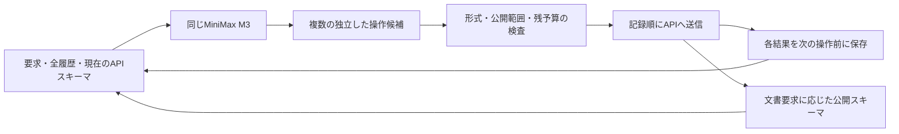

# P8：公開APIスキーマを使う全履歴基準の校正

2026年10月21日、実行前の計画。P6で使った汎用APIラッパーと1応答1操作という導入形式が、記憶方式の比較に影響していないかを調べる。APIごとのスキーマと複数操作を備えた全履歴方式を、同じ開発2課題で各1回動かす。

これは比較用実行器の改善であり、新手法ではない。原著者のプロンプト、API予測器、デモ、モデル、実行形式をそのまま使わないため、公式エージェントの完全再現・公式スコアとの直接比較とも呼ばない。

## 接続前に分かったこと

公開スキーマ457件を、課題本文も履歴もない短いヘッダーと一緒に現在のモデルへ渡すと、入力は63,929トークンだった。出力予約4,096を加えると68,025となり、65,536枠を超える。無条件の全件投入は採用しない。[ライブモデル確認付きの測定](../../reports/P8_public_api_input_inspection_v02.json)。生成は0回で、トークン数だけを取得した。初回にモデルの実体を測定記録へ結び付けていなかったため、実体確認を追加した第2回を別に保存した。両回の入力数は一致した。

公式の[API選択器](https://github.com/StonyBrookNLP/appworld/blob/42b5bcf3cd334fee33f0c37c02070a9f5807add5/experiments/code/common/api_predictor.py)には予測・全件・正解情報による選択がある。全件モードも設定上限で切られ、既定上限は20である。正解情報による選択、または先頭20件を全件と解釈する方法は今回の比較に使わない。

最初の接続案は個別APIの文書要求だけでスキーマを追加するものだった。しかし終了済み4試行を点検すると、元の有効操作のうち7回はこの規則では追加の文書要求が必要になる。元の方式より操作を制限してしまうため、アプリのAPI説明を要求したときは、そのアプリの公開スキーマを追加する方式に変えた。

| 保存済み操作の確認 | 初案 | 採用する接続案 |
|---|---:|---:|
| 有効43操作の要求変換が一致 | 43 | 43 |
| 要求内容が変わった操作 | 0 | 0 |
| 追加のスキーマ探索が必要になる操作 | 7 | 0 |
| 元の不正な操作 | 2件を保持 | 2件を保持 |

これは保存した引数の変換を検査した結果で、モデルが同じ行動をするという予測ではない。[初案](../../reports/P8_saved_api_route_audit.json)、[同じ4試行での修正版](../../reports/P8_saved_api_route_audit_v02.json)。どちらもAPI再実行・モデル生成は0回。

実環境への接続では、公開文書取得2操作と、意図的に壊した完了操作1件を試した。文書取得は実行され、不正な完了操作は送信されなかった。新しい公開スキーマ66件の追加も確認した。モデルと評価器は使っていない。[実環境の接続検査](../../reports/P8_native_bridge_controls.json)。

## 実行形式

初期状態ではapi_docsとsupervisorの10スキーマ、履歴再読取1ツールを提供する。初期の実入力は第1課題2,912、第2課題2,957トークンで、出力余白を確保できた。[初期要求の点検](../../reports/P8_native_request_controls.json)。

アプリのAPI説明を要求すると、そのアプリの公開スキーマを次のモデル呼び出しへ追加する。個別API文書の要求でも追加できる。正解一覧や課題の隠しメタデータでは選ばない。配布スキーマの必須フィールド指定が省かれている点も、そのまま記録する。実際のAPI検査は継続し、勝手に配布データを修正しない。

同じ応答内の操作は記載順に実行する。後の操作が、まだ観測していない前の返り値に依存する場合は、モデルに次の応答へ分けるよう指示する。新たなスキーマも次の応答から使える。完了宣言後、予算停止後、作用が不明な通信失敗後の残り操作は実行せず、未実行として記録する。

未送信の形式エラーと、送信後のAPIエラーと、作用不明の通信失敗を分ける。通信失敗を「操作は行われなかった」と扱って再送しない。各操作の結果を保存してから次を実行し、途中まで実行したバッチを丸ごと再試行しない。

## 固定する条件

[固定計画](../../configs/P8_native_baseline_v01.json)はP6と同じ2課題、MiniMax M3 IQ4_XS、64K、KV q8_0、温度1.0、種42を使う。全履歴のみを各1回、課題1→課題2の順に実行する。課題選定と接続方式の調整に開発観測を使っており、未経験課題の評価ではない。

各試行は80 LLM呼び出し、450,000総トークン、1呼び出し4,096出力、1,800秒を上限とする。複数操作でAPI呼び出しが無制限に増えないよう、80 API要求の上限も設ける。これはP6の80 LLM呼び出し・1応答1APIの最大要求数に対応する。文書取得、失敗、スキーマの再入力、読み直しを無料扱いしない。

P6とP7が終了してから実行する。P7でどの入力表現が有利だったかは、P8の入力・設定へ反映しない。既存サーバーの終了時刻までに2試行と余裕180秒を確保できなければ、未開始として記録する。エラーや未知費用を理由に試行を無料でやり直さない。

独立評価は実行終了後に別プロセスで行い、次の課題のモデルへ返さない。全記録を残し、[Issue #36](https://github.com/sophiria1225/AI-/issues/36)へ集計だけを更新する。

## この比較から言える範囲

公開スキーマ、複数操作、ツール発見手順、指示文をまとめて変えるため、差が出ても一要素だけの因果効果には帰属できない。最初は基準方式として成立するか、どの形式・費用・未完了の問題が残るかを確認する。スキーマやAPI接続それ自体を新規性にはしない。

品質を保つ総費用削減という研究目的は維持する。この基準で問題が消えるなら、導入形式に対する単純な改善で十分だった範囲を示す。記憶の問題が残る場合に、同じ実行器で対照をそろえて検証を続ける。
