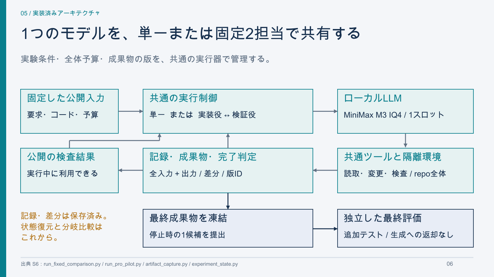

# AIハーネス研究 中間報告 — 2026年10月20日

P4のAnsible初回単一試行を独立評価まで終えた時点の説明資料。**品質を保ちながら全担当の総トークンを減らす**という目的から、実装、測定結果、考察、今後の検証へつなげた。29枚（表紙・本編25枚、付録4枚）。

- [PDF：そのまま読む](AI_harness_research_20261020.pdf)
- [PowerPoint：編集する](AI_harness_research_20261020.pptx)
- [文章版](transcript.md)
- [図表の元データ・出典SHA](data_sources.json)
- [P3の正確な数値CSV](P3_data.csv) / [P4の時系列CSV](P4_timeline.csv)
- [図表（PNG・SVG・PDF）](figures/)
- [生成条件とファイルのSHA](build_manifest.json) / [確認記録](review.json)

PowerPointの本文・表・アーキテクチャ図は編集可能。実測グラフは画像として挿入し、別途SVG・PDF・CSVを添付した。PDFは日本語フォントを埋め込んだ閲覧用。PowerPointの表示はインストールされているフォントに依存するため、共有時の基準表示はPDFとする。



## 内容

| ページ | 内容 |
|---|---|
| 1–5 | 研究の現在地、背景、目的、検証の順序 |
| 6–8 | 実装済み構成、提案予定の構成、四条件の分岐比較 |
| 9–12 | 機材とモデルの選定、実験の積み重ね、P3の条件 |
| 13–15 | P3のトークン・時間・キャッシュ・成果物と考察 |
| 16–20 | 課題選定、評価器の対照、P4の条件・経過・結果 |
| 21–25 | 分かったこと、先行研究、新規性の未確定範囲、次の検証、目標 |
| 26–29 | 正確な数値、固定版、記録・文献へのリンク |

## この時点で言えること

単一／固定2担当を、同じモデル・ツール・総予算で計測できる基盤を作った。P3は同じ2開発課題の方式ごとに1試行で、両方式とも15380合格・15957未解決。AnsibleのP4は調査と一時的な再現を行ったが、38呼び出し・586,166トークンで予算停止し、最終パッチは0バイト、要求は未解決だった。

再編の有効性、品質の非劣性、一般的な費用削減、新規性は未実証。P3とP4は課題・予算・実行環境が異なるため、合算した成功率や手法の直接比較を示さない。グラフは0起点とし、1試行しかない観測に誤差棒を作らない。

## 再生成

実験用の仮想環境を変更せず、Python 3.12の資料専用環境を使う。今回、システムPython 3.9での導入はmatplotlibの対応版制約により失敗したため、未使用の資料環境だけを作り直した。実験環境は変更していない。

```bash
python3.12 -m venv .runtime/reporting-venv
.runtime/reporting-venv/bin/python -m pip install -r materials/20261020/requirements.txt
.runtime/reporting-venv/bin/python scripts/build_research_presentation.py
.runtime/reporting-venv/bin/python scripts/review_research_presentation.py --preview-dir .runtime/presentation-review
```

Mac上の`Arial Unicode.ttf`を使用した。フォント本体は配布しない。他環境では`--font /path/to/cjk-font.ttf --font-name "Font Family"`で日本語TrueTypeフォントを指定する。改行と文字枠の高さは自動確認するが、別フォントで再生成した場合も全ページを目視確認する。

生成コード：
[構成・本文](../../scripts/build_research_presentation.py) /
[実測グラフ](../../scripts/presentation_charts.py) /
[PPTX・PDF共通レイアウト](../../scripts/presentation_renderer.py)。

`slides.json`には全要素・位置・実際の改行、`requirements-build.lock.txt`には今回使った依存版を保存する。数値はコミット済みの集計を読み取り、元実験や評価器を再実行しない。

## 出典の対応

| ID | ローカル資料・集計 |
|---|---|
| S1 | [研究仕様](../../docs/research_brief.md) |
| S2 | [P3考察](../../docs/P3_findings.md)、[測定](../../reports/P3_measurements.json)、[時系列](../../reports/P3_timeline.json)、[固定計画](../../configs/P3_development_plan_v01.json) |
| S3 | [P4考察](../../docs/P4_findings.md)、[測定](../../reports/P4_pro_measurements.json)、[固定計画](../../configs/P4_pro_single_plan_v01.json) |
| S4 | [P4公開操作の確認](../../reports/P4_pro_public_failure_observations.json)、[観察方針](../../docs/experiments/Pro_dependency_observation.md) |
| S5 | [作業ボード](../../docs/task_board.md)、[意思決定記録](../../docs/decision_log.md) |
| S6 | [固定分担実行器](../../scripts/run_fixed_comparison.py)、[Pro単一実行器](../../scripts/run_pro_pilot.py)、[共通状態・予算](../../scripts/experiment_state.py)、[成果物保存](../../scripts/artifact_capture.py) |
| S7 | [四条件分岐の未着手タスクR07](../../tracking/tasks.json)、[現方針](../../docs/research_brief.md) |
| S8 | [品質条件の検討](../../docs/evaluation_design.md) |
| S9 | [モデル選定と実機値](../../docs/model_selection.md) |
| S10 | [P1の結果](../../docs/P1_verification_results.md)、[P2の結果](../../docs/P2_progress.md) |
| S11 | [最初の公開候補](../../docs/public_task_screen.md)、[主課題の追加候補](../../docs/main_task_feasibility.md) |
| S12 | [Pro評価器の校正](../../docs/experiments/pro_environment_calibration.md)、[集計](../../reports/pro_environment_measurements.json) |
| S13 | [先行研究の本文・実装比較](../../docs/related_work_matrix.md) |
| S14 | [固定条件](../../configs/)、[公開可能な集計](../../reports/) |

文献L1–L4の原典は最終ページと各スライドのリンク・ノートに記載。TDAGの短縮名称を最終ページで用いているが、正式題名は *TDAG: A Multi-Agent Framework based on Dynamic Task Decomposition and Agent Generation*。既存手法の機能を小さく見せたり、一般的な動的分担を新規性にしたりしない。
