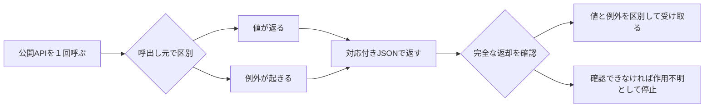

# APIの値と例外を分ける

精算で見えた型エラーの前に、認証失敗があった。書出しでは60件の情報取得後に、書込み先の制約で失敗していた。全３例外を読み取り、失敗が別のエラーへ隠れることを防ぐための通常部品を追加した。

| 完了したこと | まだ示していないこと |
|---|---|
| 全３例外の公開記録を照合 | 正しい資格情報へ直した後のタスク成功 |
| 正常値・例外・不明返却を区別する部品 | 自動修復や安全な途中再開 |
| 14部品検査と実行制限下の４合成ケース | 実タスクの費用削減・品質維持 |
| Projectと資料へ記録 | 新提案の中核・採録に足る貢献 |

今回の実装は研究の通常対照を整える作業である。モデル生成・AppWorld API・評価０。終了済み実験の結果は変えていない。元のP76では両履歴条件とも成功2/4、写真だけ24.6％減、全体採用基準は未達という判断が続く。

[３例外の全件表](error_programs.csv)／[４合成ケース](guard_fixtures.csv)／[実装と確認範囲](../../docs/public_api_result_contract_20261023.md)／[読取報告](../../reports/P77_public_failure_contract_review.json)／[合成検証報告](../../reports/public_api_envelope_guard_20261023.json)／[出典hash](manifest.json)。追加PDFや新しい実験結果ではなく、P77後の補足資料。
