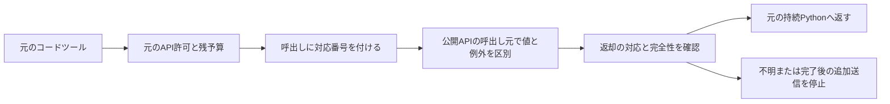

# 通常の実行系で返却と失敗を区別する

固定した８プログラム・３コンテナの合成接続検査を、1.317888秒で全件終了した。元のAPI許可・予算・記録・持続Pythonを使い、６回のfixture送信だけが発生した。全コンテナを除去した。

| セッション | プログラム | fixture送信 | 確認結果 |
|---|---:|---:|---|
| 通常 | 6 | 4 | 例外前の変数が残る。文字列・業務失敗辞書を保持。予算０・不正引数・完了後は送信なし |
| 不明返却 | 1 | 1 | 余分なstdoutで停止。次APIを送らずPythonを閉じ、再開を拒否 |
| 完了と例外 | 1 | 1 | 完了状態を落とさず、例外後の次APIを抑止 |

７プログラムの実行エラーは、上表の拒否・失敗経路を確認するために意図して起こしたもの。８タスクの性能試験ではない。追加15を含む全1,023検査と両CIも合格したが、実タスクの成功率・費用削減・新手法の新規性は未測定のままである。

モデル生成・AppWorldタスク/API・評価・DB内容・保留課題の読取０。過去の実験結果は変更していない。

[全８プログラム](all_programs.csv)／[全３セッション](all_sessions.csv)／[計画と結果](../../docs/public_api_result_runtime_20261023.md)／[機械記録](../../reports/public_api_result_runtime_20261023.json)／[版とCI](../../reports/public_api_result_runtime_provenance_20261023.json)／[出典hash](manifest.json)。
