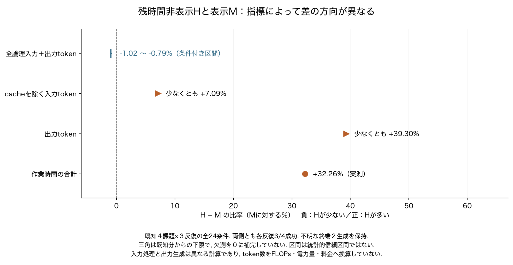

# 論理token・cacheを除く入力・出力・時間を分けた集計

2026-10-24。閉じたP80/P81の既知４課題×M/H×３反復、全24条件・429生成を集計した。Mは残時間表示、Hは非表示。**論理tokenの条件付き合計はHが約１％少ないが、cacheを除く入力と出力は既知分だけでHが多く、作業時間も長い。** 論理tokenの削減を計算資源の削減と同一視しない。



[PDF](resource_measures.pdf)／[SVG](resource_measures.svg)／[全24条件CSV](all_24_conditions.csv)／[全32集計行CSV](all_partitions.csv)／[全結果JSON](resource_accounting.json)／[集計スクリプト](../../scripts/summarize_closed_resources.py)。図は１頁を目視確認し、PDFの頁外文字０。入力処理と出力生成を異なる指標として示し、足し合わせた値をGPU計算量としていない。

## 全条件での比較

| 指標 | Mの12条件 | Hの12条件 | H−M |
|---|---:|---:|---:|
| 終端既知の論理入力＋出力 | 2,426,782 | 2,321,406＋不明２生成 | 完全な差は未確定 |
| 条件付き論理token区間 | 2,426,782 | 2,402,034〜2,407,728 | −24,748〜−19,054（−1.02〜−0.79％） |
| cacheを除く入力token | 276,458 | 既知分296,062＋不明分 | 少なくとも＋19,604（＋7.09％） |
| 出力token | 66,022 | 既知分91,970＋不明分 | 少なくとも＋25,948（＋39.30％） |
| 作業時間の合計（秒） | 6,534.495 | 8,642.256 | ＋2,107.761（＋32.26％） |
| 準備・後片付けを含む条件時間（秒） | 6,570.682 | 8,679.012 | ＋2,108.329（＋32.09％） |
| API要求数 | 660 | 608 | −52 |
| モデル生成試行数 | 211 | 218 | ＋7 |
| 独立評価による成功 | 各反復3/4 | 各反復3/4 | 書出しは全６条件で未達 |

cacheを除く入力は終端既知分の `input_tokens - cached_input_tokens`、出力は終端既知の `output_tokens` を足した。既存の全件照合では、既知427件についてこれらの値が所有推論器の数値ログと一致している。Hの不明２生成を０と推定したわけではなく、欠測分が非負であるため、既知分だけでもMの完全な合計を超えるという下限比較である。欠測のcache量や出力を補完していない。

論理tokenの区間は、既存の[順序対応・固定backend・進捗計数に条件を付けた補助解析](../../docs/P81_usage_intervals_20261024.md)をそのまま使用した。この区間を得るための前提と、既知分だけから得られる下限は異なる。どちらも統計的信頼区間ではない。

## 成功部分の減少と失敗部分の増加

| 指標のH−M | 両側成功の３課題×３反復 | 両側失敗の書出し×３反復 | 全４課題×３反復 |
|---|---:|---:|---:|
| cacheを除く入力token | −24,280 | 既知分だけで＋43,884 | 少なくとも＋19,604 |
| 出力token | −9,537 | 既知分だけで＋35,485 | 少なくとも＋25,948 |
| 作業時間（秒） | −866.092 | ＋2,973.853 | ＋2,107.761 |

成功部分だけを見ると３指標とも減るが、失敗部分を戻すと全体では増える。失敗した生成・API・作業時間を除去可能な費用と断定せず、失敗までの安さを完成に必要な費用の削減とも扱わない。成功数が同じであることは、過去の通常方式が達成した品質の回復や、未知課題の品質維持を保証しない。

## 時間と計算資源の範囲

２つの別セッションの推論器滞在は合計15,340.679秒、pipeline全体は15,340.907秒だった。ロード20.117秒、評価40.419秒、全条件時間15,249.694秒、batchのその他44.684秒は別記し、重なる測定値を加算しない。共通のロードや評価をM/Hへ恣意的に割り付けていない。各条件の作業時間はモデル待ち・通知作成・入力計数・API等を含み、純粋なGPU処理時間ではない。

ホスト負荷、実行順、cache状態、停止理由が異なるので、観測した32％の差を通知方式による因果的な減速率や、将来の平均差としない。入力token、出力tokenは処理の単位が異なり、KV参照、投機生成の不採択分、演算精度等も単純な和には含まれない。FLOPs、電力量、料金は測定していない。この再集計は新しい制御方式や一般的な性能改善の主張ではない。

## 確認と再生成

公開済みの66出典をhash照合し、全24条件の格子、全429保存要求のID/hash/終端記録、既知427件・不明２件、既知使用量の和、条件時間とセッション時間の対応を確認した。終端記録が存在することと、使用量の数値が既知であることは区別する。CSVからも独立に合計と成否別の分割を再計算し、一致した。

処理時間は公開JSONの読取・照合・集計で約0.008657秒（図の描画等を除く）。追加モデル生成・入力計数・環境API・評価は０。原履歴、モデル出力本文、内部推論、DBを読んでいない。P82の実行条件とP84の計画は変更していない。既存の原稿・台帳は保持し、最終統合稿でこの指標差を説明する。

新しい出力先へ再生成する場合は、集計のみなら標準Python、図も作るならmatplotlibを用いる。図はHiragino Sansを使用した。

```sh
python3.12 scripts/summarize_closed_resources.py --output /tmp/p81-resource-accounting
python3.12 scripts/summarize_closed_resources.py --figure --output /tmp/p81-resource-figure
```

既存の出力先は上書きしない。再集計は時刻依存の処理時間を除いて元の全件集計へ対応する。
