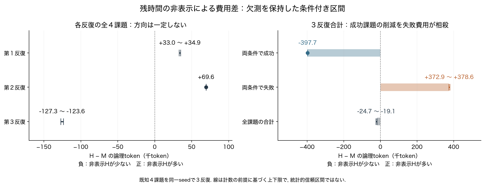

# 欠測を保持した費用区間

P80・P81の終了済み全24条件・429生成を読む補助解析。元の不明使用量２生成は保持した。追加の生成・入力計数・API・評価は０。

[PDF](conditional_cost_intervals.pdf)／[SVG](conditional_cost_intervals.svg)／[全24条件CSV](all_24_conditions.csv)／[反復・成否別16集計CSV](partitions.csv)／[詳細と前提](../../docs/P81_usage_intervals_20261024.md)。

Hは残時間非表示、Mは常時表示。線の範囲は数値ログの順序対応、送信前入力計数、固定推論器の生成上限を前提にした計数区間であり、統計的信頼区間ではない。点は確定値だけに用い、区間の中点を使用量の推定値にしない。薄い棒はゼロから区間の近い側までを示す。丸め前の値はCSVに保存した。

成功した３課題の３反復合計では397,675 token減ったが、失敗したCSV課題の費用が372,927〜378,621 token増えた。全体の条件付き差は19,054〜24,748 token減、約0.79〜1.02％。反復ごとの方向は増加・増加・減少であり、安定した改善や新規手法の成立とは扱わない。両条件とも各反復3/4成功で、必要品質の回復も未実証。

既知４課題を同一seedで繰り返している。12独立課題ではない。元の報告・不明使用量・採用基準未達を変更せず、進行中のP82も固定条件で継続する。
