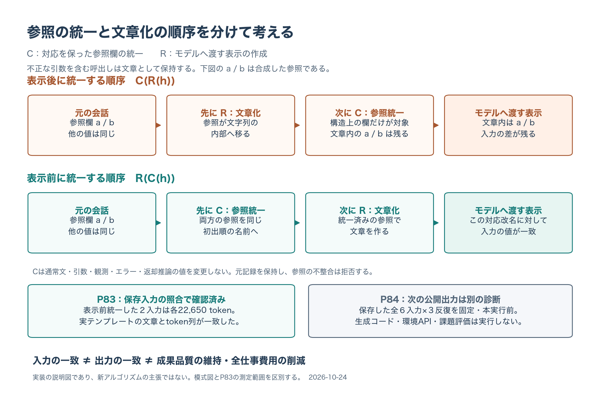

# 参照統一と文章化の順序を説明する１頁図

[PDF](protocol_order.pdf)／[SVG](protocol_order.svg)／[PNG](protocol_order.png)

図のa/bは合成した参照であり、実験の要求文や返却内容ではない。構造上の参照を統一するCと、不正引数を含む呼出しを文章化するRの順序を示す。Cは通常文・引数・観測・エラー・返却推論の値を変更しない。

下段のP83は閉じた測定結果である。対象の２保存入力は表示前の統一によって各22,650 tokenとなり、テンプレート適用後の文章・token列が一致した。図を作るための追加計数は行っていない。P84欄は2026-10-24の**本実行前の準備時点**を示す。

入力の一致から出力の一致、成果品質、全仕事費用の削減を推定しない。参照統一の順序を説明する図であり、新しいアルゴリズムの提案とは扱わない。

１頁のPDFを実際に画像化して文字・配置を確認した。初期の下段文字の重なりと日本語フォントのPDF表示不良を修正し、前の出力は私有フォルダーへ保存した。現在のPDFは字形を埋め込み、SVGも字形をパスとして保存する。モデル・入力計数・環境API・評価器・私有履歴への追加アクセスは０。

[生成コード](../../scripts/build_protocol_order_figure.py)／[出典と出力hash](build_manifest.json)／[表示確認](visual_review.json)／[最小再現例](../20261024_protocol_minimal_reproducer/README.md)／[P83結果](../../docs/P83_findings.md)／[P84の固定計画](../../docs/experiments/P84_fallback_output.md)
