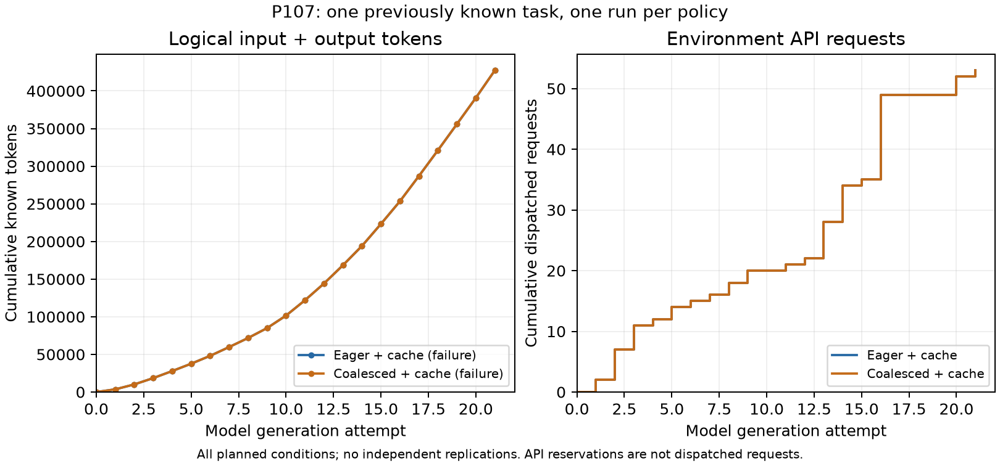

# P107 全２条件の結果

既知CSV１課題で、即時＋通常キャッシュと共有遅延＋通常キャッシュは両方未達、各21生成、427,234論理token、53 API. 使用量不明０、監査不一致０. read_viewの利用は０で、対象のshow_song自体も呼ばれていなかった. 削減効果、新規性、一般的な品質維持は未成立.

[所見と費用](../../docs/P107_findings.md)／[全２条件](all_2_conditions.csv)／[全42モデル要求](all_model_calls.csv)／[全42プログラム](all_programs.csv)／[固定判定](summary.json)／[API名の全件点検](../../reports/P107_api_name_inventory_20261025.json)／[P108の制御照合](../20261025_p108_results/README.md).

両方式の線は一致して重なっている. 全21位置の入力、出力、API送信数を照合済み. 独立反復を追加した図ではなく、予約は実APIへ数えていない. [SVG](cumulative_costs_v01.svg)／[図の指紋](plot_manifest_v01.json)／[目視確認](visual_review_v01.json)／[集計指紋](build_manifest.json). 所有推論器は停止し、原稿は保留した.
