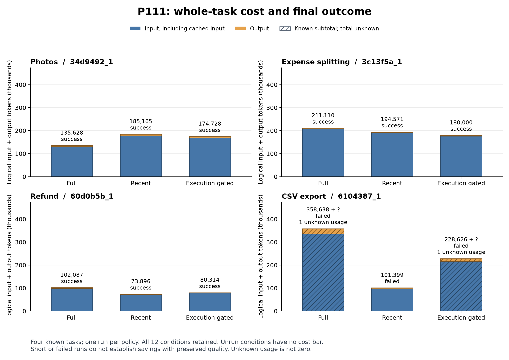
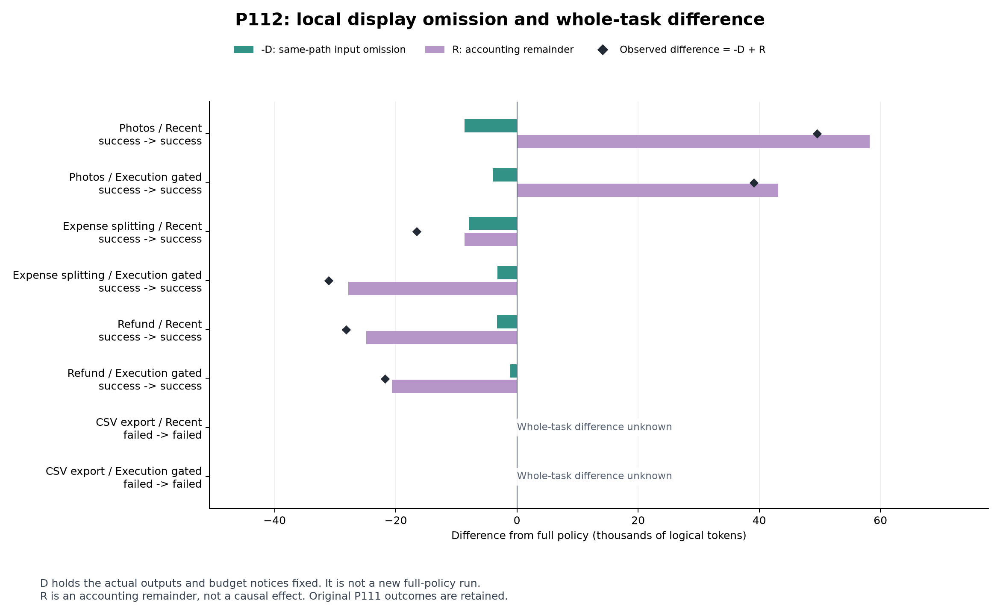

# 全仕事の費用と履歴表示の診断

P111の全12条件とP112の全８比較を表示する. ４課題は既知の開発課題で、各方式１回の実行である. 合成データの事前プレビューは含めていない.

縦軸は全要求の論理入力＋出力token. 青は入力、橙は出力. 斜線と「+ ?」は使用量不明の生成があるため、棒が既知小計であることを表す. CSVの３方式はいずれも未達で、短い失敗を品質を保った費用削減とは扱わない. 全方式3/4成功だが、選別方式は両対照への固定採用基準を満たしていない.

[PDF](P111_all_conditions.pdf)／[SVG](P111_all_conditions.svg)／[元の全条件表](../20261025_p111_results/all_conditions.csv).

緑は同じ実軌跡の表示省略量を負符号で示した値、紫は会計上の残差、黒い点は実測総費用の全保持との差. 点は緑と紫の和に一致する. 残差は特定の原因の因果効果ではない. CSVでは局所の表示差を計数できても実測総費用との差が不明なため、会計分解の棒と点を描かない. その局所差も[全比較表](../20261025_p112_results/all_decompositions.csv)に残している.

[PDF](P112_accounting_components.pdf)／[SVG](P112_accounting_components.svg)／[P112の解釈](../../docs/P112_findings.md).

作図は結果を見る前に用意した処理を使用した. 実データのPNG２枚を目視し、12条件、８比較、不明表示、ラベル、脚注を確認した. ６画像ファイルと生成元の指紋は[生成記録](build_manifest.json)にある. モデル、API、評価器は追加実行していない.
