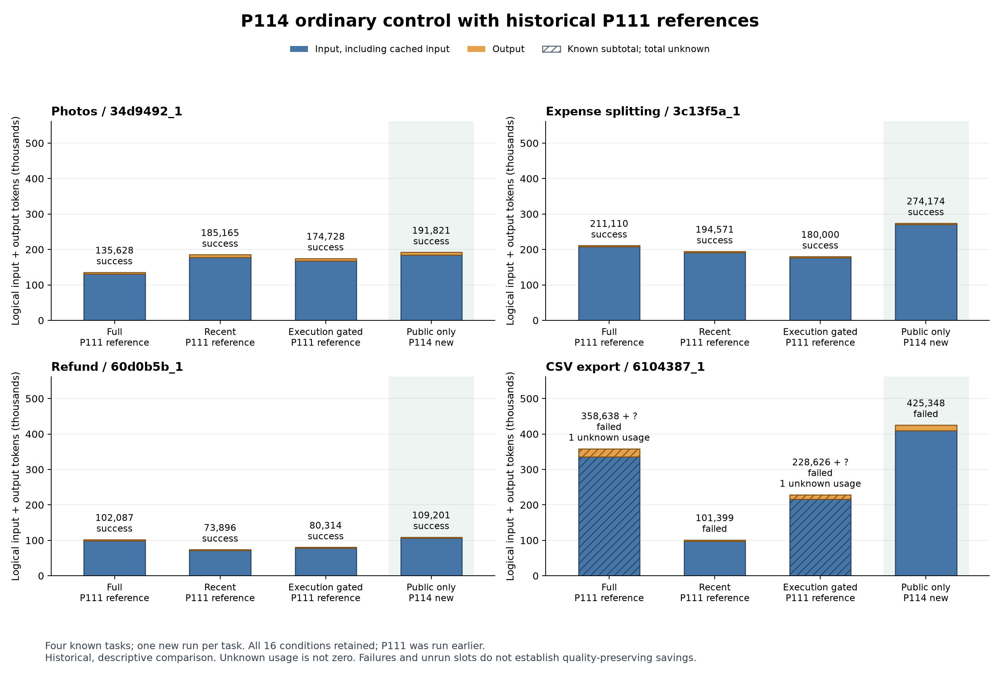

# P114と過去P111の全16条件

青はcached分を含む入力、橙は出力. 斜線は既知部分だけの合計で、未知使用量を０にした全費用ではない. 淡い背景の４本が今回のP114、他12本は過去P111の参照. 各課題の成否、未知２件、全16条件を省かず示した. 全ラベル、値、出典、未知の表示を実データPNGで目視確認済み. 合成previewを成果図として使っていない.

[PDF](P114_all_conditions.pdf)／[SVG](P114_all_conditions.svg)／[生成指紋](build_manifest.json)／[全件の所見](../../docs/P114_findings.md).

非再入力は３／４成功、1,000,544 token. 全件既知の過去の直近保持555,031より高かった. 全保持と選別の全４課題は未知使用量を残す. この図から一般的品質維持、新手法の優位性、因果効果を主張しない.
