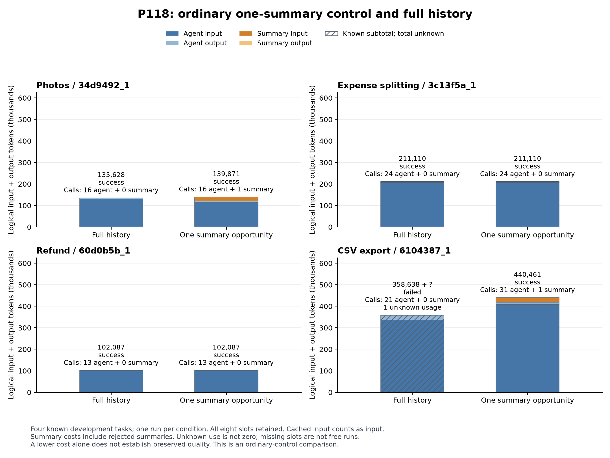

# P118の全８条件と役割別token費用

[PNG](P118_all_conditions.png)／[PDF](P118_all_conditions.pdf)／[SVG](P118_all_conditions.svg)／[生成指紋](build_manifest.json).

全保持は3/4成功、通常の一度だけの要約条件は4/4成功. 写真とCSVだけで要約が採用され、精算と返金の要約呼出しは０だった. 棒は実行役と要約役のinput・outputを積み上げ、cached inputも論理入力に含む.

CSVの全保持は358,638 tokenの既知部分と使用量不明１件であり、斜線の棒と`+ ?`で表示する. 棒の高さを確定した総費用へ読み替えない. 他の７条件の使用量は既知である.

両側成功３課題の全仕事費用は、全保持448,825、要約453,068 token. 要約で4,243増え、事前のtoken削減基準は未達. CSVの要約条件は440,461 tokenで成功したが、既知４課題の各１回の比較であり、新規性や一般的な品質保証ではない.

2026年10月25日03:37 UTCに実データPNGの全８ラベル、成否、両役割の費用、不明表示、欠け・重なりのないことを確認した. 合成プレビューはこの図へ含めていない. [所見と限界](../../docs/P118_findings.md)／[全件表](../20261025_p118_results/all_conditions.csv)／[全４対の費用分解](../../reports/P118_pair_controls.json).
