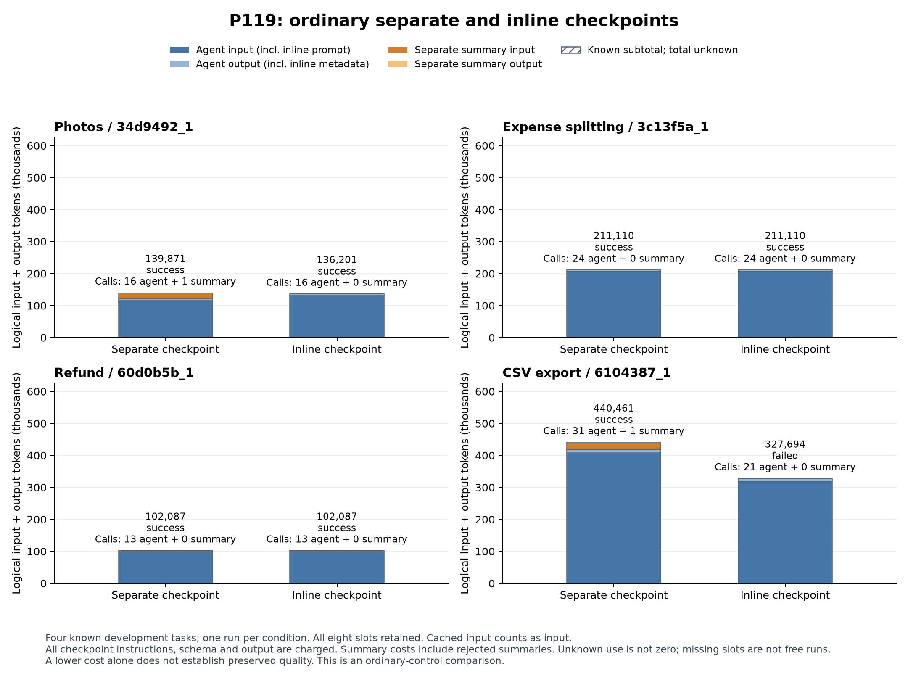

# P119 全８条件と役割別費用

[PNG](P119_all_conditions.png)／[PDF](P119_all_conditions.pdf)／[SVG](P119_all_conditions.svg)／[作成記録](build_manifest.json)／[全件所見](../../docs/P119_findings.md).

全モデル要求の論理input＋outputを表示する. 青は実行役、橙は専用要約役で、追加指示とschema、全出力を含む. 全８件の使用量が既知である. 別呼出し要約は4/4成功、任意の同時出力は3/4成功で、CSVはAPI上限による未達. 同時出力側は２回とも任意のcheckpointを出力せず、履歴の要約置換は一度も起きていない. 全費用が少ないことを品質維持や要約の有効性へ読み替えない.

固定済みの描画ソースから一度だけ作成した実測図で、合成プレビューは含めない. 全８条件、両役、全成否ラベル、凡例と脚注の可読性を目視確認した. cached inputも論理inputへ含む. 生の要約、推論、完全履歴、課題データは公開していない.
