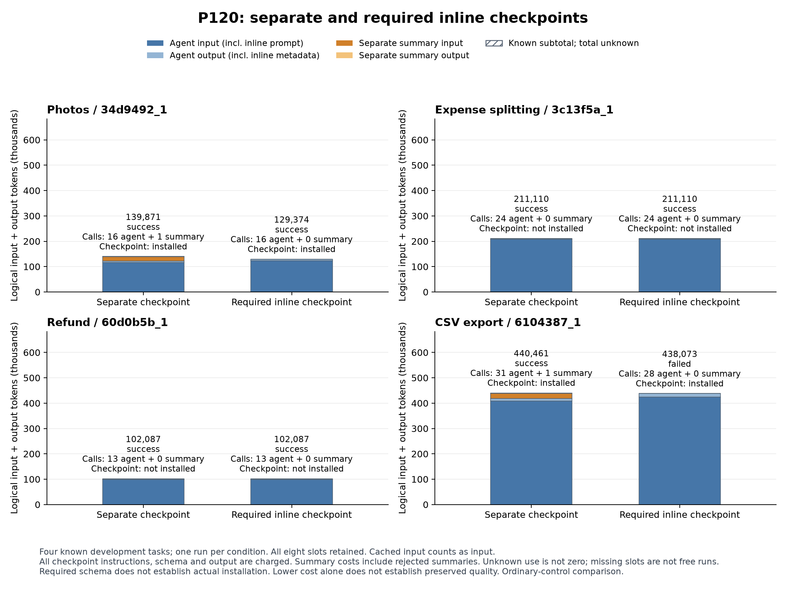

# P120の全８条件と要約採用の図

既知４課題の別呼出し要約と必須欄の同時出力. 棒は実行役のinput/outputと別要約役のinput/outputを全て含む. 同時出力の指示、schema、要約出力も実行役へ含まれる. 全167要求の使用量は既知. 成功と未達、要約が実際に採用されたかを各棒へ併記した.

写真は両方式成功で139,871から129,374 tokenへ約7.50%減少した. 一方、CSVは別呼出しが成功、同時出力が未達であり、全４課題の性能維持は成立していない. 精算と返金は要約が起動しておらず、その成功を要約の成果としない.

図は全８枠と所有serverの閉鎖後に固定ソースから作成し、全件の成否、要約の採否、両役割の費用、文字の重なりと欠落がないことを原寸で目視した. 合成previewを実験結果へ用いていない.

[全件所見](../../docs/P120_findings.md)／[全件資料](../20261025_p120_results/README.md)／[固定した描画範囲](../../docs/experiments/P120_reporting.md).
